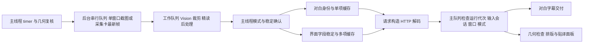

# 译芽 Debug 与回归工作流

前一阶段交付范围与证据入口见 [阶段交付](docs/mac-decoupling-stage-delivery.md)：保留1–38批，收尾词典39批。2026-10-14 [学习存储拆分](docs/learning-storage.md) 已完成，用户随后授权继续独立的 [学习 AI 分析拆分](docs/learning-analyzer.md) 阶段；设置、诊断的新拆分仍暂缓。以下历史“继续全目标”计划不再是当前阶段必做。

每次修复 Bug 前先读本文件。先复现、验证根因、最小修复，再运行回归并报告证据。自动检查验证代码处理与交付；真实设备和用户体验另行验收。

本文件及源码根 AGENTS.md 随 Git 与源码包保留，新 Codex 会话从仓库根进入即可读取。维护者本机的唯一源码为工作区 `.build/yiya-translator-publish-ocj99vs_/fuyi-0.1.0`；其它机器使用正常克隆目录。工作区根仅导航，不能清空包含源码的 `.build/`。

2026-10-13 深度拆分进度与模块表见 [Mac 深度拆分](docs/mac-decoupling.md)。预览调度独立为 `FYLivePreviewScheduler`；内容修订与交付分别由 `FYContentTranslationState` / `FYRuntimeDeliveryChecks` 维护，宿主只有原生动作与兼容状态入口。`bash scripts/run-live-preview-tests.sh`、`bash scripts/run-content-delivery-tests.sh`、`bash scripts/run-translation-coordination-tests.sh`、`bash scripts/run-recognition-cycle-tests.sh`、`bash scripts/run-ocr-refinement-boundary-tests.sh`、`bash scripts/run-ocr-worker-tests.sh`、`bash scripts/run-content-stability-tests.sh`、`bash scripts/run-content-policy-tests.sh`、`bash scripts/run-capture-boundary-tests.sh`、`bash scripts/run-capture-session-boundary-tests.sh`、`bash scripts/run-capture-mapping-coordinator-tests.sh`、`bash scripts/run-inline-model-boundary-tests.sh` 、`bash scripts/run-inline-text-measurement-tests.sh` 、`bash scripts/run-inline-layout-calculation-tests.sh` 、`bash scripts/run-inline-renderer-boundary-tests.sh` 、`bash scripts/run-inline-display-coordinator-tests.sh` 、`bash scripts/run-inline-manual-drag-tests.sh` 、`bash scripts/run-inline-selection-tests.sh` 、`bash scripts/run-inline-expanded-reading-tests.sh` 、`bash scripts/run-inline-overflow-tests.sh` 、`bash scripts/run-inline-card-renderer-tests.sh` 、`bash scripts/run-word-selection-tests.sh` 、`bash scripts/run-live-reading-tests.sh` 、`bash scripts/run-inline-translation-list-tests.sh` 、`bash scripts/run-live-page-builder-tests.sh` 、`bash scripts/run-main-window-boundary-tests.sh` 、`bash scripts/run-grammar-interaction-tests.sh` 、`bash scripts/run-grammar-scroll-tests.sh` 、`bash scripts/run-grammar-detail-tests.sh` 、`bash scripts/run-grammar-results-tests.sh` 、`bash scripts/run-grammar-page-builder-tests.sh` 及 `bash scripts/run-grammar-bookmark-tests.sh` 的最小依赖检查均接入统一 Debug。请求与缓存/批次分别由 `FYTranslationRequestCoordinator` / `FYInlineTranslationCoordinator` 维护，原生动作、任务 scope 和 callback 租约保持；OCR 调度由 `FYRecognitionCycleScheduler` 独立拥有，保留实时 OCR 完成释放槽、手动界面翻译等到 HTTP 回包的区别；`FY_OPT=-O2` 可核对发布优化下同一生产实现。渲染边界脚本运行纯尺寸、按压决策和不创建UI对象的原生链接/归属检查；新增 `InlineCardPressUITests` 只编译，实际事件/控件验收须另获当前桌面授权。显示协调检查运行Foundation/CG的原缓存/commit算法，以及真实native calculator和实际控制器配合合成panel事实；同一个无窗口host fixture直接编译拆前/后O0/O2，检查生命周期、身份/复用、几何重排与原clear；不mock布局算法。手动/拖动检查独立运行原key/邻桶/clamp/age及原NativeDrag适配，真实native控制器同fixture拆前/后O0/O2核对实际0.1s timer/weak回调/early-reset；只合成UI事实，不创建视图/窗口，也不把它当桌面交互验收。选择检查独立运行原copy模型/三位身份/source-epoch/stable-raw/Host比较和NativeCardBinder的实际弱回调与强payload租约；19实际host同fixture拆前/后O0/O2，无UI对象，真实点击/hover仍仅编译待验收。

展开阅读检查直接执行原六个Native算法：size、appearance、open、reposition、advance、close；合成的只有panel/card/scroll/monitor边界事实与已测量placement输入，不创建NSApplication/view/control/window或调用真实事件监听。原/新真实控制器同fixture检查原定位/状态/清场，实际字体由已有测量套件另验，真实collapse/Esc/滚动体验仍仅UI编译。

overflow检查执行原Foundation/CG条目/两帧计数/1.5s过期/冻结/row策略及Native入口位置/resize/build/close，保持原strong数组别名和关闭期间entry局部租约。Native事实只提供UI属性/动作与已测量size；>1真实chooser构造/按钮/scroll/Esc只编译，未授权不运行。新共享FlippedDocumentView保持原class与isFlipped实现，Root/其它调用兼容。

CardRenderer检查用真实NSFont/paragraph/boundingRect/attributed与原body primitive，合成的只是label/card/scroll/panel属性；运行原复用/rebuild/clamp/颜色算法，不fake glyph width。16最小依赖和20实际host同fixture原/新O0/O2通过；原空正文height为native测量ceil+4且至少22，并非固定22，初fixture硬编码/诊断越界/修改入口匹配错误与止损审计保存，生产未因此改变。实际构造/绘制/事件只编译。

WordSelection检查用Foundation实际业务与FYLearningCoordinator真实range/generation/version/selection gates，注入的只有tokenizer/learning服务边界及原生UI事实；held callbacks验证原tokenizer/bookmark强source租约与AI/follow弱source、stale结果/同句同文异选区和原busy释放顺序。不初始化真实学习库、不发API/连设备/建UI。37最小依赖+22实际原/新MainWindow同fixtureO0/O2通过；MainWindowResize/PreviewLayout/学习等UI只编译，实际窗口与鼠标另验。

LiveReading检查分别链接Foundation/CG真实刷新与等级读取，以及AppKit真实字体/paragraph/textStorage boundingRect与原生属性事实；实际Main拆前/后共用同一fixture。保持ID/version变化、Display4/Word3、空状态156/104、Host刷新与hover门、原文字符/UTF16索引、speaker源匹配及高度42..190。18纯编排、18原生事实与17原/新host在O0/O2通过；不建立应用/视图/窗口/控件，不发API或连接设备。真正布局、选择和侧栏须另行桌面验收。

InlineTranslationList检查执行原Trim/filter/signature/empty/same gates和index/copy策略，native执行原card/row factory、实际字体与UI属性事实。26纯编排、24native与25实际Main同fixture在O0/O2通过；Main fixture仅覆盖未迁移的scroll原生工厂，三个被测列表方法与状态/Host桥接完整执行，真实scroll构造另列UI编译。首minimum缺canonical normalize链接、草稿count动作/native setter碰撞均有原记录，纠正依赖/新接口名后原/新共同夹具通过，没有弱化行为断言。

LivePageBuilder最小检查只链接独立native builder与FYLearningViews，通过真实NSNotificationCenter/mainQueue和合成text/field原生事实运行原弱callback/注册算法，不创建NSApplication/view/control/window。20最小与19实际Main/原makeLivePage选择body精确摘录同fixtureO0/O2通过；返回同一SDK token仅供测试移除合成注册，生产仍忽略center拥有的token，无新增observer owner。完整页面构造只编译原/新专用LivePageBuilderUITests与现有布局/学习UI，不能按摘录检查宣称全页面/桌面通过。旧列表fact按实现补方法声明，生产算法及所有旧断言不改。

MainWindowBoundary检查用原FrameDriven sync三表达式与原class独立AppKit链接，10几何检查包括真实属性求值次序、3次bounds读取和setter重入；18实际Main原/新同fixture运行原导航/chat/resize，canonical选中状态更新使用mounted页面UI事实，未运行unmounted真实约束mount。所有163个Main方法正文保持。首getter顺序误预期与fact优先级ABI错误由旧代码同fixture/本机SDK证明，只纠正测试预期及NSLayoutPriority float签名，不改生产或249断言。完整窗口/FrameDriven真实初始化与resize/layout仍UI编译单列。

GrammarInteraction检查用Foundation真实七个分析/followup/config/expand/review算法、canonical learning gate与原ActionState；只注入held learning/analyzer服务边界、原生config/文字/渲染动作。51最小与44实际原/新controller同fixtureO0/O2通过，包含原strong source leases、迟到version/generation/item/state gates、错误保留结果和main/quick独立transport/cancel。readonly配置container保留原strong局部字符串别名，native Trim/fallbackgetter顺序不改，Key排除identity JSON；只用合成Key，不发API/初始化真实库。UI scroll/render与真实服务另验，GrammarActionsAppTests等只编译。

GrammarScroll检查执行四个原Native算法，独立renderer38与实际原/新controller37同fixture在O0/O2通过。只合成SDK view/clip/document/window/stack事实，updates与layout期间更换几何和scroll；原before/after强局部、当前读取位置、layout后frame/bounds clamp保持。clang-MM实际依赖证明公有头不带Root/support/capture/OCR/settings/diagnostics。5变异退出2、恢复38退出0；四相关UI仅编译，真实AppKit滚动/文字布局未运行，不由facts替代。

GrammarDetail检查执行六个原Native算法：detail、三highlight、局部selection、main/quick actioncontrols。39独立与37实际原/新controller同fixtureO0/O2通过，真实NSMutableAttributedString、canonical applicableGrammarItems/gates、UIFont/颜色与alpha0.23；合成仅控件/约束/工厂与输入状态。UTF16/emoji/换行/选区和其它属性保留；原动态facade覆写和detail→highlight→hover顺序、104pt/3/4行与原raw解释保持。8变异退出2，恢复39退出0；四相关UI仅编译，真实鼠标/控件布局/高亮体验未执行。

GrammarResults检查执行五原Native busy/results/clear/tab/followup算法。96独立与93实际原/新controller同fixtureO0/O2通过，使用真实Core七字段、ActionState reset/cancel和UIFont/颜色，只有控件/约束/结构图工厂与其它组件动作是明确边界。覆盖结果局部强引用/读取时点、clear主状态取消与quick保留、两代次/两次nil和Tab动态重入、offset/rows/empty与页签优先级。首95/92夹具未检出读取时点变异，保留全部证据后只新增原result身份断言；最终八变异失败且恢复96通过。四UI只编译，真实图/窗口/鼠标体验未运行。

GrammarPageBuilder检查完整三个生产构造方法的独立冷初始化和结构输入验证：65最小、原64/新65实际controller同fixture O0/O2通过；新版本额外验证新增target适配只读取一次原弱Host，旧版没有该接口。合法main/quick与emoji在私有子进程到达第一原生factory即以明确43退出，父进程验证marker/状态，未创建视图。该证据只覆盖guards/目标/归属，不能称完整card/info/graph运行通过。三个完整正文只typed receiver/原host target适配，144其它方法精确；完整原/新专用GrammarPageBuilderUITests两opt和五相关UI均仅编译。六变异失败、恢复minimum/host65通过。

GrammarBookmark检查真实Foundation两类收藏算法/canonical gate，注入的仅held learning/store服务与native BOOL/text/事件边界。60独立与61实际原/新controller同fixtureO0/O2通过；验证原index gate/参数求值和重入、selected两次读取、enabled短路、existing delete、原stale分支与强source/item/existing任务租约，sender不进入async捕获。Core仍七字段，原Core其它实现和146 Native方法精确；七变异失败、恢复60通过。业务头clang完整依赖无AppKit/Root/private/采集/设置诊断；相关五UI只编译，真实按钮与持久化体验另验。

StudyChatContext检查执行Foundation真实四算法、canonical identity/对白比较/片段与原Session；采集/store/analyzer及原生字段是held边界，不创建UI或真实数据库。73最小与74实际原/新controller同fixture O0/O2通过，八变异失败/恢复通过。覆盖fresh UUID/latest与pinned、nil/empty回退、配置读写交错、取消独立、旧解析不清新busy、两草稿顺序恢复及原strong上下文/weak网络寿命。RuntimeOwnership另查两字段唯一owner与双向兼容，相关UI仅编译，详见[聊天上下文](docs/study-chat-context.md)。`bash scripts/run-study-chat-context-tests.sh`已接入统一Debug。

QuickSentenceWorkflow检查Foundation真实六算法、canonical identity/text与实际ActionState.reset；analyzer/store响应及native配置/BOOL/text是明确held边界。81最小与82实际原/新controller同fixture O0/O2通过，九变异失败/恢复通过，覆盖独立cancel/旧回包/重复请求、strong任务租约与copy/别名、ID/version/UUID及原status刷新顺序。RuntimeOwnership另查九状态唯一归属与冷/双向兼容。`bash scripts/run-quick-sentence-workflow-tests.sh`已接统一Debug；相关UI仅编译，详见[查句业务](docs/quick-sentence-workflow.md)。

StudyNavigation检查真实七个Foundation/CG进入/返回算法、canonical Snapshot/Session与原Quick cancel；identity/learning与原生panel/input/peer actions为明确边界。59最小与60实际原/新controller同fixtureO0O2通过，11变异失败/恢复通过；覆盖两种sameBlock、同源同译草稿/在途回答、固定ID/version、close重入/强result、读序/focus短路及强回调。RuntimeOwnership新增12字段唯一owner并加强跨Inline相同快照断言，兼容getter临时autorelease排空后才验证释放。`bash scripts/run-study-navigation-tests.sh`已接统一Debug；UI只编译，详见[学习导航](docs/study-navigation.md)。

StudyRenderer检查原Chat/Quick/Scroll三组件：69独立与68实际原/新controller同fixtureO0O2通过，执行13完整原生方法，真实字体/富文本与weak闭包；仅OS控件构造及native属性/peer工厂为明确边界，私有IMP恢复，不创建UI。完整Quick render图/真实窗口与绘制只编译原/新StudyRendererUITests O0O2，登记统一UI inventory。10变异失败/恢复，Runtime增加零state/冷/视图owner与Host target，public header编译器依赖证明不带大Support/Root/capture/settings/diag。`bash scripts/run-study-renderer-tests.sh`接统一Debug，详见[原生渲染](docs/study-native-rendering.md)。

CollectionReview 检查真实七个 Foundation 业务方法、生产模型与 canonical 选词算法；仅 held Store 与原生文字/显隐/刷新动作是服务边界。60 独立与 61 实际原/新控制器同用例在 O0/O2 通过，八项变异失败并恢复。覆盖列表 strong 别名、nil/空、稳定 ID 重绑、原刷新/重入顺序、错误保留、强加载/标记和弱删除回调。RuntimeOwnership 检查三字段唯一 owner 与兼容访问；业务头实际依赖隔离 AppKit/Root。`bash scripts/run-collection-review-tests.sh` 接入统一 Debug；CollectionLayout 等 UI 仅编译，详见 [收藏复习](docs/collection-review.md)。

CollectionWorkflow 执行真实 Query/Card/Foundation 和原生十方法：94 业务/64 原生最小及实际旧新控制器同用例 O0/O2 通过，11 变异失败并恢复。只注入 Store/learning 和 OS 工厂/控件事实，真实模型、选词、例句与 UIFont 共用。覆盖原强数组/copy、raw identity 渲染、版本绑定、同步 sender、不扩大 pending/cancel、卡片 generation/强控件 lease 与原位更新。首 fixture 类型/nil字典/+new返回所有权/弱观测问题的原失败与定位证据保留，不改生产/断言；两业务头及公开原生头的 compiler graph 检查隔离 UI/Root 边界。`bash scripts/run-collection-workflow-tests.sh` 已纳入统一入口，相关 UI 只编译，详见 [收藏工作流](docs/collection-workflow.md)。

## 数据流与审查基线

完整审查及实施计划见 [架构审查](docs/debug-architecture-audit.md)。关键链路为：



| 模块 | 入口与职责 |
| --- | --- |
| 宿主与运行编排 | `objc/app/FYAppDelegate.m` 保留生命周期和设置控件；四个 `app/*Bridge.m` 类别保留动作／属性门面，委托字段声明为 `@dynamic` 防止主类自动生成重复状态；`objc/runtime/FYTranslationRuntimeController.m` 保留 `start` / `stop` / `timerFired:` 和 UI/原生动作适配；`FYRecognitionCycleScheduler`、`FYContentTranslationState`、`FYInlineTranslationCoordinator`、`FYTranslationRequestCoordinator` 分别拥有 OCR 调度、内容代次、缓存/长短计划、实时请求状态。方法仍通过明确宿主协议访问原始接收者，保留回调持有与覆写边界 |
| 输入 | `objc/runtime/FYCaptureRuntimeController.m` 负责输入选择、目标／映射与预览适配；`FYDisplayTargetTracker` 唯一拥有目标/几何与探测日期，`FYDisplayTargetResolver` 仅按窗口快照及同步几何接口解析；`capture/` 中映射算法/缓存与 schedule/坐标转换仅用 Foundation/CG；独立 `FYLivePreviewScheduler` 只接收值快照与取帧租约，拥有预览队列/timer/busy/serial/帧号，`FYPreviewImage` 保留原尺寸算法；窗口 `CGWindowListCreateImage(IncludingWindow)`；`FYCaptureCardInput` 保留设备/权限适配并继承 `FYCaptureSessionController` 的原 AV 会话/队列/观察/epoch，原具体 self/锁/delegate/强任务捕获保留；`FYCaptureCardFrameSlot` / `FYCaptureCardModels` 仅用 Foundation/CG，显式 snapshot 是不可变会话字段视图；QuickTime / OBS 作为显示窗口 |
| OCR | `ocr/FYOCRTextModels` 的观察/基本文字与读序；`FYOCRRefinement` 的原资格/选择/合并去重；`FYOCRRefinementSession` 的上下文唯一状态与 worker 隔离；`FYOCRRecognitionWorker` 编排两种后台识别与图像 lease；`FYOCRVisionEngine` 拥有配置/过滤/排序/错误；`FYOCRImageGeometry` 拥有 scope/放大/回映；`FYDialogueStability` / `FYOCRStabilityOwner`、`FYInlineOCRFrameStabilizer`、`FYContentModeCoordinator` 分别拥有对白/字段/模式状态；`FYOCRPixelAnalysis` 拥有原模态/姓名栏像素及 caller-owned buffer，`FYOCRTextProcessing` 处理显式源图/浮层快照；`FYOCRManager` 只保留原公有方法兼容适配 |
| 内容路由 | `FYContentPolicy` 的过滤、分类与对白路由三个独立编译单元保留原 self/helper 分派；`FYContentRouter` 继承兼容入口并委托模式状态 owner；同句与连续确认沿用 `FYDialogueStability`；翻译运行组件保留请求、缓存与显示编排，详见 [模块边界](docs/content-router-module.md) |
| 翻译 | `FYTranslationManager` 的请求构造、对白及短文本批次 15 秒 / 显式长正文批次 60–90 秒的数据等待超时、HTTP / JSON 解码；缓存规划/批次协调与请求/主线程交付分别由上述独立组件处理，没有独立自动重试队列 |
| 页面与学习交互 | `objc/presentation/` 的主窗口／阅读、收藏、语法、查句／聊天和词典／悬停控制器拥有控件及临时状态；宿主保留动作入口和测试覆写边界，控制器通过明确协议读取服务与连接页面 |
| 学习状态 | `FYLearningCoordinator` 的句子身份、版本、不完整帧复用及固定阅读；`FYLearningStore` 的 SQLite 持久化 |
| 显示 | `FYWindowManager` 保留原显示器查询与候选选择覆写，`FYGeometryManager` 兼容原映射/坐标入口，实际计算在上述纯组件；`inline/FYInlineTextModels`、`FYInlineLayoutCalculator` 的纯候选／避让／评分与轮次，`FYInlineLayout.m` 原生兼容门面和 `inline/` 的分组／身份、独立原生浮层视图、纯渲染几何/按压状态、`FYInlineDisplayCoordinator` 的面板复用/缓存与帧提交、共用实际测量工具；`presentation/FYSubtitlePresenter` 的字幕／快捷小条／预览，`presentation/FYInlineOverlayController` 的面板复用、拖动、折叠／选择与展开阅读；宿主提供几何和学习连接 |
| 设置 | `objc/settings/FYSettingsStore` 管理普通设置、凭据保存状态及延迟保存；`FYServiceTestController` 独立管理服务测试任务和代次；服务表单与预设沿用原组件 |
| 诊断 | `FYRuntimeDiagnostics` 元数据内存环；`FYTranslationTrace` 显式启用的文字 JSONL；`objc/diagnostics/FYDiagnosticsController` 接收元数据并管理报告导出和邮件草稿状态 |

2026-10-12 第一、二批模块拆分：`LiveCaptionTranslator.m` 仅启动应用；宿主实现独立编译，测试和离线工具导入 `app/FYAppDelegateInternal.h` 声明并链接共享生产源码清单，不再导入 `.m` 或重命名应用 main。私有头保留既有字段与覆写边界用于逐步迁移，不作为公开 API；设置、服务测试与诊断状态由宿主持有的独立组件拥有。`HostExtractionTests` 覆盖快照、凭据失败、保存定时器、服务测试代次与诊断隐私，并纳入核心检查。2026-10-12 第四批继续迁移 159 个页面／学习交互方法及 210 个状态字段；当时主循环和贴译展示仍未拆分。`PresentationOwnershipTests` 验证冷初始化、弱宿主、唯一状态、原生动作和草稿保留，登记至桌面检查清单。随后第三批迁移 101 个字幕／贴译方法及 49 个展示字段，控件配置继续读取原设置，OCR／请求／几何编排保持宿主原入口。`OverlayOwnershipTests` 检查冷／弱归属、唯一状态、原生按钮、稳定阅读身份和清场监听释放，也登记在桌面检查清单。第五批继续迁移 180 个方法、74 个存储字段及 13 个既有派生访问入口至 `objc/runtime/`；`RuntimeOwnershipTests` 在无窗口环境检查冷／弱归属、独立忙碌槽、内容租约、服务测试独立、停止清理及异步回调强／弱宿主生命周期，纳入核心入口。第六批机械拆分兼容类别、共享辅助及分组／浮层视图；`RuntimeOwnershipTests` 同时检查全部动态兼容属性没有宿主 ivar，单文件排版消费者改用统一的 `FY_LAYOUT_CORE_SOURCES`，不拉入可选布局诊断。

对白默认两帧确认，高相似修正三帧；连续同句复用，真正 A→B→A 重新建立身份并请求。失败不缓存，下一周期经过节流可重试：对白 4 秒、界面 1.2 秒。界面字段的确认与保留规则见 [OCR 稳定合同](docs/inline-ocr-stability.md)。

## 快捷命令

以下命令均在源码仓库根执行，需要 macOS 13+、clang / Xcode Command Line Tools 与 Python 3.9+。Debug 不需要接设备、开游戏、填真实 Key、下载 Sparkle 或安装大型平台。

```bash
# 完整无界面入口：源码清单、资料/更新分发、学习与 Debug；CI 使用同一命令
bash scripts/run-headless-checks.sh

# 默认核心检查：测试隔离、诊断、模块、生产链路、Replay 与已知缺口
python3 scripts/debug.py check

# 单一场景，默认跑两遍并比较所有检查点
python3 scripts/debug.py replay tests/fixtures/replay/ocr-jitter.json

# 仅 Replay，给全面验收脚本复用；仍检查失败报告和已知缺口
python3 scripts/debug.py check --replay-only

# 元数据统计，不显示对白
python3 scripts/debug.py trace /absolute/private/path/events.jsonl

# 把已授权的文字日志转成私有草稿，需要补 mock 和正确断言
python3 scripts/debug.py import-trace /absolute/private/path/events.jsonl /absolute/private/path/draft.json
```

`scripts/run-checks.sh` 默认执行无界面入口，随后明确报告桌面检查未运行。只有在安排好的桌面时段设 `FY_TEST_ALLOW_UI=1` 才执行 UI / 更新安装验收；`FY_TEST_COMPILE_ONLY=1` 仅编译这些套件。GitHub Actions 使用 macOS 15 runner，报告上传到工作流附件；本机通过不代表远端 CI 已执行。

2026-10-13 离线工具启动隔离：工作区签名工具或私有 bundle 读取受保护工作区图片时，经 LaunchServices 曾在 ImageIO / Foundation `__open` 停住，尚未进入应用初始化或 OCR。同签名二进制直接处理原图通过；私有 bundle + 字节完全相同的私有输入完成真实 Vision。离线脚本在构建锁下复制签名 bundle 到 0700 的每轮目录，再把输入原始字节复制到其中的 0700 input 目录、文件 0600，保留原 basename；不修改原文件或图像像素，不重编码。仍经 LaunchServices 启动并生成独立原子报告，完成后删除该轮副本；报告复制回既有私有证据目录。launch metadata 原“路径必须原文件”结构断言改为私有位置/权限/原副本 SHA256/原文件不变的行为断言，签名字节、真实 OCR、正反/并行/等待失败断言全部保留。失败报告及首次探针的 open wait 超时仍保存；OS 策略的具体原因未据此认定。

2026-10-09 补齐采集卡脚本覆盖：`debug.py check` 和 `run-acceptance.py` 均执行 `SourceManifestTests` 与 `CaptureCardOfflineTests`。后者以仓库中的合成图片调用真正的 `run-capture-card-check.sh offline` 和签名 OCR 工具，验证 Accurate / Fast、指定台词缺失必须失败、文件缺失、硬件门禁及并行正反断言隔离（含强制重建）；不创建窗口、不读取真实凭据或学习库、不连接采集设备或请求翻译。每轮离线核对独立传参、独立报告，同一工具的重建 / 签名串行化。默认无界面入口与 CI 经 Debug 复用这一步。

2026-10-08 审查修复新增了实际请求超时、并发任务释放/取消、服务测试代次复位、AppKit 参数线程、迟到截屏丢弃、窗口轮询快照复用、数据库事务/关库/短暂锁/空回调/坏词典及语法片段枚举回归。OCR 最小文本高度直接观察实际 Vision 请求，不再靠可能读不到源码而跳过的字符串断言。发布构建使用 `-O2 -g`，生成并核对两架构 dSYM UUID；符号文件留在本地发布归档，不随应用包分发。

2026-10-09 补充选项误判与重启 OCR 竞态回归：下半屏含假名、句号的四项选择，以及带姓名标题的选择列表，保留界面判别；短对白豁免要求领先的说话人标签和未结束的对白片段。`lower-choice-menu-auto-mode.json` 经生产自动模式、分组、稳定、缓存和请求交付检查四项独立贴译。`TranslationTracePipelineTests` 在 OCR 边界保持旧、新任务，覆盖实时／手动界面识别的四种停止重启组合；过期 OCR 与译文回调只能释放同运行代次的忙碌状态，不能清除重启后新任务的标记。上述用例不读取真实设备、凭据或学习库，不请求真实 API；实际游戏画面仍需单独验收。

报告在 `.build/debug/<UTC时间戳>-<随机标识>/`：`summary.txt` 便于阅读，`summary.json` 记录命令、执行状态、源码 / 夹具 / 媒体哈希和日志路径；逐场景 JSON 记录检查点、请求源文、字幕 / 界面交付及失败的预期 / 实际。报告目录 0700，文件 0600；私有 Replay 的报告同样可能包含敏感对白，不提交、不附发布包。虚拟时间变化不等待现实秒数；构建 / 进程超时由 `--timeout` 控制，回调期限默认 5 秒，媒体夹具允许 30 秒冷启动。

`check` 每个场景默认两遍；`--repeat 1` 可缩短局部调试，`--repeat 2` 用于最终证据。正常基线成功退出 0；新回归失败、超时、隔离阻断、输出缺失或重复结果不一致均退出非零。`known_gap_reproduced` 只有失败步骤与预期 / 实际严格匹配登记证据才成立；崩溃或其它失败不能冒充已知缺口。有缺口时总结果是 `baseline_passed_with_known_gaps`，不是全部产品验收通过。直接运行对应已知缺口的 `replay` 仍退出 1。

## 诊断记录

普通「运行设置 → 诊断与反馈」只保留最近 5 分钟 / 600 条内存元数据，用户导出才落盘，不含截图、台词、服务地址或凭据。 容量满时优先淘汰常规帧事件，保留近期请求耗时和错误证据；仍受总条数与时间上限约束。优先用它检查权限、窗口、采集、OCR / HTTP 状态和数字错误码。

需要文字链路时，由用户明确启用：

```bash
python3 scripts/translation-trace.py start --seconds 120
python3 scripts/translation-trace.py status
# 复现完成后及时停止
python3 scripts/translation-trace.py stop
```

默认关闭、最长 300 秒 / 1 MiB，文件在 `/tmp/yiya-text-trace-<UID>/events.jsonl`，控制命令会打印确切路径。`start` 清除上一份日志，保留证据时先在私有目录另存。开关动态生效；停止、过期、达到上限或更换会话后，旧回调不继续写入。命令不会启动应用或请求翻译。

新 schema 2 每行含 `event_id`、时间戳、session、cycle、运行代次、输入类型与 epoch；采集成功后附 `frame_id` / `frame_index`。窗口截图的设备 frame index 为 0，用 frame ID 区分；采集卡额外有设备序号。逻辑 `request_id` 关联缓存到最终交付，独立 `http_task_id` 区分长短批次的实际网络任务。旧 schema 无这些新字段时分析器仍支持基本统计。

| 事件 | 判断的问题 |
| --- | --- |
| `cycle_begin` / `capture` | 有调度但没有帧，还是已经拿到可处理图像 |
| `task` | OCR 已调度、开始或完成；`skip: task_busy` 表示上周期尚未完成，没有取得新帧 |
| `ocr: vision_raw` / `vision_raw_crop` | 应用 Vision 适配器输出、源文本去重之前的观察；已经过适配器长度 / 框大小门，不能当作全部 Vision 候选。crop 坐标仍属于局部图 |
| `pass1_filtered` / `merged` / `modal_scoped` | 源观察去重、精读合并或模态范围是否改变了文字 |
| `inline_grouped` / `inline_stable` | 分组问题还是跨帧确认问题 |
| `mode` / `stable` / `skip` | 模式切换、等待、相同已译、节流、空结果或输入过期的具体原因 |
| `dialogue` / `cache` | 提取对白、完整身份原文、版本以及缓存是否复用 |
| `request_submit` / `http_complete` / `request_complete` | 真正提交、HTTP / 网络数字状态、解码成功或失败 |
| `caption_apply/drop` / `inline_apply/drop` | 是否交付、为什么丢弃；apply 不证明面板实际可见 |

不要打印完整请求、认证头、服务地址、缓存键、提示词或 NSError 描述。trace 对 HTTP 错误只记录状态和数字码，不记响应正文。文字日志不保存画面；旧 `FUYI_DIAG` 会保存最新帧，仅在用户明确授权画面诊断时使用，不能默认启用。完整开关和既有边界见 [文字诊断说明](docs/translation-text-trace.md)。

本轮源码的诊断扩充没有自动进入已安装应用。现场取新日志前需按 README 构建 / 安装，再核对运行二进制 UUID；版本号和 build 相同也不能替代二进制核对。

## 界面布局诊断

布局排查先读 [布局诊断与回归报告](docs/inline-layout-diagnosis.md)。固定截图与 OCR 的 P0 → P3 使用生产坐标、分组、跟踪、布局和正文渲染代码；阶段失败立即停止，不靠偏移或平滑消除失败。

```bash
python3 scripts/layout-debug.py check --through P0
python3 scripts/layout-debug.py check --through P1
python3 scripts/layout-debug.py check
```

`debug.py check` 已包含这套检查和 102 帧界面抖动 Replay。六类固定合成截图与 OCR 存在 `tests/fixtures/layout/`。无真实窗口的 NSCell / 正文视图测量不等于桌面浮窗、真实采集映射或游戏验收。

默认和发布构建将 `FY_ENABLE_LAYOUT_DEBUG` 固定为 0；合法控制文件也不能启用保存或覆盖层。下列 `start` 命令仅对明确编译 `FY_ENABLE_LAYOUT_DEBUG=1` 的开发诊断构建有效，该构建不得分发。合成 P0–P3 回归单独打开此编译开关。现场排查须使用开发诊断构建，并在明确安排的桌面时段由用户启用后，才保存画面和文字证据：

```bash
python3 scripts/layout-debug.py start --seconds 120
python3 scripts/layout-debug.py status
python3 scripts/layout-debug.py stop
python3 scripts/layout-debug.py compare /absolute/private/before.json /absolute/private/after.json
```

默认关闭。`start` 明确允许保存原始截图、OCR 和译文；不会启动应用、采集设备或请求翻译。`--no-overlay` 只导出。目录 `/tmp/yiya-layout-debug-<UID>/` 权限 0700，文件 0600；每次会话最多 300 秒、120 帧、300 条布局/决策记录、64 MiB。停止、过期或换会话后，旧回调不得继续写入。诊断文件不进入 Git、发布附件或普通反馈包。

绿色为完整 Vision 观察经实际裁剪回映后的边界，黄色为显示区域中的锚点，蓝色为避让前首选框，红色为最终框；连线显示偏移。PNG 合成原始采集图与当前原生面板的绘制结果，不代表桌面合成器截图。JSON 记录候选、碰撞对象、更新/缓存原因、每块允许的位移范围、预测尺寸和实际 NSCell / 正文尺寸。P0 隔离不调用避让或历史评分；没有新布局的帧明确记 0 次布局。

## Replay 夹具

测试专用驱动 `tests/ReplayTests.m` 调用生产 `timerFired:`。输入图像、Vision 观察和 HTTP 会话可替换；其后的后处理、字段分组、稳定、身份、缓存、请求构造、解码、主队列代次判断及交付都由生产代码执行。它不创建 NSApplication、真实窗口或硬件会话，不加载用户设置 / Key / 数据库。未 mock 的网络会由 `FYTestIsolation` 阻断。

AppKit 终点替换成参数记录器，因此 Replay 验证字幕 / 面板接收到的内容；实际排版和 UI 行为用既有布局 / AppKit 套件及手动验收。`restart` 调用真实 stop，再恢复生产启动用的运行与稳定状态，跳过权限 / UI 启动；`connect` / `disconnect` 使用测试采集卡会话和真实帧槽，不模拟驱动、设备占用或系统授权。

```json
{
  "schema_version": 1,
  "name": "最小对白",
  "mode": "dialogue",
  "source": "window",
  "responses": [{"source": "明日は図書館に行きます。", "translation": "明天去图书馆。"}],
  "steps": [
    {"at_ms": 0, "action": "frame", "text": "明日は図書館に行きます。", "expect": {"requests": 0}},
    {"at_ms": 500, "action": "frame", "text": "明日は図書館に行きます。", "expect": {"requests": 1, "captions": ["明天去图书馆。"], "in_flight": false}}
  ]
}
```

顶层 `stable` 默认 true，`auto_fit` / `auto_mode` 默认 false；默认固定路线以单独测试对白 / 界面，`auto_mode:true` 才走生产自动模式判定。生产固定开启自动贴合精读，不创建旧复选框，也不读取或保存 `autoFitRegion`；`auto_fit` 仅在隔离测试构建中控制精读，以便单独验证下游边界。`language` 为 `ja` / `en`，`scope` 为左上原点的归一化区域。帧 `blocks` 使用 `text` 与 `[x,y,w,h]`，原点左下；只有 `text` 时使用字幕位置合成框。`auto_fit:true` 可额外提供 `refined_blocks`，注入第二遍识别回映后的全图坐标；生产精读区域门、合并、结果选择、稳定与交付仍实际执行。所有夹具必须有明确产品断言，草稿不能执行为通过。

帧也可用 `image:"assets/frame.png"`，或 `video:"assets/input.mp4", video_ms:500`。路径相对夹具；不同时提供文字 / blocks 时调用真实 Vision、区域及模态处理。合成 PNG / MP4 已附带，用 `vision-image.json` / `vision-video.json` 验证。媒体哈希写入报告；跨 macOS / Vision 版本不承诺逐字与坐标完全相同，需复核预期，不能据此放宽真实产品要求。`tests/GenerateReplayMedia.m` 可重建这些合成资源，无网络、无截图、无设备。

| 动作或响应字段 | 用途 |
| --- | --- |
| `frame` | 新图像 / 新采集卡 frame；可加 `capture_failed:true` 或数字 `ocr_error` |
| `tick` | 保持输入再调 timer；采集卡没有新帧时应跳过 |
| `advance` | 推进虚拟时间并释放到期响应；时间单调且小于 300 秒 |
| `release` + `request` | 按零起始 HTTP 提交索引释放 `hold:true` 的响应，控制乱序 |
| `window` / `mode` | 改显示窗口 ID / 固定模式，检查旧结果丢弃 |
| `restart` / `disconnect` / `connect` | 改运行代次 / 输入会话并验证迟到响应 |
| `cache_probe` | 清帧级去重门，再走原缓存路径；不是模拟真实用户动作 |
| `translate` | 直接调用生产请求入口，用于补充并发交付测试 |
| response `translation` / `status` / `raw_body` / `error_code` | 合成成功译文、HTTP 错误、解码错误、网络超时 |
| response `release_at_ms` / `hold` | 到指定虚拟时间返回，或保持等待手动 release；省略则当前时间返回 |

`expect` 可断言 `requests`、`sources`、`captions`、`inline`、`errors`、`in_flight`、`pending`、`cancel_calls`、`ocr_calls`、`mode`、`drops`、`events` 等，也可用 `has_reason` / `caption_contains`。responses 按实际提交顺序对应；额外请求、未使用的 mock 或结束仍有待处理任务均失败。不要把生产算法或正确结果复制进 mock；mock 只描述服务边界。

导入日志生成 `draft:true`：保留所选阶段的相对帧时间；需选择模式、输入源，填写服务 mock 和用户预期断言后删除 draft。`modal_scoped` 已是后处理结果，不能恢复前面丢掉的观察；精读可能产生同 cycle 多条 `vision_raw`，需人工辨别。截断日志不能作为完整场景导入。既有 `InlineOCRFrameReplayTests` 仍用于资料页专项历史回放，不作为通用 Replay。

## 当前覆盖与产品缺口

2026-10-11 翻译服务修复：`8dbf649` 已推送 Mac 分支。新增失败回归先确认 Anthropic `refusal`／`max_tokens` 的 text 被接受，以及模型框真实 field editor 的 Enter 触发两次保存；修复后解码在 content 之前返回固定中文 NSError，学习拒答同样失败，服务框仅保留结束编辑委托。`anthropic-refusal-recovery.json` 与 `anthropic-truncation-recovery.json` 验证失败不缓存、不进入历史、4 秒节流后重试及成功缓存复用；翻译解码 14 项、学习套件和三组设置 UI 均通过。该轮统一 Debug 为 166 条全通过、378 个散列一致，报告 `.build/debug/20261011T141237Z-98526c/summary.json`；命令与前后证据见[服务组件记录](docs/translation-service-settings.md)。该轮未安装、未调用真实翻译服务。

2026-10-11 后续审查基线：本机追加提交截至 `54cfec0` 的工作树报告为 `.build/debug/20261011T141946Z-f2f2a5/summary.json`，168 条记录中 166 条通过、2 条 `known_gap_reproduced`；整体为 `baseline_passed_with_known_gaps`，380 个源码／夹具／媒体散列在文档同步前与当前文件一致。两条失败来自同一 `known-gaps/fused-trailing-button.json` 的两遍回放，表示按钮与对白粘在一个 OCR item 时仍无法单独去掉按钮文字；缺口尚未修复，不能写成全部产品要求通过。它在上述 166 条服务报告之后登记，历史零缺口记录不代表当前基线；边界见[OCR 稳定合同](docs/inline-ocr-stability.md)与[维护状态](docs/project-maintenance.md)。六条独立判断、失败证据、五个提交及定向验收见[审查记录](docs/review-speaker-routing-20261011.md)。本次仅同步文档，不重跑或扩大代码、桌面与设备验收范围。

2026-10-11 窗口与实时阅读集成：功能提交 `4956d21` 与翻译服务提交 `73c306e` 已推送 Mac 分支 `dev0.2.1_261009`，本机已安装 0.2.1 build 59。原生外框驱动内部画布，AI 侧栏按用户选择只手动开关，展开 / 收起最小内容宽度为 1100 / 720 pt；保留中文优先和紧凑空状态。新增缩放回归先复现外框锁宽与 960 → 958 pt 时侧栏释放导致画面跳变，再验证修补；缩放回归、五组相关 UI、111 项核心检查及双架构打包通过。完整 `PixelAdventureUITests` 的「已选中」徽标断言在 build 58 基线也失败，未记为通过。正式 build 59 的真实鼠标体验、真实设备及跨机器仍待验收，公开 Release / Sparkle 仍为 build 17；具体证据和最短步骤见[窗口缩放记录](docs/window-resize.md)，阅读规则见[阅读布局](docs/live-reading-layout.md)。下方 build 52 / 51 等安装号保留各轮历史含义。

2026-10-11 最近台词收录修补：`54cf83b` 在 Mac 开发分支 `dev0.2.1_261009` 中，只把最新版本已有非空译文的记录计入列表和最近 5 条额度；保留原有原文工作集以支持在途身份、重试和固定阅读。新增隔离学习库检查先复现无译文入列表，再验证 Unicode 空白、失败不挤掉成功历史、回填清理事务回滚及旧版本隔离；生产 timer/HTTP 回归覆盖窗口与采集卡的取消、迟到结果，以及对白、实时界面和手动界面的失败/恢复。完整核心检查 111 项执行记录通过，本机已安装 0.2.1 build 52，签名、双架构 UUID 与凭据元数据核对通过；桌面历史套件仅编译，真实游戏体验尚未验收。此次源码及文档通过开发分支交付，公开 Release 附件与 Sparkle 清单未更新。详细根因、命令与报告见 [最近台词收录规则](docs/dialogue-history-translated-only.md)。

2026-10-11 引用词修补的现场结论：用户在本机 0.2.1 build 51 安装后确认该句复测正常，随后要求提交及更新项目文档。完整核心检查 111 项记录通过，代码、夹具及本机安装证据见 [引用词修复记录](docs/ocr-refinement-quotation.md)。该确认只覆盖本机本句；下方 build 50 的复测失败和两条缺词路径保留为根因与验证历史，不再重复请求用户验收这一句。

2026-10-11 引用词现场复测补充：build 50 的用户截图及本机该条学习记录仍缺词。把提供的 OBS 截图中的游戏区域在内存中按 1920×1080 运行生产双遍识别，精读保留引用词但拆成横向相邻观察；完整路由只留下后半句，复现截图中的最终原文。此前只验证 `dialogueTextFromItems`，遗漏 `dialogueRouteForItems` 的字幕带收录，不能把该次截图处理通过当作完整路由通过。新增 `dialogue-horizontal-quoted-fragment.json`，修复前第二帧学习原文断言缺引用词（`.build/debug/20261011T075809Z-d75d62/`）。对白带追加同基线、相近字高、亚字符间距的短片段，按同一物理行左右顺序串接；姓名栏、多行、注音、远处字段及竞争重叠观察不走这条规则，界面字段分组保持原合同。两种输入、同行首/中/尾片段、观察顺序、选项共存及持续去重均有回归。只处理用户提供图片的内存内容，未启用新诊断、保存新画面、改写旧历史或调用真实翻译 API。详见 [追加验证记录](docs/ocr-refinement-quotation.md)。

2026-10-11 引用词漏识别：用户提供截图的首遍保留完整引用词，二次放大识别却产生不闭合的错误引用，原合并按位置覆盖首遍；本机该句已有记录也缺失引用词。新增 `quoted-word-refinement-loss.json` 修复前第二帧学习原文断言失败。双遍合并仅在单行、一对一、水平覆盖至少较宽框 65%、首遍唯一完整引用且句子外围一致时保护被删除/空引用/短不闭合引用的词；完整引用纠错、只有引号丢失而词保留、其它位置、拆行、多行及模糊引用继续原策略。`quoted-word-refinement-correction.json` 覆盖正常引用纠错。截图只在内存中处理，公开回归使用合成对白；未自动改写旧历史或请求真实 API。详见 [验证记录](docs/ocr-refinement-quotation.md)。

2026-10-11 短对白被误判为贴译追加修复：精读把省略号识别为多个中点时，窄句可达到 10 字的强锚点门，却不满足后续实质行至少 0.15 宽的门，字幕带因此被整体否决，原短句兜底没有执行。强锚点与已有实质行宽度保持一致，窄句继续走原有标点 / 堆叠兜底；不改 OCR 原文、菜单优先规则或两帧模式确认。`short-dialogue-ellipsis-auto-mode.json` 修复前第二帧误切界面且无字幕，修复后覆盖窄句、省略号、多帧去重、真正下半屏选择菜单及从菜单返回对白。现场文字只放私有目录；历史模式回放不代表实际浮窗已验收。

2026-10-11 同位置重行追加修复：双遍 OCR 读到相同单行，但精读框高不足首遍的 60% 时，原替换门及 85% 外框覆盖去重均可能保留两份。`mergeCoarseItems:refinedItems:` 增加跨遍同文单行判定：文字仅去空白后完全相同、水平重叠至少为较宽框的 85%、交集覆盖较小框至少 85%、垂直中心偏差不超过较高框的 25%，保留当前精读观察及元数据。不放宽不同文字、多行或原始观察的通用去重。`refinement-overlapping-same-line.json` 修复前第二帧尚无字幕，修复后覆盖框高交替、完整请求原文、静止去重和不同位置真实重复行；该合成场景证明重行可阻断稳定门，不推断现场首次长延迟的全部原因。

2026-10-11 精读抖动修复：`FYOCRRefinementStabilizer` 在实时双遍 OCR 合并时逐块比较连续帧。同一位置的首遍文字连续两帧一致、精读文字发生变化时，暂用当前帧首遍观察；精读需连续三帧一致才能恢复替换。不改变下游对白/界面稳定门，不累积间断命中；持续正确的精读、精读新增行及拆分/合并多行保持既有合并策略。采集代次、窗口、输入类型/epoch、语言、范围或图像尺寸变化会更换独立状态，旧 OCR 不能污染新上下文。`refinement-dialogue-oscillation.json` 覆盖持续交替、静止去重、切窗与重启；`refinement-correction-and-missing-line.json` 验证稳定精读仍修正首遍错字并补回漏行。详见 [精读结果选择与验证](docs/ocr-refinement-stability.md)。真实诊断文字只保留在本机私有目录，公开夹具全部为合成对白。

2026-10-11 姓名栏错读污染正文及重复历史：已授权的文字采样显示同一正文前的姓名栏在不同错读间变化，生产链路会将完整串送入翻译和学习身份。新增 `speaker-plate-ocr-noise.json`，修复前第二帧提交源文多出合成姓名栏错字，断言失败（`.build/debug/20261011T050725Z-03edc5/`）。修复在完整输入图中确认独立填色姓名栏，复制观察并标记角色；未知姓名栏只在对白正文和对白比较中排除，明确姓名仍参与身份。单纯短句、假名、英文或重复字符不构成排除条件。专项 Replay 覆盖未知姓名栏变化时只请求一次、学习原文不受污染、不同明确人物同文仍分开；`SpeakerPlateTests` 验证原观察不可变、普通底色与无界色块不误删、姓名栏下的短句保留。真实证据留在私有目录，合成图片无真实画面；历史学习记录不自动删除或改写。完整检查、本机安装和用户实际验收分别记录在 [模块记录](docs/content-router-module.md)。

2026-10-10 审查修复：短批超时按显式批次类别设置，不随按钮数量放宽；服务测试使用独立任务 owner 和代次，运行/切窗/切源不再取消测试，服务配置改变或重复测试仍取消旧测试。主窗口隐藏、最小化、位于其它 Space 或完全遮挡时暂停独立预览；重新可见时恢复。采集卡转换在可见预览时为 30 Hz，隐藏或仅 OCR 时为 10 Hz；取帧同时原子取得帧号。旧识别间隔/快速 OCR/等待稳定/预设已从生产 UI、设置读写和运行策略删除，固定对白 0.5 秒、界面 1.2 秒、准确 OCR，保留原稳定流程。测试可显式绕过稳定门以隔离下游边界，生产构建没有该注入开关。完整审查与验证见 [本轮报告](docs/review-dev0.2.1-261009.md)。

2026-10-09 预览卡顿修复：画面预览使用独立的 Common Modes timer（窗口截图 100 ms，采集卡约 33.3 ms） 和串行后台取帧 / 缩放队列，不再等待 OCR 或 HTTP 完成；采集卡预览与 OCR 分开记录帧序号。最多一个预览任务在途，不因暂停 / 重启清除尚未结束的任务槽；代次、窗口、输入源、会话 epoch 与请求序号变化后拒绝旧画面。`TranslationTracePipelineTests` 挂起生产 HTTP 入口的 mock 回复，验证两种输入仍显示连续新帧、没有额外 OCR / 请求，并检查积压限制和迟到画面丢弃。旧 OCR 预览入口在独立 timer 活跃时不覆盖画面。此修复只解耦预览；下方 `latest-frame-while-busy` 的 OCR / 旧字幕缺口仍保留，不能把预览通过当作该缺口修复。详见 [预览卡顿说明](docs/live-preview-stall.md)。

| 场景 | 自动断言 |
| --- | --- |
| 静止与重复 | 两次确认后一次请求 / 字幕，后续静止帧仍 OCR 且不重复翻译 |
| OCR 抖动 | 一两帧近似错字不替换；恢复原文打断候选；省略号变体保留身份 |
| 翻译在途快切 | OCR 继续；已确认新对白/页面替换旧请求；重复帧不重复提交；旧回复与错误不能覆盖新内容，也不能释放正在执行的新 OCR |
| 乱序 | 重启后 C 先返回、A / B 后返回，只有 C 展示；同代次长短批次逆序完成后仍正确归位 |
| A→B→A | 三次真实出现建立不同身份并提交三次；连续身份的 cache probe 复用成功译文 |
| 翻译失败 | 超时、429、无效 JSON 结束网络状态；OCR 不受阻塞；节流内不重试，到期后恢复并缓存成功结果 |
| 输入中断 | 截图失败保留上一条、恢复后处理新对白；采集卡断开作废旧 epoch，重连后的新帧恢复 |
| 窗口 / 模式过期 | 迟到结果有丢弃原因且不更新旧字幕 |
| 界面 | 字段确认、缓存复用及长短批次乱序映射；真实布局由既有模块与 UI 套件验证 |

2026-10-10 英文句点追加修复：原 `known-gaps/english-period.json` 修复前仍以“应提交英文对白”为断言失败（预期 1 次、实际 0 次）；raw OCR 保留而 extracted 为空，根因是 `shouldIgnoreInlineText` 的“含点且无日文字符”提前删除。移除这一提前删除，继续通过实际字符判断过滤纯标点/符号/空白，保留现有日文、短碎片和按钮规则。夹具升级为普通 `english-period.json`，保留原请求断言并增加原文、字幕与静止去重；`english-inline-period.json` 检查界面英文句点交付及同帧纯省略号过滤。无窗口生产过滤检查覆盖两条路径、三种框宽、英文句号/省略号/缩写/全角句点、日文省略号及纯标点。修复后的命令与结果见本轮报告追加记录。

2026-10-10 追加修复：`inFlight` 只由实时采集/OCR 占有，识别完成即释放；网络使用独立内容 revision 与操作计数。确认新对白/页面时取消旧批次，传输、字幕与排队中的面板交付均检查内容 revision。相同在途文字不重复请求；保持对白两帧确认、恢复原文打断候选及界面修正三帧规则。界面仅位置变化时复用请求，回包使用最新已确认字段坐标，缓存键序列变化时重新提交。服务测试仍独立。显式“翻译当前界面”的快照操作保持原单次忙碌合同，会作废之前的实时网络结果。

原 `known-gaps/latest-frame-while-busy.json` 已升级为普通回归 `latest-frame-while-translating.json`；保留“C 已确认后不得交付 A”的目标，并加强 OCR 连续、相同帧长期去重、取消及迟到错误检查。另有采集卡版本、带稳定门的 `fast-switch-busy.json`、`inline-page-while-translating.json` 与 `cancelled-dialogue-recurrence.json`。后者验证 A→在途 B→A 建立新身份，再次出现 B 不受已取消请求的 4 秒节流影响，迟到 B 不覆盖字幕。只证明这些合成生产链路场景通过，不证明所有真实游戏场景均已验收。原两个已登记缺口均转为普通回归，历史失败证据保留；这不等于所有设备与产品场景完成验收。

2026-10-10 Nit 追加核实：A 已显示、B 在途时，单帧回读 A 原先在稳定门之前取消 B。`pending-dialogue-single-frame-recurrence.json` 修复前第 4 步取消次数预期 0、实际 1；移除该分支的提前作废后，由 `beginContentTranslation` 在 A 稳定确认后取消 B。新增回归开启生产稳定门，检查单帧 A 保留 B、回到 B 复用请求并打断候选、连续两帧 A 建立新身份，以及再次出现 B 不受取消尝试的节流影响、迟到 B 不覆盖字幕。原 `cancelled-dialogue-recurrence.json` 继续覆盖隔离测试绕过稳定门的身份边界。OCR 主回调统一释放后的重复 `inFlight = NO` 已删除，保留采集、过期 OCR 与手动识别路径的必要释放。

此前已知缺口 `known-gaps/inline-long-batch-unrelated-change.json`：长正文批次在途时，独立时钟块的分钟变化经连续三帧确认，整页请求匹配失败，旧长批次被取消并重发；第 4 步仍断言不应取消（预期 0、实际 1）。2026-10-11 本轮重新执行原失败夹具，仍在同一检查点失败（`.build/debug/20261011T051317Z-700345`），确认取消发生在整页内容作废边界。

现已为实时界面追加局部保留规则：长正文键及重复次数不变时，保留原长 HTTP 批次、更换当前界面计划，仅取消过期短批；长译文按源键和出现次数接入最新字段位置，旧短结果不能进入当前计划。正文变化及原运行/输入/模式/服务作废边界仍取消旧请求。原夹具转为普通 `inline-long-batch-unrelated-change.json`，保留原取消断言并加强多次时钟变化、长短返回顺序及最终交付。另有 `inline-long-batch-retained-error-retry.json`、`inline-long-batch-retention-cancellation.json`、`inline-long-batch-retention-field-removal.json`、`inline-long-batch-retention-duplicate-fields.json` 和 `inline-long-batch-retention-restart.json`。完整命令与结果见 [N2 追加记录](docs/review-dev0.2.1-261009.md)。历史失败报告保留；合成 HTTP/Replay 不证明实际服务等待、Token 计费或桌面显示已验收。

## 标准 Bug 修复协议

1. **复现**：记录触发条件、实际 / 预期、应用二进制 UUID、输入源和发生时间。先看已有日志、测试和最小 Replay；尽量减少再次开游戏。新增最小失败夹具，不把历史测试的通过记录当成本轮复现。
2. **定位**：按同一 session / cycle / frame / request / HTTP task 追踪输入、raw OCR、后处理、稳定、缓存、响应和展示；区分没采集、没识别、被过滤、等待、缓存、请求失败和结果被丢弃。
3. **验证根因**：证明故障首次出现在哪个边界，给出原始观察与失败断言。证据不足时写“尚未确认”，补诊断或下一次最短采样；禁止按症状直接猜改代码。
4. **最小修复**：局部修正并保持已有产品合同；有必要的设计选择先列待确认项。回归必须覆盖同一生产逻辑，不能靠删除测试或接受错误输出获得通过。
5. **自动验证**：新增夹具修复前失败 / 修复后通过；运行相关模块和 `debug.py check`。OCR / 布局改动追加相应专项，UI 改动在明确的桌面测试时段运行 AppKit 套件。记录命令、退出码、源码哈希及报告；源码变化后先前报告不代表最终代码。
6. **报告**：根因及证据；文件与关键逻辑；新增 / 修改回归；实际执行及结果；已知缺口、未验证范围与风险；是否需要手动验收及具体最短步骤。使用“该场景自动验证通过”，不无证据宣称彻底修复。

## 相关检查与常见排查

采集卡检查按故障边界选择，不能拿一种检查替代另一种：

| 变更或问题 | 必须补充的检查 | 范围 |
| --- | --- | --- |
| 源文件清单、诊断脚本、OCR 或对白提取 | `python3 tests/CaptureCardOfflineTests.py`；统一 Debug / 验收已包含 | 合成图片 → 当前生产 OCR / 对白提取，包含失败断言；无硬件 |
| 真实画面漏字或对白残缺 | 用户明确授权的已保存图片：`bash scripts/run-capture-card-check.sh offline /absolute/private/frame.png '必须包含的文字'` | 当前源码处理该画面；原图与文字报告仅私有保存 |
| 相机权限、设备列表、收不到帧、会话释放 | 安排设备时段后显式调用脚本的 `inspect` / `authorize-ui` / `capture` | 新的真实设备证据；不得自动混入 headless / CI |
| 对白被误判贴译、跨帧身份、缓存或迟到字幕 | 自动模式 Replay、稳定与交付测试 | 离线脚本仅调用 OCR / 对白提取，不验证主循环自动模式与异步交付 |
| 字幕白底、贴译位置、QuickTime / OBS 显示映射 | 相关 AppKit / 映射测试与现场验收 | OCR 检查不证明实际浮窗外观或映射 |

设备探针的进程退出 0 只表示程序完成，验收还须检查 `status.json`：列表检查为 `inspected_only`；取帧须为 `captured_requested_frames`、达到请求帧数、`session_released=true`、`audio_inputs=0`、`screen_capture_used=false`。无权限、无帧、超时、被门禁阻断均不能写成采集通过。首次授权、拔插与长期运行另外验收。

```bash
python3 tests/CaptureCardOfflineTests.py
bash scripts/run-module-tests.sh
bash scripts/run-translation-trace-tests.sh
bash scripts/run-diagnostics-tests.sh
bash scripts/run-dialogue-grammar-tests.sh
# 先准备完整验收，UI 只编译；不占桌面、不等于 UI 通过
python3 scripts/run-acceptance.py
# 已安排桌面测试时段后，执行相关真实 AppKit 测试
FY_TEST_ALLOW_UI=1 scripts/run-learning-app-tests.sh InlineTranslationPipelineTests
# 全套 UI / 剪贴板验收，仅在安排好的时段运行
python3 scripts/run-acceptance.py --ui
```

所有产物与日志保留在忽略的 `.build/` 或测试私有临时目录。全面检查入口已接入 Replay；旧套件和布局断言继续使用，不另建依赖平台。

| 现象 | 先检查 |
| --- | --- |
| 一直没有译文 | 当前构建、权限、显示窗口、capture；采集卡 frame index 是否增长，是否只是 busy 或无新帧 |
| 少半句 | raw → pass1 → merged → modal → extracted；干净源图不能按已有译文过滤原文 |
| 一句重复请求 | logical ID / HTTP task 是否长短批次；cache miss、身份 / 版本、失败重试或 A→B→A 是否属于既定行为 |
| 旧字幕覆盖 | generation / epoch / window / mode 的 drop；同代次新内容检查 content revision；未确认的一帧变化仍受稳定规则保护 |
| 贴译闪动或错位 | inline_grouped / inline_stable 的块和位置；几何代次、映射与布局；最后核对真实面板 |
| 测试超时 | 看该步骤日志、native failure 与 task 状态；首次 Vision 初始化可用媒体夹具的回调期限，不把超时当通过 |

模块中的字体检查以 60 秒为原生进程期限，超时先采样堆栈再结束，并作为失败保留。2026-10-10 的 macOS CI 堆栈确认未安装圆体的 `NSFont fontWithName:` 会等待系统字体下载；主题和贴译共用 `FYLocalFontNamed`，先按 CoreText 的可用 PostScript 名称检查，仅查找本机可用字体，缺失时走已有系统字体回退。`LocalFontTests` 检查缺失名称不进入 AppKit 匹配及真实主题/布局选字一致；字号稳定夹具用生产排版寻找当前字体的换行边界，不依赖机器安装可选字体。

## 最短手动验收清单

只在自动测试覆盖不到的范围请求用户验收，列出具体画面 / 动作，不让用户重复全套。

- 本轮构建与安装二进制 UUID 一致；启用诊断的运行版确实包含新调用点。真实 Key 只检查是否已配置及文件权限，不输出内容；按 `docs/api-key-storage.md` 保留跨版本读取约定。
- QuickTime / OBS 静止对白停留、A→B→C 快切、A→B→A；核对实际字幕内容、时机和遮挡。快切缺口解决前不能标为通过。
- 采集卡首次相机授权、QuickTime 共用、停止释放、拔插重连；窗口输入屏幕录制权限、关闭 / 重建目标、多屏 / 全屏投影的映射。
- 界面菜单 / 长正文、窗口移动 / 缩放、字体设置、折叠及打开的选择列表；核对实际位置、可见性、原生选择 / 复制与交互身份。
- 按该 Bug 的最短步骤恢复失败，必要时连续运行；30 分钟稳定性、另一台机器、Intel 实机及其它 macOS 单列，不由合成检查推定。

上述 Debug / Replay 平台建设当时只更新源码和自动化，没有安装、改变版本、推送或发布；无需为了验证 Replay 启动游戏。后续 Bug 修补的本机安装与用户验收另记于「当前覆盖与产品缺口」及对应记录，不能把这段历史状态当成当前所有修复的交付状态。

词典查询／悬停与原生展示专项：`FY_OPT=-O2 bash scripts/run-reference-workflow-tests.sh`。默认O0，已接入统一Debug。四入口63／26／63／26检查执行生产算法，传输与控件边界隔离；header实际clang依赖图、独立代次、迟到结果、缓存写入顺序、weak currentness与strong任务租约同时验证。真实查询／鼠标／窗口及外链不运行，见[词典工作流](docs/reference-workflow.md)。
