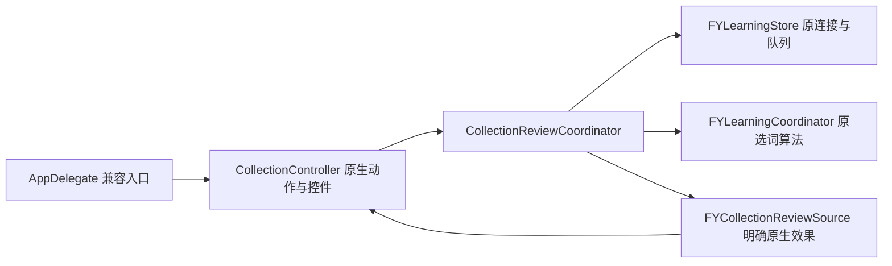

# 收藏复习流程

`FYCollectionReviewCoordinator` 独立维护原有七个业务方法：收藏列表加载与当前词条重绑、下一个词、揭晓释义、已掌握/还不熟入口、状态写入和取消收藏。`FYCollectionController` 保留控件、原生事件、收藏列表构造及明确的文字/显隐适配，公共动作与属性兼容入口保持。

| 职责 | 唯一状态拥有者 | 接口与回归 |
| --- | --- | --- |
| 列表、游标、正在复习的词条 | ReviewCoordinator 的 reviewList / reviewIndex / reviewingEntry | CollectionReviewTests；RuntimeOwnershipTests |
| 加载、按 ID 重绑、选词及写入 | ReviewCoordinator 七个方法 | Foundation Source 协议；最小组件与实际拆前/拆后控制器同用例 |
| 控件、标签及原位列表构造 | CollectionController | 明确文字/hidden 动作；CollectionLayoutTests 仅编译，桌面另验 |
| 词条身份、持久化连接和 SQL | 原 LearningCoordinator / LearningStore | 生产共用实现，无新数据库连接或 schema |

reviewList 和 reviewingEntry 保留原 strong 别名，列表不改为 copy。nil 列表先提示加载，空列表只提示无词；成功加载按稳定 ID 重绑到返回数组中的对象。原游标比较、卡片重建与空状态处理顺序不变。揭义保留 nil/空释义的区别及原字符串格式。

加载和标记回调继续强持有实际原生接收者；取消收藏仍为 weak 接收者。未引入查询代次或迟到结果门，也不扩大取消范围。标记成功先启动刷新再更新提示；移除成功先清空原标签与选择再刷新。

运行 `bash scripts/run-collection-review-tests.sh`。60 项独立 Foundation 检查、61 项实际拆前/拆后控制器同用例在 `-O0` / `-O2` 下通过；仅注入 held Store 响应和原生属性/事件事实，使用生产模型和选词算法，不创建窗口、真实库或 API 请求。覆盖 nil/空、强数组别名、重绑/消失、重入顺序、错误保留状态与强弱回调释放。八项反向变异必须失败，恢复后通过。实际编译器依赖检查证明业务头不带 AppKit、Root 私有状态、采集、设置与诊断。

统一 Debug 已登记该入口；完整报告和源码散列以 `.build/mac-decoupling/batch37-evidence.json` 为准。相关 UI 只编译；真实词卡按钮、遮义复习、滚动和持久化交互须另行桌面验收。收藏历史/语法/句子查询、词卡操作与原生渲染已分别进入 Query/Card/Renderer，Review 的三字段与方法保持不变，见 [收藏工作流](collection-workflow.md)。
