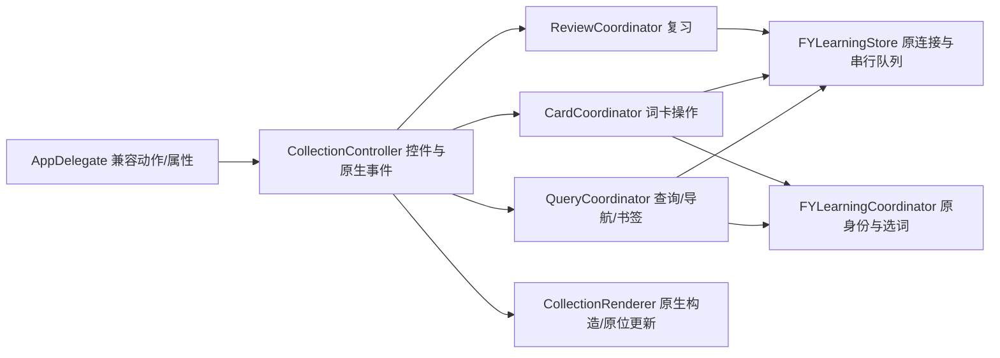

# 收藏查询、词卡操作与原生展示

收藏页兼容入口仍为 `FYCollectionController`。查询、词卡操作、复习各自维护业务状态；`FYCollectionRenderer` 只有原生工厂、行/卡片和原位更新类方法，不保存接收者或视图。公开头使用 AppKit 与准确的领域头，不再导入整套应用支持。

| 职责 | 唯一状态拥有者 | 接口与检查 |
| --- | --- | --- |
| 历史、语法、例句选择列表、句子快照 | QueryCoordinator：三个 strong 数组、savedSentences copy 数组 | FYCollectionQuerySource；CollectionWorkflowTests |
| 展开详情、释义显示、例句游标 | CardCoordinator：原三个 mutable 容器 | FYCollectionCardSource；CollectionWorkflowTests |
| 复习列表、索引、当前词条 | ReviewCoordinator：原三个字段，沿用上一批 | FYCollectionReviewSource；CollectionReviewTests |
| 控件、页签、卡片渲染代次 | CollectionController | 兼容属性/原生动作；RuntimeOwnershipTests |
| 原生页面、行、卡片与原位更新 | 无状态 CollectionRenderer | FYCollectionRenderSource；CollectionRendererTests |
| 数据库及跨页面身份 | 原 LearningStore / LearningCoordinator | 没有新增连接、schema、查询代次或取消范围 |

Query 包含十个原有完整方法及原词卡例句回调。历史先清空展示再处理错误；语法刷新先启动句子查询，再启动独立语法查询。成功回调保持原强接收者寿命，错误保留原数据与提示。savedSentences 继续 copy，渲染仍遍历回调原始 identities 数组；ID 与 version 同时参与句子查找，过期标识不回退到别的行。

Card 包含六个原有操作方法。按钮字段和选中词通过同步、准确类型的 provider 在原读取点求值，不进入 Store 的异步捕获；详情和遮义更新原卡片，不重建列表或重置滚动。句子删除沿用 Study 中的 pending 字段，先设置 pending、禁用原按钮，再发出原存储操作。

原生 renderer 的十个方法保留原构造、字体、目标和行序。词卡例句使用原 generation 门，仍强持有当次标签、按钮、ID 和实际接收者；旧结果返回前不更新旧控件，回调结束释放旧控件。未增加其它查询原本没有的迟到结果门。

`bash scripts/run-collection-workflow-tests.sh` 已接入统一 Debug：94 项 Foundation 业务检查、64 项完整原生算法检查，均以同一用例对照最小组件和实际拆前/拆后控制器，在 O0/O2 下通过。生产模型、身份、选词、例句格式与原生算法共用；注入的仅是 held Store/learning 响应和 OS 控件工厂/属性事实，字体使用真实 AppKit 对象，没有创建窗口、真实数据库或网络请求。11 项反向变异被检出，恢复后通过。实际编译器依赖验证两个业务头不带 AppKit，公开原生头不带 Root 私有状态、采集、设置或诊断。

首轮测试中的类型声明、nil 字典输入、OS `+new` 替身的返回所有权及完成后弱引用观测问题均保留原证据；只修测试夹具，生产算法和原行为断言未改。完整 Debug、Replay、源码身份及 UI compile-only 结果以本机 `.build/mac-decoupling/batch38-evidence.json` 为准。相关 UI 只编译，真实显示和交互仍另验。

最短桌面验收：打开收藏页依次切四个页签；在同一词卡展开/收起详情与遮义、切来源例句，确认滚动位置；打开固定版本的收藏句子，再删除语法/句子/词语并刷新；在复习页切词、揭义和标记，确认仍使用同一收藏状态。
