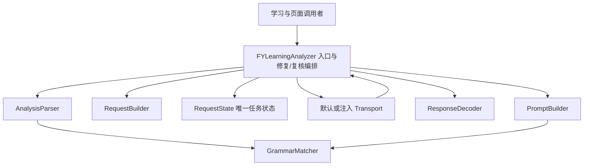

# 学习 AI 分析模块

2026-10-14 学习存储阶段完成后，用户授权继续学习 AI 分析模块拆分。本阶段保留 `FYLearningAnalyzer.h` 的公开接口及调用者，设置和诊断的新拆分仍留在后续阶段。

`FYLearningAnalyzer.m` 从 791 行缩减为 261 行，保留公共入口、默认/注入传输的连接、一次可选修复、主动复核合并和追问行为。实现位于 `objc/learning/analysis/`。

| 组件 | 独立职责 |
| --- | --- |
| `FYLearningRequestBuilder` | Key/URL/model 的原有前置校验、服务适配、30 秒超时、token 参数、DeepSeek JSON/推理参数 |
| `FYLearningResponseDecoder` | 网络/HTTP/envelope 错误、OpenAI/Claude 内容提取、截断/拒答/空最终内容 |
| `FYLearningRequestState` | 唯一 generation、activeTasks、pendingCompletions；登记、任务 resume、完成移除及取消 |
| `FYLearningGrammarMatcher` | UTF-16 原文定位、只归一空白、明确词内冲突、目录名称/ID/签名核对 |
| `FYLearningPromptBuilder` | 标点单元、读取候选、初次/一次修复/主动复核的原提示词与消息构造 |
| `FYLearningAnalysisParser` | Markdown fence/JSON/schema/type 校验、语法/词汇/结构结果构建及词条补全解析 |

请求构造只接收服务配置的窄协议，按原顺序访问当前属性；结果解析的目录协议只暴露 catalog，仍在回包解析时读取当前目录，不把请求发起时的旧目录冻结到回包中。纯提示词/解析/定位组件不持有网络任务、数据库、窗口或宿主状态。

Facade 的传输与回包 block 继续强持有原 Analyzer。默认 NSURLSession 仍在主队列核对代次后登记并 resume；完成先取出/移除该请求的 callback 和 task，再检查代次与解析内容。取消先递增代次、取消已登记任务、清空当前 pending，再同步通知原取消回调；取消回调中新建请求不被旧请求清空。迟到/重复回包只在自己的 requestID 下取 completion。原内部任务字典检查入口保留为转发 getter，不存第二份状态。

初次解析仍复制原句，保留原文字符、换行和 UTF-16 索引；只允许一轮针对拒绝片段的修复，失败保留已核实结果，取消不能返回旧的部分成功。主动复核不自动递归修复，不撤回已核实条目，并保留原对象身份和解释。314 处 Objective-C 字符串字面量与原实现一致，提示词、错误文案及目录键没有改写。

## 验证与交付边界

开始时上阶段统一报告的 735 个源码/脚本/夹具哈希全部符合工作树，旧存储实现及六批迁移、39 批深拆保留。新增 `LearningAnalyzerBoundaryTests` 的 44 项检查，在拆分前、后同一夹具的 O0/O2 下通过；覆盖默认任务登记前取消、已登记取消、迟到回包不清新任务、重复完成、并行/重入/独立实例、原 Analyzer 任务租约、同步前置失败、严格 schema/fence、可变输入的原句快照、emoji 后跨行 UTF-16 定位及回包时当前目录。默认 NSURLSession 仅替换为明确的 held session/task 事实，其他情况仅注入 transport，不发送真实网络请求。

`bash scripts/run-learning-analyzer-tests.sh` 接入统一 Debug。学习功能 `bash scripts/run-learning-tests.sh` 及 `FY_OPT=-O2 bash scripts/run-learning-tests.sh` 已通过；真正的 O2 `GrammarCoverageTests` 也通过，覆盖复合/缩略、定位、修复上限、失败保留、主动复核及取消。

最终 `python3 scripts/debug.py check --timeout 300` 退出 0，报告 `.build/debug/20261014T053234Z-5a0b25/summary.json`：208 passed、同一粘连按钮旧缺口两次 `known_gap_reproduced`，总结果 `baseline_passed_with_known_gaps`；`source_unchanged=true`，全部 750 个源码、规则、脚本和夹具哈希符合当前文件。77 个 Replay 场景的 154 次执行在 scenario/checkpoints/status/assertions/failure 上与学习存储阶段一致。25 处搬迁正文/请求校验/响应解码/修复合并/提示词构建核对一致，314 处 Objective-C 字符串字面量核对一致。完整证据为 `.build/learning-analyzer-split/delivery.json`。

本阶段纠正了上一阶段一项验证标注：当时 `run-learning-tests.sh` 没有把 `FY_OPT` 传给 clang，故设置 `FY_OPT=-O2` 的学习功能日志不能算 O2 证据。本阶段增加显式优化参数，并真正重跑 O0/O2；同时补验上阶段存储在该学习功能程序中的 O2 链路。上阶段 `run-learning-resilience-tests.sh` 的 O2 参数原本正确，其故障/事务专项证据仍成立；旧日志保留，不改写历史产物。

证据保存在忽略的 `.build/learning-analyzer-split/`。测试只使用合成请求、临时数据库和捆绑语法资料，不读取真实凭据/玩家库、消耗 Token 或连接设备。本阶段不安装、提交、推送、发布；真实桌面、服务体验及取消操作仍需另行安排。最短手动步骤为分析一句、在请求中切换/取消、发起新分析，确认旧结果不覆盖；再主动复核和追问一次。
