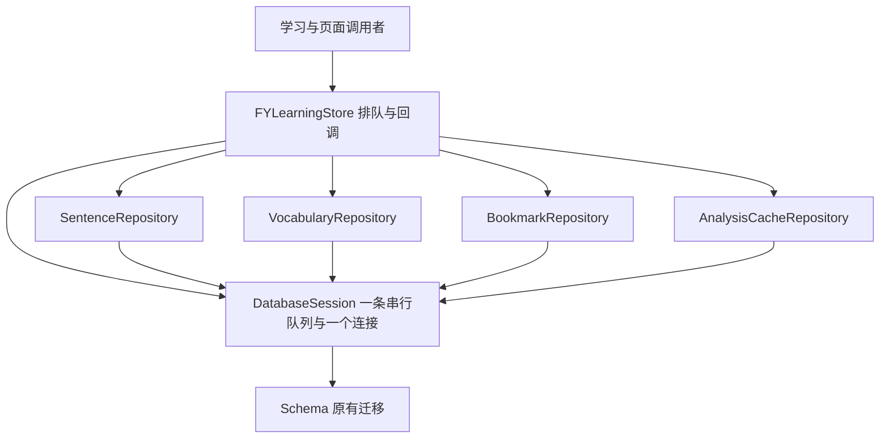

# 学习存储模块

后续验证更正：本阶段 `run-learning-tests.sh` 当时没有传入 `FY_OPT`，设置 `FY_OPT=-O2` 的学习功能日志实际使用默认优化，不能算 O2 证据。后续 [学习分析阶段](learning-analyzer.md) 补齐参数并真正重跑 O0/O2 学习功能；本阶段故障专项 `run-learning-resilience-tests.sh` 的 O2 参数正确，原证据继续成立。

2026-10-14 用户在完成六批迁移和 39 批深拆的阶段验收后，授权启动独立的学习存储阶段。此次只拆持久化职责；分析服务、设置集成和诊断的新拆分仍是后续阶段。

`FYLearningStore.h` 的外部接口保持不变。`FYLearningStore.m` 从 1,145 行缩减为 285 行，只负责接口适配、串行排队、输入快照及回调交付。实现位于 `objc/learning/storage/`。

| 模块 | 独立职责 |
| --- | --- |
| `FYLearningDatabaseSession` | 唯一数据库连接、串行队列、完成队列、打开/关闭、短暂写锁等待、SQLite 自定义译文检查函数 |
| `FYLearningSchema` | 原有 v1–v3 建表与迁移 SQL、失败返回和迁移回滚 |
| `FYLearningSentenceRepository` | 会话、句子、版本、回填译文、姓名栏排除证据、历史保留与固定阅读保护 |
| `FYLearningVocabularyRepository` | 词条、例句、收藏事务、复习状态与删除 |
| `FYLearningBookmarkRepository` | 句子收藏和语法收藏的独立快照 |
| `FYLearningAnalysisCacheRepository` | 分析缓存读写、JSON 编解码及损坏/旧格式验证 |

仓库接口是内部同步接口，只在同一个 session 队列上调用；仓库不各自排队、创建连接或拥有完成队列。句子版本与主句更新、译文与历史清理、词条与例句的事务仍由对应仓库一次完成。历史 SQL 可以查询句子收藏表，但不跨模块异步调用、不引入嵌套事务。历史的译文资格、独立待译工作集、固定身份及收藏保护保持原规则。

Facade 的排队 block 继续强持有原 Store，工作完成后释放；交付 block 只持有结果和调用者的 completion。默认完成队列为主队列，测试指定队列及 nil completion 均沿用原行为。失败关库保留可用连接；后续操作在串行 close 之后可以重新打开同一文件。此次不增加自动关库或改变显式生命周期合同。

旧测试的 `db`、`queue`、`databasePath` 以及历史保留字段 KVC 访问保留为内部转发入口；不在 facade 再存一份状态。桌面 `PrototypeAuditTests` 的原断言和设置入口保持不变。

统一源码清单新增 `FY_LEARNING_STORAGE_SOURCES`，应用、学习核心及专项消费者共同使用，避免某个工具遗漏新编译单元。

## 验证与边界

拆分前的 695 个交付文件哈希与已验收阶段一致；现有完整核心报告为 207 passed + 同一旧缺口两次复现。此次另以同一组真实 Store/SQLite 测试核对拆分前后。新增 `StorageOrderingAndLifetime` 覆盖四类数据的混合提交顺序、指定回调队列、close/reopen、排队中的 Store 保留及回调等待时释放；`VocabularyTransactionFailure` 在生产连接安装合成故障，检查例句失败时词条与例句一起回滚及重试成功。旧事务、busy close、短锁、nil completion、历史资格与旧库迁移断言保留。

局部命令为 `bash scripts/run-learning-resilience-tests.sh`、`FY_OPT=-O2 bash scripts/run-learning-resilience-tests.sh` 及 `FY_OPT=-O2 bash scripts/run-learning-tests.sh`；统一收尾使用 `python3 scripts/debug.py check --timeout 300`。新增的三组回归与旧故障检查在拆分前、后同一夹具的 O0/O2 下通过。兼容访问专项通过实际历史清理验证 KVC setter 与公开配置共用状态。

最终统一报告为 `.build/debug/20261014T045603Z-e8a018/summary.json`：207 passed、同一粘连按钮旧缺口两次 `known_gap_reproduced`，总结果 `baseline_passed_with_known_gaps`，`source_unchanged=true`；735 个源码、脚本、规则与夹具哈希全部符合当前文件。77 个 Replay 场景的 154 次执行在 scenario/checkpoints/status/assertions/failure 上与独立验收基线一致。31 处搬迁正文/迁移/缓存编解码核对和 63 处 SQL 关键字面量核对一致。

日志与完整交付证据保存在忽略目录 `.build/learning-storage-split/delivery.json`。首次统一检查在并行强制重建离线 OCR 工具时出现一个子进程的 120 秒超时（`.build/debug/20261014T045017Z-6b2b20/`）；未改源码或期限，同一用例复测约 50 秒通过，随后上述完整检查通过。此前为补齐私有 KVC 兼容入口主动中断的检查也单独保留。失败、中断和通过的记录不相互替代；首次超时的具体原因未确认。

测试使用隔离的合成临时数据库，不读取玩家数据库或真实凭据，不请求真实服务。界面、真实旧用户数据及设备体验没有由这些 headless 断言验收；本阶段不安装、提交、推送或发布。最短手动检查是在另行安排的桌面时段收藏一条句子、一个词及其例句，修改复习状态，重开应用核对保留结果。
