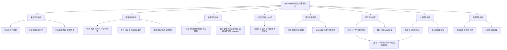

# Mac 拆分阶段交付

2026-10-14 用户将目标调整为阶段交付。本阶段保留此前六批迁移及已验证的深拆1–38批，并纳入通过拆前／拆后对照的词典39批。数据库会话／迁移／仓库、设置与诊断的新拆分不属于本次历史交付；历史文档中的“继续全目标”是当时计划，以本页的新范围为准。

本阶段验收后，用户另行授权独立的 [学习存储拆分](learning-storage.md)。后续实现与证据单独记录，不改变本页的 39 批验收结果。

唯一维护仓库及分支不变：`dev0.2.1_261009`。全部已有 tracked/untracked 修改保留。没有安装、提交、推送、发布，也没有改版本、schema、视觉资源、全局 Codex 配置或其它平台。

## 已完成范围与模块图

| 批次 | 已完成职责与状态边界 | 定位与回归入口 |
| --- | --- | --- |
| 此前六批 | 启动组件、设置／诊断入口、页面、贴译、运行态及共享支持的基础迁移 | README、HostExtraction／Module／RuntimeOwnership |
| 1–4 | 预览、内容修订与交付、请求与缓存、OCR独立忙碌槽 | runtime/；LivePreview／ContentDelivery／TranslationCoordination／RecognitionCycle |
| 5–8 | 观察／精读、worker与引擎、对白／字段／模式、过滤与像素处理 | ocr/；OCRRefinement／OCRWorker／ContentStability／ContentPolicy |
| 9–11 | 目标／几何／日期，采集会话与帧槽，自动定位／复核 | capture/；CaptureBoundary／CaptureSessionBoundary／CaptureMappingCoordinator |
| 12–15 | 布局模型、分组、跨帧身份、真实测量、布局计算、按压与绘制依赖 | inline/；InlineModel／TextMeasurement／LayoutCalculation／RendererBoundary |
| 16–21 | 贴译显示／复用、手动位置／拖动、选择快照、展开阅读、冻结候选、卡片展示 | presentation/；InlineDisplay／ManualDrag／Selection／ExpandedReading／Overflow／CardRenderer |
| 22–26 | 可见句子与选词状态、实时阅读、界面译文、实时页构造、窗口依赖与尺寸画布 | WordSelection／LiveReading／TranslationList／LivePageBuilder／MainWindowBoundary |
| 27–32 | 语法任务与七项状态；滚动／详情／结果／完整页面无状态渲染；收藏异步租约 | GrammarInteraction／Scroll／Detail／Results／PageBuilder／Bookmark |
| 33–36 | 聊天上下文2状态、查句9状态、导航12状态，原生视图仍Study拥有 | StudyChatContext／QuickSentenceWorkflow／StudyNavigation／StudyRenderer |
| 37–38 | Review3、Query4、Card3唯一状态；收藏原生renderer零状态 | [收藏复习](collection-review.md)、[收藏工作流](collection-workflow.md) |
| 39 | Query4、Hover4唯一状态，共享只读词典；原生renderer零状态 | [词典工作流](reference-workflow.md) |

逐批的方法、接口、生命周期、失败及恢复记录见 [Mac深拆记录](mac-decoupling.md) 与各模块文档。本机 `.build/mac-decoupling/batch*-evidence.json`、`PROGRESS.md`、开工源码快照和散列保留此前未提交成果与过程证据。

## 验证与限制

最终实际源码冻结后执行 SourceManifest、diff检查、词典专项、RuntimeOwnership、Module的优化构建及相关UI编译，再执行一次完整 `python3 scripts/debug.py check --timeout 300`。源码散列用于核对这些命令针对同一交付源码；77场景／154次Replay逐项比较checkpoint、status、assertions、failure。最终命令、退出码、计数、报告路径、变更白名单与源码散列统一保存为 `.build/mac-decoupling/stage-delivery-evidence.json`；详细最终结果见本机 `.build/mac-decoupling/STAGE-DELIVERY.md`。不得把本页的验证要求视为尚未产生的执行结果。

无窗口专项执行真实生产算法，但原生控件属性／构造与服务传输采用隔离事实。完整语法图、查句页、真实布局及鼠标／设备体验中，仅编译的项目仍为仅编译，不能据此宣称功能全部验收。默认检查使用合成数据，不读取真实Key／学习库、不连接设备、不发真实API请求。

## 已知缺口

| 项目 | 实际状态与边界 |
| --- | --- |
| Replay尾句粘连 `思い出した。使用` | 同一旧缺口回放两遍仍为 known_gap_reproduced；不是修复完成 |
| 520×170贴译长卡 | O0/O2各两条旧UI预期失败；用户已确认保留高度上限／卡内滚动及既有避让，不为全绿改显示 |
| PixelAdventure徽章 | 旧UI徽章预期与当前视觉存在差异，真实桌面仍待验收 |
| 采集启动／停止待选设备 | 子批10拆前／拆后同夹具O0/O2均保留两条旧失败；设备行为未验收 |
| 数据库、设置、诊断进一步解耦 | 暂缓；现有实现保留，没有新拆分或迁移 |

此前离线测试的LaunchServices／ImageIO停滞及合成原生事实问题已有隔离修正和证据；不将测试工具修正算作产品Bug修复。其它逐批记录的未执行范围继续有效。

## 最短待验收步骤

获得当前桌面授权后，按统一UI清单执行相关套件，再用真实应用检查：

1. 拖动／缩放窗口并切页，手动开关侧栏，核对尺寸、会话和草稿保留。
2. 实时原文选择／复制；贴译长卡内部滚动、空间不足折叠／避让；打开候选列表后跨帧更新保持身份。
3. 语法三个页签、结构图、分析／追问中切句；学习进入／返回与查句导航保持原快照和草稿。
4. 收藏增删、词卡释义／例句、复习标记／移除；词典查询切换、收藏资料展开与主／查句悬停。
5. 单窗口及采集卡启动／停止／切目标、晚到回包，使用用户自己的服务检查翻译；凭据只核状态和权限，不输出内容。

本阶段交付的是源码与隔离自动回归；本机安装、真实设备、服务、用户体验及公开发布分别记录。
