# Mac 模块深度拆分

当前阶段范围与验收边界见 [阶段交付](mac-decoupling-stage-delivery.md)。用户已停止扩大范围：保留1–38批，收尾词典39批；数据库、设置、诊断的新拆分暂缓。以下历史“继续全目标”计划不再是本阶段必做。

2026-10-13 起，在前六批职责迁移上继续收敛依赖与状态。当前完成预览、内容修订/交付、请求/缓存协调、OCR 调度、观察模型/精读、识别 worker/引擎、对白/字段/模式状态及内容策略/像素后处理及目标跟踪/解析与映射边界、采集会话/帧槽、映射自动定位/复核、布局模型/分组/身份匹配、真实文字测量及布局计算、渲染几何与按压状态、面板复用/缓存编排、手动位置与原生拖动、选择与快照/卡片绑定十八个子批，其余领域仍按下表推进。保持现有 OCR、排版、窗口、学习与凭据合同；源码重构与自动回归不代表设备、桌面或发布验收。

本机恢复入口为 `.build/mac-decoupling/PROGRESS.md`，开工源码快照与散列在同目录 `task0-before/`、`task0-hashes.json`，包含此前未提交修改。它们不包含凭据、真实画面、文字日志或学习库，不进入发布包。

## 当前模块图

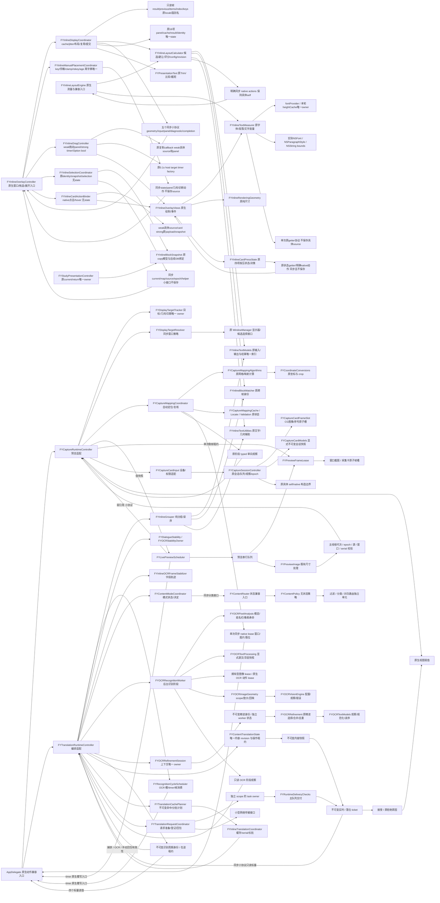

预览组件仅依赖 Foundation/CoreGraphics，不导入宿主私有状态或共享 UI 头，不读 UI 控件。适配层负责主窗口可见性、输入访问、采集卡转换节奏和最终展示。`FYLivePreviewSnapshot` 是按值传递的标量快照；`FYLivePreviewSource` 仅提供快照、单次取帧租约、可见性刷新和图像展示四个动作；timer target 只保留原 `previewTimerFired:` 入口。

`FYPreviewFrameLease` 保留当前取帧所需的原始宿主与输入资源，epoch 校验针对提交时的原始输入。闲置 scheduler 弱持有适配层；后台任务结束后释放原宿主。保留原 Common Modes timer 和宿主覆写入口，窗口 100 ms、可见采集卡约 33.3 ms。请求作废只推进 request/render serial、清除最后预览帧号，在途 busy 槽仍保留到主线程完成，重启不能积压第二次取帧。预览不消耗 OCR 帧号、不取消 HTTP 或服务测试。停止时的 OCR 图预览沿用独立 render serial 与 100 ms 节流。

尺寸处理函数从共享 UI 支持文件移至 `FYPreviewImage.m`，函数正文与开工快照逐字节一致。保留原尺寸不可变图像的独立寿命和 2560 像素上限，不变更坐标、颜色或缩放算法。

## 职责、状态与测试

| 职责 | 唯一状态拥有者 | 接口与依赖 | 验证入口 |
| --- | --- | --- | --- |
| 预览调度、busy、timer、队列、serial、帧号、节流 | `FYLivePreviewScheduler` | 值快照、小协议、单次取帧租约；Foundation/CoreGraphics | `LivePreviewSchedulerTests`（130 项，最小依赖）、`RuntimeOwnershipTests`（当前 149 项，真实宿主）、`TranslationTracePipelineTests`（生产链路） |
| 原始采集会话/资源/观察/队列/epoch | `FYCaptureSessionController` | 原具体 self/锁/delegate/弱观察与强队列租约；Foundation/CG/AV/CI/CM/CV，native 构造接口，无 UI/root | CaptureSessionBoundary（47 项，真实生命周期/真实合成 sample+CI、native transport 边界替身）、RuntimeOwnership/Trace/Replay，O0/O2 |
| 原子最新帧、cadence/计数/CG寿命 | `FYCaptureCardFrameSlot` | Foundation/CG；原 @synchronized、单槽 pixels/index、30/10Hz/1ms 容差；独立消费者拥有图像 lease | CaptureFrameBoundary（20 项，包括并发实际像素/index与provider释放）、原 CaptureCard/UI只编译、Trace |
| 设备发现/授权与会话只读视图 | `FYCaptureCardInput` 原 native 适配；`FYCaptureCardModels` | 仅外接视频/无回退，public class继承session API不重复状态；显式 immutable snapshot不更改原读取/通知 | 63处算法比对、Native/FrameBoundary、Host/Trace；权限/设备实际体验待验收 |
| 显示目标解析 | 无状态 `FYDisplayTargetResolver` | 原窗口字典快照/值 ID/PID、同步几何/候选小协议；Foundation/CG，无 UI/设备 | CaptureBoundary（44 项）、原 WindowPolicy、Trace/Replay，O0/O2 |
| 目标探测/恢复与几何 revision/token | `FYDisplayTargetTracker` | 原 resolved/ambiguous/id、probe/recovery dates、generation/token 七项；capture/host 无重复 ivar | CaptureBoundary、RuntimeOwnership（当前 149 项）、Trace/Replay |
| 映射算法/缓存/schedule 与坐标转换 | `FYCaptureMappingAlgorithms`、原 `FYCaptureMappingCache` / `FYAutoLocateSchedule` / `FYMappingValidationSchedule`、`FYCoordinateConversions` | 原借用/拥有型 CG 图像/网格、plist/原阈值；Foundation/CG，geometry manager 公有适配 | CaptureBoundary 复用原几何 96 项断言、原 Module/Trace/Replay，O0/O2 |
| 自动定位/映射存储/定点复核 | `FYCaptureMappingCoordinator` 拥有原三个 lazy 状态 owner | Foundation/CG、不可变 version/sentinel 配置、窗口/图片/落位三个同步小协议；native lease 只在单次调用保留具体 host/window，typed 诊断不保存 | CaptureMappingCoordinator（44 项）、RuntimeOwnership（当前 149 项）及 Trace 的 O0/O2、Module/Replay、4 种反向验证 |
| 采集输入/目标/映射 UI 与运行适配 | `FYCaptureRuntimeController` + 现有 native manager | 原面板/屏幕/窗口动作与兼容属性；映射业务和唯一状态归属已迁出 | 原 RuntimeOwnership/Trace；CaptureMapping/DisplayTargetFollow 等 UI 只编译 |
| 内容修订、操作租约、源文/模式/观察/几何身份 | `FYContentTranslationState` | Foundation + 原模式枚举；不可变内容快照、同步比较/源键依赖 | `ContentDeliveryTests`（52 项）、RuntimeOwnership（当前 149 项）、Trace、全部生产 Replay |
| 实时 / 单次界面落位 / 主队列交付校验 | `FYRuntimeDeliveryChecks` | 不可变 ticket、5/7 项标量只读源协议；不保存宿主或源 | ContentDelivery、原 TranslationManager/Geometry/Task 检查、Trace、Replay |
| 实时请求准备、任务登记与传输回包 | `FYTranslationRequestCoordinator`（实时 task owner）；服务测试原独立 owner | 不可变准备结果/身份、仅在途的原宿主租约、小型传输协议；Foundation | TranslationCoordination（45 项）、RuntimeOwnership（当前 149 项）、Trace、Replay |
| 命中/长短计划、缓存、serial、长批复用 | `FYTranslationCachePlanner` / `FYInlineTranslationCoordinator` | 不可变批次、同步原 key/kind 依赖、operation transport lease；原观察身份/序号保持 | TranslationCoordination、原 TranslationManager/Task 模块、Trace、长批 Replay |
| OCR 调度、busy、timer、OCR 几何身份与帧消费 | `FYRecognitionCycleScheduler` | Foundation；不可变周期身份、四读值在途 lease、原生 timer 入口 | RecognitionCycle（90 项）、RuntimeOwnership（当前 149 项）、生产 Trace 和 Replay |
| 捕获/识别工作阶段、内容路由与精读上下文 | `FYTranslationRuntimeController` + 现有 manager | 调度/请求/缓存状态已提取；工作阶段与 UI 适配仍待细拆 | 原 Trace、Replay、RuntimeOwnership；待细拆 |
| OCR 观察、基本文字规则与读序 | `FYOCRTextModels` | Foundation/CoreGraphics；原观察类型与元数据，原规范化/假名扫描/读序 | OCRRefinementBoundary（61 项）、原 Module、Trace、Replay |
| 精读资格、结果选择、合并及重叠去重 | `FYOCRRefinement` / `FYOCRRefinementStabilizer` | Foundation/CoreGraphics；原算法/观察身份/坐标；既有公有入口兼容 | OCRRefinementBoundary（61 项）、Module（O0/O2）、Trace、Replay |
| 精读上下文选择与旧 worker 状态隔离 | `FYOCRRefinementSession` | 不可变 typed identity；原 scope 格式精度与 legacy dictionary 相等合同；两项状态只有一个 owner | OCRRefinementBoundary、RuntimeOwnership（当前 149 项）、重启 Trace/Replay |
| 实时/手动后台识别阶段与图像寿命 | `FYOCRRecognitionWorker` / `FYOCRRecognitionImageLease` | 不可变参数/结果、OCR 专用操作协议/强在途 lease、单向 typed 观察；Foundation/CG，无宿主/UI | OCRWorker（55 项）、真实宿主（当前 149 项）、Trace、Replay |
| scope/放大/crop/观察回映 | `FYOCRImageGeometry` | CG 纯计算、原坐标/NULL error 合同、显式 crop 诊断包装；旧 manager 兼容 | OCRWorker、原 Module（O0/O2）、布局诊断、Trace/Replay |
| Vision 请求配置/观察/过滤/排序/错误 | `FYOCRVisionEngine` | Foundation/CG/Vision；configurationObserver 唯一 owner、按次 raw observer；无 UI/宿主/布局 | 独立真实 Vision（11 项）、原 Vision 配置 Module、Trace/Replay |
| 字段开页/局部编辑/新增/缺失/坐标与页稳定 | `FYInlineOCRFrameStabilizer` | Foundation/CG；原私有轨迹/候选/blank/ready，原观察副本元数据 | 原 39 项字段回归最小依赖复用；新增空帧断言，Module/Trace/Replay |
| 对白同句/相似度/连续帧确认 | `FYDialogueStability` / `FYOCRStabilityOwner` | Foundation；原比较 key 注入，无学习库/控件；原 candidate/count 单 owner | ContentStability（34 项）、原 Module/Trace/Replay，O0/O2 |
| 模式连续证据与 lastDecision | `FYContentModeCoordinator` / `FYContentModeStability` | Foundation；不可变 mode decision、同步 classifier 不保存；router 无重复字段 | ContentStability、RuntimeOwnership（当前 149 项）、Trace/Replay |
| 内容过滤、模式分类与对白/选项路由 | 无状态 `FYContentPolicy`；`FYContentRouter` 继承兼容 | 三个独立算法编译单元、原 self/helper 分派；Foundation/CG，无 UI/root/Vision | ContentPolicy（23 项）、原 Module/Trace/Replay，O0/O2 |
| 模态/姓名栏像素及 buffer 寿命 | 无状态 `FYOCRPixelAnalysis` | 原 RGBA/CG/malloc caller-owned buffer、原排除/资格/角色副本；Foundation/CG | ContentPolicy、原 Modal/SpeakerPlate/Module、真实 Vision Replay |
| 源图后处理与显式浮层文本排除 | 无状态 `FYOCRTextProcessing` | 原观察身份/字符索引；干净源图不读取缓存，浮层路径显式传快照 | ContentPolicy、原 OCRPostprocessing/Module/Trace/Replay |
| 布局数据与结果索引/变体状态 | `FYInlineTextModels` 的原 line/block/request/placement/result | Foundation/CG；原 copy 与可变元素身份、result 唯一 byBlockID、placement 三个原 private 字段；font/style 仅强类型引用 | InlineModelBoundary（43 项）、RuntimeOwnership（当前 149 项）、Module/Trace/Replay，O0/O2 |
| 字段分组、读序与跨帧身份匹配 | 原配置 `FYInlineGrouper`；无状态 `FYInlineBlockMatcher` / `FYInlineTextUtilities` | Foundation/CG，纯分组/模型清单；原算法/源下标/同文异位/三位小数身份保持 | InlineModelBoundary、全部原 Module/Trace/Replay；4 种边界破坏/恢复 |
| 真实字体/段落/文字尺寸与字形primitive | `FYInlineTextMeasurer` 唯一拥有原fontProvider与heightCache | Foundation/CG/AppKit/CoreText；原source协议只有两项getter，不保存source，实际native字体与boundingRect；布局/绘制共用primitive | TextMeasurement（25 项实际原生）、Lifecycle（13 项，同fixture直接编译拆前/后O0O2）、RuntimeOwnership（当前149）、Module/Trace/Replay及4变异 |
| 布局候选/避让/评分/轮次与默认配置 | `FYInlineLayoutCalculator` 唯一拥有原config/revision/diagnostics | Foundation/CG；原native Engine继承，具体self/helper分派保持；实际字体/段落/weight/bounds/cache及旧class-title入口用明确同步actions | LayoutCalculation（31纯几何+6原生receiver，同fixture拆前/后O0O2）、Lifecycle、RuntimeOwnership（当前149）、Module/Trace/Replay |
| 原生浮层绘制/安装与纯尺寸 | `FYInlineOverlayViews` 独立AppKit头；无状态 `FYInlineRenderingGeometry` | native只依赖原实际measurer/文字工具/尺寸与按压；不导入Engine/grouping/model/root，5尺寸函数Foundation/CG | RendererBoundary（12纯尺寸+25按压+8冷依赖/归属）、Module/Trace/Replay；原UI仅编译 |
| 卡片按下/拖动/松手/标题命中 | `FYInlineCardPressState` 唯一拥有pressPoint/moved/collapse/titleHeight | Foundation/CG，原getter/setter四值与五native actions同步，保留concrete self，native兼容无重复ivar、不保存source/actions | PressState getter/action顺序、阈值/短路/重入/异常/寿命；RendererBoundary、RuntimeOwnership（当前149）；原/新UI只编译 |
| 显示内容/几何身份、jitter/布局与面板复用提交 | `FYInlineDisplayCoordinator` 拥有原16项panel/cache/result/identity字段，native继承无重复 | Foundation/CG/canonical model/matcher/calculator；只读frame保留原locals别名，五组明确native协议；3文本函数/原panel struct独立pure定义 | DisplayCoordinator（33纯算法+37真实native计算）、同fixture13真实host拆前/后O0O2、RuntimeOwnership（当前149）、Module/Trace/Replay |
| 手动位置key/lookup/record/clamp/rekey/age | `FYInlineManualPlacementCoordinator` 只拥有原offset与age两字典 | Foundation/CG；原getter/key helper、明确native panel/viewport/诊断actions同步、不保存source，native兼容dynamic保持alias | ManualPlacement（26项）、原/新18 native host O0O2、Display/RuntimeOwnership（当前149）、Module/Trace/Replay |
| 原生拖动wire/Option/定时器资源 | `FYInlineDragController` weak拖动panel、strong timer、Option bool三项唯一 | AppKit/Renderer原生适配，无Root/privateSupport；原具体source/弱panel callback、原host target0.1s factory、invalidate→nil→disarm | NativeDrag（21项合成UI事实）、原/新实际host/timer18项O0O2；真实UI只编译 |
| 选择身份/输入scope快照/比较与Host映射 | `FYInlineSelectionCoordinator` 无state；`FYInlineBlockSnapshot` 原copy模型 | Foundation/CG/canonical文本/matcher；current/return snapshot仍Study唯一owner，source/map/current/epoch只同步借用 | Selection（24项）、19原/新host同fixtureO0O2、RuntimeOwnership（当前149）、Module/Trace/Replay |
| 卡片点击/compact切换/hover与payload lease | `FYInlineCardActionBinder` 无state | AppKit/Renderer+typed动作接口，weak具体source/card、strong原item/translation/stable/snapshot；无Root/privateSupport | NativeBinder（19项实际算法/synthetic UI facts）、19真实host同fixtureO0O2；真实UI只编译 |
| 页面、浮层、语法、聊天、收藏、词典/悬停 | `presentation/` 各控制器 | 原动作门面与独立临时状态 | 相应原生 UI；待细拆 |
| 数据库会话/迁移与学习仓库 | `FYLearningStore` | 单连接、串行写与跨表事务；原 schema/SQL | LearningStoreResilience、原学习/历史检查；待拆 |
| 设置保存、凭据与服务测试 | `settings/` + `FYLocalAPIKeyStore` | 原普通设置快照、独立服务测试任务 | HostExtraction、隔离凭据/设置检查；待细拆 |
| 诊断缓冲、报告、文件导出与邮件入口 | `FYRuntimeDiagnostics` / `diagnostics/` | 单向白名单观察、原隐私限制 | Diagnostics、Trace、HostExtraction；待细拆 |

捕获适配器与宿主的七个预览属性只保留明确兼容访问器，不生成第二份 ivar；运行代次通过 `invalidatePreviewResults` 让 scheduler 统一作废结果。该结构断言随实际 owner 调整，旧行为断言保留。

## 本批验证与边界

开工重新跑完整 Debug，168 条执行记录 passed，粘连按钮缺口两遍均 `known_gap_reproduced`；报告 `.build/debug/20261013T040210Z-7c6425/summary.json`，源码散列保持不变。SourceManifest 7 项和 `git diff --check` 均退出 0。

接入后预览最小依赖、生产宿主归属和 Trace 专项在 `-O0` / `-O2` 均退出 0。新增最小依赖套件接入统一 `scripts/debug.py check` 与共享源码清单，生产与测试使用相同实现。测试仅替换图像输入、最后展示和 HTTP 传输，不替换调度或交付算法。

受控反向验证只修改隔离副本：删除 generation 校验退出 2（迟到图像断言失败）；作废时提前释放 busy 退出 2（忙碌租约断言失败）；恢复原实现退出 0。命令、散列和日志在 `.build/mac-decoupling/negative/report.json`。完整收尾结果在同目录 `batch1-evidence.json`，不是安装或发布证据。

UI 默认仅使用 `FY_TEST_COMPILE_ONLY=1 bash scripts/run-learning-app-tests.sh SUITE` 编译。实际窗口拖动、手动侧栏、原文选择、隐藏/恢复、长卡滚动、冻结选择列表、学习返回与草稿仍需当前授权的桌面时段。粘连按钮缺口、520×170 长卡两条旧预期继续按原状态记录，不为重构变更显示。

最短手动验收：在同一输入源连续翻三段画面，慢翻译时预览仍更新；暂停/重启、换源、隐藏/恢复主窗口后不回填旧画面；拖动主窗口并手动开关侧栏，检查原文选择和现有字幕行为。真实设备帧率、CPU/耗电与长期运行另行记录。本批未安装、提交、推送、发布或使用真实 API。

## 子批 2：内容修订与交付校验

`FYContentTranslationState` 独立拥有七项内容状态；宿主与运行适配器的原属性只是兼容访问器，两层都没有第二份内容 ivar。开始/保留长批替换、增添选项操作、按 revision 完成、匹配与快照形成可单独回归的状态合同。作废的两阶段接口允许原适配层保留“清提交节流 → revision → inline serial/长批清场 → 内容清空 → 仅取消实时任务”的原顺序；宿主 invalidate 与时钟覆写仍保留。文本及容器复制，观察对象身份与排序不变。

`FYRealtimeDeliveryTicket` 保留 generation→running→window→epoch→mode；`FYInlinePlacementDeliveryTicket` 保留 content→generation→epoch→仅运行时的 mode→geometry/target。后者仍允许暂停时的显式单帧翻译，未知提交目标仍免去目标匹配；不把两个产品合同合并。早期拒绝不读取后续模式或几何/UI 派生值；纯组件不保存只读源。Trace 与几何刷新后的面板处理留在原适配层，旧结果拒绝不会再次隐藏已正确重排的面板。

`FYInlineDeliveryDropReason`、`FYGeometryDeliveryIsStale` 与 `FYDeliverTranslationOnMain` 的函数正文逐字节保留，集中到 `FYRuntimeDeliveryChecks.m`，原公有名称保持兼容。网络传输、请求构造与服务测试仍沿用原 owner；内容变化与 inline plan serial 分别检查，旧 completion 不释放新 revision 操作。生产、Replay、离线工具和独立消费者通过共享 `FY_DELIVERY_SOURCES` / `FY_TRANSLATION_CORE_SOURCES` 链接同一实现。

拆前完整 Debug：169 passed + 2 known_gap_reproduced，报告 `.build/debug/20261013T043110Z-fca63f/summary.json`。新增 Foundation-only 内容/交付检查 52 项，宿主归属 62 项；两者及生产 Trace 在 O0/O2 均通过。新增检查接入统一 Debug。隔离副本的四个变异（旧完成释放新操作、忽略 plan serial、忽略实时窗口、误拒绝暂停单次落位）分别退出 2，原实现恢复退出 0；日志与源散列在 `.build/mac-decoupling/batch2-negative/report.json`。

完整收尾结果在 `.build/mac-decoupling/batch2-evidence.json`。本批 UI 只编译 `InlineTranslationPipelineTests`、`CaptionSelectionTests`、`InlineFoldReadTests`、`InlineLearningAcceptanceTests`，不作为交互通过。保留前述已知缺口与桌面/设备边界；下一步继续请求与缓存规划、OCR 调度、目标与映射，随后按全目标表推进 OCR/排版、页面、存储和设置/诊断。

## 子批 3：请求协调与缓存规划

`FYTranslationRequestCoordinator` 接收原不可变设置配置、源文/提示词/模型覆盖/令牌与长文本标志，生成请求或原校验错误；API Key→URL→模型→默认提示词的校验顺序保持。实时 task owner 只有一份存储，服务测试仍传入自身 owner；注册后才观察提交并 resume，HTTP 接收/解码后保留原主队列 generation/revision 门。过期任务只 finish 自己，不能释放新任务；服务测试不受实时内容 revision 影响。Scope、提交身份是不可变模型，两个标量读值 block 仅在途保留原宿主；协调器无闲置宿主引用、UI、窗口、设备、timer 或凭据持久化。默认 transport 延迟到提交时才使用原 shared session 与解码实现。

本机探针确认 `NSMutableURLRequest copy` 保留可变具体类；准备结果因此私有保存 canonical request，每次读取返回独立副本。测试实际修改对外副本并核对 canonical 不变，不靠 class 名称证明不可变。请求参数、错误、模型/推理、等待策略、认证分发及原宿主默认提示词/提交覆写入口保持。

`FYTranslationCachePlanner` 的七个原函数及 cache 类保持原实现，新增不可变命中/短长批次计划。`FYInlineTranslationCoordinator` 独立拥有 inline cache、dialogue cache、serial、pending long batch；宿主与 runtime 五项属性仅兼容访问，没有第二份 ivar。key→缓存观察顺序、原观察对象/索引、长短分开提交、等待双方完成、按 key 与 occurrence 对齐重复字段、失败重试、旧短 serial 拒绝、旧 long batch 身份检查均保持。原生 long/batch/parse/cache 动作仍经过宿主，Root 覆写与仅在途的强持有有真实宿主回归证据。Trace 与 UI 来源语言读取留在适配层；新业务组件只依赖 Foundation 和领域模型。

拆前完整 Debug：170 passed + 2 known_gap_reproduced，报告 `.build/debug/20261013T052116Z-381abe/summary.json`。新增协调检查 45 项、宿主归属 73 项及生产 Trace 在 O0/O2 通过；检查接入统一 Debug 与共享源清单。三种隔离变异（忽略重复 occurrence、忽略 short serial、忽略内容 revision）各退出 2，原实现恢复退出 0；七个 cache/batch 函数和 task owner 正文逐字节一致，证据 `.build/mac-decoupling/batch3-negative/report.json`、`batch3-legacy-body-parity.json`。完整收尾见 `batch3-evidence.json`。

本批 UI 仅编译设置、服务测试和贴译/学习相关套件，完成后串行执行 Debug，避免与离线工具强制重建同时占用构建资源。没有运行真实 API、采集设备、桌面交互、安装或发布。其余运行编排、OCR/排版、页面、存储、设置/诊断仍按完整目标继续，不能将此子批视为全目标完成。

本批收尾另遇离线工具启动环境问题：工作区 bundle 的进程停在 ImageIO `__open`，尚未进入新组件；同签名字节复制到私有临时目录后，LaunchServices + 原图片 + 真实 OCR 通过。只调整离线验证运行位置，不改输入、阈值或启动/报告断言；新增签名字节、0700、原输入、报告及每轮清场检查。失败报告与采样在 `.build/mac-decoupling/batch3-offline-launch-boundary.json`，不改记通过。具体 OS 策略原因未确认，生产应用和版本配置未修改。

## 子批 4：OCR 调度与周期身份

`FYRecognitionCycleScheduler` 只依赖 Foundation，独立拥有 running、timer、OCR busy、OCR 几何代次、目标及已识别采集帧号。宿主和 runtime 六项属性、capture 的帧消费属性只兼容访问，没有重复 ivar；采集卡最新帧槽仍由原输入 owner 管理，预览和 HTTP 状态没有迁入。原 `FYCaptureFrameNeedsRecognition` 正文原样迁入 scheduler，采集检查和生产使用同一实现，仍接受非零回退帧号。

原生 timer 保留原宿主 `timerFired:` 覆写、默认 runloop mode 和模式间隔；开始时的立即执行仍由原适配层触发，重建 timer 不释放 OCR 槽。`FYRecognitionCycleIdentity` 是只读标量模型；四读值 `FYRecognitionCycleLease` 只由在途回调保留原宿主，闲置组件不持有宿主。实际生产取帧阻塞时保留宿主、过期回调后释放宿主的行为已在 RuntimeOwnership 验证。

捕获回调保留 generation→window→epoch；实时 OCR 保留 generation→running→window→epoch；手动 OCR 和 HTTP 保留 generation→window→epoch，允许暂停时的显式界面翻译。拒绝原因与读取短路有最小依赖行为检查。释放槽只核对原 generation，旧 generation 不能清除重启后的 busy；原停止/换源清理顺序保持。实时 OCR 在 HTTP 前释放槽，手动周期保留到 HTTP 完成，两者分别由生产 Trace 覆盖。

最小依赖 90 项、宿主归属 87 项及生产 Trace 在 O0/O2 通过。四种隔离变异（旧 generation 释放、误加手动 stopped 门、漏 epoch 门、拒绝回退帧）退出 2，恢复原实现退出 0；检查实际状态/读取/回调行为。实时与手动 OCR 算法正文、像素分析和图像释放顺序与本批开工快照逐字节一致，证据在 `.build/mac-decoupling/batch4-algorithm-parity.json`。

拆前完整 Debug：171 passed + 2 known_gap_reproduced，报告 `.build/debug/20261013T062054Z-c46443/summary.json`。新增最小依赖检查接入共享源清单与统一 Debug；完整收尾结果以 `.build/mac-decoupling/batch4-evidence.json` 为准。四项 UI 仅编译 PreviewLayout、MainWindowResize、InlineTranslationPipeline、InlineLearningAcceptance，实际交互、真实 API 和设备仍未运行。

识别引擎/裁剪精读/稳定上下文、采集目标/映射、页面、存储及设置/诊断继续按职责表推进；这批没有独立 OCR 算法 worker，也不能据此认为整个深度拆分目标完成。最短桌面验收追加：暂停时点击「翻译当前界面」，慢回包期间再次点击仍等待；在识别未完成时暂停/重启后不显示旧内容，实时慢翻译期间新帧继续识别。

子批 4 的首轮完整 Debug 在离线 LaunchServices 读图边界超时，失败记录 `.build/debug/20261013T063724Z-08daf8` 保留。采样发生在宿主创建前，同二进制直接处理原图通过；私有输入探针最终产生真实 OCR PASS（25 秒 open wait 超时仍记录，不改记即时通过）。离线 harness 因此只增加字节完全相同的 0700/0600 输入快照，保持 basename、像素与原文件；原私有启动检查用输入位置/权限、原副本哈希及原文件不变替代“路径必须原文件”的结构断言，同签名字节和全部真实 Vision/正反/等待失败/并行断言保持。修正后原 10 项离线检查通过，再串行运行完整 Debug；具体 OS 策略原因仍未确认。

## 子批 5：观察模型、精读处理与上下文

`OCRTextItem`、原空白规范化、假名字符扫描与读序集中到 `FYOCRTextModels`；观察类的所有属性/默认值/身份规则保持。`FYOCRManager` 与 `FYContentRouter` 公有入口继续兼容，生产/Replay/离线工具通过统一 `FY_OCR_ENGINE_SOURCES` 链接同一模型和算法。共享 `FY_OCR_PURE_SOURCES` 只含 Foundation/CoreGraphics，不依赖 AppKit、Vision、布局或宿主。

`FYOCRRefinement` 集中原精读资格/区域、接受/拒绝流程、合并与重叠去重；`FYOCRRefinementStabilizer` 独立拥有其上下文连续帧 tracks。16 处函数/方法的算法正文与开工快照一致，仅原 manager/路由接收者调用改为新纯组件/共享函数；阈值、文本、坐标、对象身份、输出不变门、引号保护和接受通知先于合并的顺序保持。原公有 API 保留兼容调用，实际算法只有一份。

`FYOCRRefinementSession` 唯一拥有旧上下文兼容记录与对应 stabilizer；runtime/宿主属性不生成重复 ivar。新不可变身份包含 generation/window/source/epoch/language/scopeSignature/width/height，保留原 `NSStringFromRect` 字符串精度与字典相等规则；不改为更严格的浮点比较，也不因兼容入口显式设置 nil 而增加自动重置。改变任一原维度会分配独立状态；旧工作保留自己的状态，完成后释放。冷构造无窗口、设备、HTTP 或 timer，组件不保存宿主。

最小依赖 61 项、真实宿主归属 91 项和生产 Trace 在 O0/O2 通过，原模块检查在 O2 通过；新增检查接入统一 Debug。三种隔离变异（复用旧上下文、破坏抖动确认、把接受通知放到合并后）各退出 2，原实现恢复退出 0。测试使用真实生产算法和状态，识别回调仅提供输入观察；专门准备实际 fallback 状态验证接受通知阶段。初始草稿弱引用测试曾复用外层池里的未接收返回值，按实际 autorelease 生命周期改为内层池新建 worker/状态，保留同一释放断言；原草稿失败留在本机。

拆前完整 Debug 为 172 passed + 2 known_gap_reproduced，报告 `.build/debug/20261013T071501Z-57defa/summary.json`；完整收尾见 `.build/mac-decoupling/batch5-evidence.json`，算法正文证据在 `batch5-algorithm-parity.json`。UI 仅编译 PreviewLayout、InlineTranslationPipeline、InlineFoldRead、CaptionSelection；真实设备/API/桌面、安装和发布均未执行。

识别 worker 与 Vision/裁剪适配、对白和字段稳定、目标/映射、排版、页面、存储及设置/诊断仍按完整职责表推进，不能把这批视为全目标完成。最短桌面验收追加：同一画面持续精读后切语言/识别范围、暂停重启或换输入源，检查旧识别不回填，原文选择、冻结选择列表与字幕内容保持。

## 子批 6：识别 worker、引擎和裁剪适配

`FYOCRVisionEngine` 拥有原真实 Vision 请求、配置观察者、原观察过滤/逐行元数据/排序和错误。原 manager 的 configurationObserver 只访问同一个 engine，不重复存储；诊断 raw 观察改为每次识别提供的单向 callback，原 layout context 和 image size 元数据仍在兼容适配层。新引擎只依赖 Foundation/CoreGraphics/Vision，冷初始化不创建请求或窗口，独立测试实际运行合成像素，未 mock Vision。

`FYOCRImageGeometry` 独立处理原 full/scoped 资格、坐标裁剪、放大、回映与 NSError NULL 语义；crop 诊断的原线程范围通过专用同步包装传入，几何组件不读取布局 singleton。copy/remap 的正文精确一致，Vision 在抽出 raw diagnostics 接口后正文一致；原配置、过滤、排序、上限、像素与文本索引保持。旧 API 保留为原名称兼容入口，所有消费者链接同一实现。

`FYOCRRecognitionWorker` 将两种后台工作阶段从 runtime 提取：实时 full/scoped→精读→日文姓名栏像素→modal；手动 scoped→modal，只包住原 pass1 的布局上下文。不可变 settings/result/progress 只承载 OCR 数据，不查询 UI 或私有宿主；专用七动作 lease 保留原宿主 blocks/items/enlarged/modal 覆写与在途强寿命，其余源码处理调用现有 canonical helper。worker 不存储 host/当前任务/图像；调度、取消、当前代次与主队列 UI 交付继续归属于既有组件。

`FYOCRRecognitionImageLease` 接收原 +1 图像，不额外复制；在所有像素分析和 merged 观察之后、完成通知与返回/主队列交付之前释放，重复结束安全，未开始的租约丢弃时释放。最小检查使用实际 CG provider 释放计数验证释放边界；初始草稿 callback 曾按值捕获计数 0，独立 CG probe 确认真正释放，再将 fixture 改为指针读取实际计数，保持原释放断言；没有多 release 来适配测试。

worker/几何最小依赖 55 项、独立真实 Vision 11 项、真实宿主归属 95 项和生产 Trace 在 O0/O2 通过；原 Module 在 O2 通过。三种隔离变异（不结束图像、手动添加姓名栏操作、移除手动 pass1 上下文包装）退出 2，恢复原实现退出 0；观察阶段、强 lease、实际图像寿命与原生动作顺序都有行为回归。全部新业务不导入 AppDelegate 私有状态/FYAppSupport，不读取控件或通过万能 context 取数据。

拆前完整 Debug 173 passed + 2 known_gap_reproduced，报告 `.build/debug/20261013T075917Z-cf44e6/summary.json`；完整收尾见 `.build/mac-decoupling/batch6-evidence.json`，引擎正文证据在 `batch6-engine-parity.json`。四项 UI 只编译 PreviewLayout、InlineTranslationPipeline、InlineLearningAcceptance、CaptionSelection，真实 API/设备/桌面仍未运行。

后续继续对白/字段稳定与模式/像素路由、采集目标/映射、排版、页面、存储和设置/诊断，完整目标仍未完成。最短桌面验收追加：两种输入分别切换识别范围/语言、连续启动暂停并点击手动界面翻译，检查原文字、选择、旧回包拒绝与已确认窗口/字幕行为；真实 Vision 设备耗时与长期稳定另记。

## 子批 7：对白、字段与模式状态

`FYInlineOCRFrameStabilizer` 从 OCR manager 独立为 Foundation/CoreGraphics 模块；原轨迹、开页/整页候选、局部文字/几何变化、新增/缺失、blank/ready 及所有阈值/元数据保持。原 `FYCopyInlineOCRItem` 同时服务姓名栏像素，改为观察模型中的单一共享函数，不复制第二份实现；原字段 39 项回归只调整头文件导入，所有原行为断言保留并以最小依赖运行。

`FYDialogueStability` 集中原编辑距离、相似度、日文 key 等价、其它模式同句及两帧/三帧确认，`FYOCRStabilityOwner` 仍是 candidate/count 唯一 owner；只注入已有 key，没有学习数据库或别的规范化算法。新 min 检查包括非空单字日文、空 key、英文长度门、真实高相似修正与打断/重置。18 处函数/方法正文与本批快照完全一致，涵盖字段、共享复制、对白与模式稳定原实现。

`FYContentModeCoordinator` 唯一管理原 modeStability 与 lastDecision；3 个模式 scalar 仍只在原 modeStability 内储存，router 属性为兼容入口，不重复存储。locked 不调用分类器，也不清候选，解锁继续原两帧确认；原 classifier 通过同步小接口调用且不会被保存或保留。mode/reason 变为只读不可变决定，所有输出值/复制 reason/原零态保持。具体模式分类/内容路由仍由原 router 实现，后续继续细拆。

新最小依赖 34 项和原字段 39 项在 O0/O2 通过，真实宿主归属 97 项及生产 Trace 在 O0/O2 通过，原 Module 在 O2 通过。三种隔离变异（两帧放行高相似修正、locked 仍调用分类器、首个空帧提前清场）在目标行为上失败，原实现恢复通过。首次空帧变异在原字段回归下未被捕获，保留该结果并新增第 1/2 空帧保留、第 3 连续空帧清场的输出/ready 断言，没有改旧断言或算法；补充后该变异退出 2。

首次宿主/Trace 编译因遗漏共享观察复制依赖失败，原失败留档；按单一模型函数修正后两者通过。O0/O2 曾共用测试产物路径，原记录不用于证明各优化版本；现在分目录并串行重跑通过。拆前完整 Debug 为 174 passed + 2 known_gap_reproduced，报告 `.build/debug/20261013T084851Z-89276c/summary.json`，完整收尾见 `.build/mac-decoupling/batch7-evidence.json`。四项 UI 只编译 InlineTranslationPipeline、InlineLearningAcceptance、InlineFoldRead、CaptionSelection，桌面/API/设备未执行。

模式分类/内容路由与像素处理、采集目标/映射、排版、页面、存储和设置/诊断仍按原完整目标推进，不能将本批视为全目标完成。最短桌面验收追加：界面短暂空帧/字段漏识别后恢复、模式锁定与解锁、菜单返回对白，检查已确认字段边界、选择列表身份与原文选择不变；真实游戏稳定性单列。

## 子批 8：内容策略、像素与文本后处理

`FYContentPolicy` 是无状态 Foundation/CoreGraphics 策略基类，过滤、分类和对白路由分别编译为 `FYContentTextFilter`、`FYContentClassifier`、`FYDialogueContentRouting`。保留原 `self`/helper 和继承覆写分派，`FYContentRouter` 只保留模式 owner 的兼容访问与原公有入口，不存储另一套模式状态。策略不读 UI、root、布局、Vision 或全局缓存；生产、Replay、离线工具经共享清单链接同一实现。

`FYOCRPixelAnalysis` 独立拥有原 buffer 创建/释放、亮区/周围背景、姓名栏色块与模态筛选算法；资源仍由调用者持有，原 CG/malloc 生命周期和重复释放安全保持。`FYOCRTextProcessing` 处理源图和显式浮层文本快照；源图路径只调用原重叠去重，不按已有译文删除原文。原 `FYOCRManager` 公有方法仍兼容，原 native Root 识别/模态覆写与强在途 lease 不变。

54 处函数/方法正文一致，只有 3 处接收者迁移（横向片段假名 helper、姓名栏字幕带、源图重叠去重）；像素阈值常量精确相同。独立 23 项、真实宿主 98 项和生产 Trace 在 O0/O2 通过，原 Module O2 通过。四种隔离变异（丢失继承 helper 分派、删除干净源图原文、降低模态最小证据、释放后留下悬空 buffer）分别被行为断言捕获，恢复原实现通过；生产源码没有被变异。

拆前完整 Debug 175 passed + 2 known_gap_reproduced，报告 `.build/debug/20261013T094050Z-913b57/summary.json`；完整收尾见 `.build/mac-decoupling/batch8-evidence.json`。UI 仅编译 InlineTranslationPipeline、InlineLearningAcceptance、InlineFoldRead、CaptionSelection，实际桌面/API/设备未运行。按钮粘连和长卡旧预期保留；目标/映射、排版、页面、存储及设置/诊断按原完整范围继续。最短桌面追加检查：同一输入中来回切换菜单、对白及姓名栏，确认选项分流、原文字选择与姓名排除和此前一致；弹窗出现/关闭后不丢框外正文。

## 子批 9：目标跟踪、解析与映射边界

`FYDisplayTargetTracker` 独立拥有原 target resolved/ambiguous/id、probe/recovery dates、geometryGeneration/token 七项；capture 和宿主属性仅兼容访问，没有重复 ivar。同步接口保留 0.4 秒探测/2 秒恢复的原门、force、首次解析 0、重复歧义仍推进 revision、target 变化和 %.1f viewport token 精度。选中窗口仅在未解析时读取，歧义或已解析 0 不回退；窗口 UI、面板隐藏/重排/阅读卡和代次取消仍按原顺序在适配层执行。

`FYDisplayTargetResolver` 只接收原窗口字典序列、值 ID/PID 与同步四动作几何/候选接口，不保存 provider 或查询 UI/显示器。原 CG/NSScreen 查询留在 `FYWindowManager`，保持每次调用的懒读取及顺序，原 native 候选选择覆写仍经过 manager；实际测试核对 selected-display→candidate-display→candidate-display→main-display 四步，没有缓存或提前查询。

`capture/FYCaptureMappingAlgorithms`、`FYCaptureMappingState`、`FYCoordinateConversions` 单独编译原网格采样/积分/相关/搜索、版本/输入/窗口有效性、缓存及 locate/validation schedule 和坐标/crop。各原状态 owner 保留，未创建第二份 cache/date；`FYGeometryManager` 公有方法兼容且只调用同一个 canonical 实现。40 处函数/方法正文保持（显式几何接口与 crop 接收者迁移），另核对 6 处跟踪状态段；原所有数值门、plist/对象身份、像素/CG/malloc 生命周期、NULL/out 不变合同保持。

44 项新检查和原几何 96 项在 O0/O2 以 Foundation/CoreGraphics 最小依赖通过；原几何测试只调整导入与 canonical 接收者，全部原断言精确保留。初始草稿因它还检查 OCR 模型/交付门而缺声明，已直接链接原共享模型/交付源，失败留档，无删断言。真实宿主 107 项及生产 Trace 在 O0/O2 通过，原 Module O2 通过。四种隔离变异（歧义回退、缩短探测门、绕过原候选 selector、改映射 stale 门）分别在目标行为失败，恢复 44+96 通过。

拆前完整 Debug 176 passed + 2 known_gap_reproduced，报告 `.build/debug/20261013T101341Z-fd6596/summary.json`；完整收尾见 `.build/mac-decoupling/batch9-evidence.json`。UI 只编译 DisplayTargetFollow、CaptureMapping、WindowPicker、InlineTranslationPipeline；没有真实桌面/设备/API/安装/发布。采集会话/最新帧及映射自动定位/复核运行适配继续收敛，随后排版、页面、数据库及设置/诊断仍按原完整目标推进。最短手动追加：同输入在 OBS 编辑器与投影间切换，移动/缩放窗口并手动调整映射；歧义时旧贴译隐藏，目标恢复后按新位置显示，原选择列表/展开阅读身份保持。

## 子批 10：采集会话、最新帧槽与模型

`FYCaptureSessionController` 只负责原 AV 会话/input/output/device/pendingDevice/观察、session 与 frames 两个队列、CIContext、epoch/startToken/状态/计数/released 和单一 frameSlot。`FYCaptureCardInput` 继承该实现，仅维护原设备发现/权限适配；具体运行对象仍是原 input 或其子类，所有原 `self` 锁、delegate、弱 observer、强队列 block 与 private/native 覆写保持。没有加入通用转发、宿主 context 或第二套状态。四个构造入口只封装原 AV/CI 调用，允许独立测试替换原生资源，实际 configure/teardown/sample/代次算法仍运行生产实现。

`FYCaptureCardFrameSlot` 原样独立为 Foundation/CoreGraphics：单图有界缓存、原子 pixels/index、原 cadence/容差/计数和 CG retain/release 保持；实际 provider 释放、消费者 clear 后 lease 和并发读取均验证。`FYCaptureCardModels` 集中原 enum/permission/status/device 模型，新增显式不可变会话字段快照，原 public getter 和通知没有改为另一套读取时序，也不保存或打印真实设备信息。

20 项纯帧/模型与 47 项会话边界检查在 O0/O2 通过；后者只替换设备访问和 AV 对象构造，真实配置/拆除/系统事件和合成 CV sample→真实 CoreImage→同槽的生产代码执行，无真实设备或权限查询。它显式控制正常路径的 native access 返回时序；停止测试先阻塞后台 teardown，证明主线程立即清帧；旧 start 在 native 构造结束后不能回填 Running。强活动 self/结束释放与弱观察均有检查。真实宿主 109 项和生产 Trace 的 O0/O2、原 Module O2 通过；四种变异（借用帧 lease、stop 保留旧像素、旧 start 发布 Running、observer 强持有 self）退出 2，恢复通过。63 处原函数/方法正文一致，只有 4 个 native 构造表达式改为明确入口。

草稿先遇 fake device 的 AV getter 名遗漏，再发现即时设备读取可与原排队 teardown 竞争。独立探针直接编译拆前原源码以及拆后同一生产实现，人工阻塞会话队列：accepted=1、pending 先非空后清空、仍 Starting/released=YES，O0/O2 的期望 Running 断言均退出 2。这是原条件的失败证据，没有修复、跳过或改记通过；正常路径 fixture 控制旧 teardown 在 native access 返回前完成，原生产算法未改。新探针 `bash scripts/run-capture-session-boundary-tests.sh --known-gap` 退出 2 属于单列旧缺口证据，不能作为通过项；是否影响真实设备连接仍未验证。

拆前完整 Debug 177 passed + 2 known_gap_reproduced，报告 `.build/debug/20261013T104051Z-cac02a/summary.json`；完整收尾见 `.build/mac-decoupling/batch10-evidence.json`，上述会话探针另列，不混入既有按钮粘连的两次 Replay 计数。UI 只编译 CaptureCardInput、CaptureMapping、PreviewLayout、InlineTranslationPipeline。没有实际设备/API/桌面、安装或发布。下一批继续映射自动定位/复核运行编排，再推进排版、页面、数据库及设置/诊断的完整目标。最短手动追加：授权后连同一外接采集卡，开始/停止/重连、显示/隐藏预览、断开/接回设备，确认状态、最新画面、旧字幕拒绝和原窗口行为；新发现的启动顺序条件需要真实设备另行判断。

## 子批 11：映射自动定位、存储与复核

`FYCaptureMappingCoordinator` 只依赖 Foundation/CoreGraphics 与已有映射/坐标组件。原七段 build/autoDetect/score/store/clear/estimate/display 编排保留；三个 lazy cache/locate/validation owner 只存在于协调器，runtime/宿主属性保留可变 entries 身份与显式 nil 后按需重建合同，没有第二份状态。version 3 与 -99 sentinel 由不可变配置传入，原常量、阈值和 plist 不变。

窗口存在/ID/geometry、图片/权限、落位/评分三个同步小协议分别说明输入与原生动作。每次 native lease 强持有原具体宿主和 WindowItem，保留 build/estimate/score/store/reset 覆写；闲置协调器不保存 host/provider/observer。原图片 +1 消费、窗口截图失败释放 frame、借用/拥有 grids 的释放顺序保持。六个诊断事件按值单向观察，原文案/数值/阶段留在 native adapter，业务不导入 UI 或私有 Support。

44 项最小依赖与真实宿主 122 项、生产 Trace 在 O0/O2 通过，原 Module O2 通过。检查真实 CG provider 释放、单一 lazy 状态与外部 mutable alias、原 search→fit→观察→cache 顺序、3 秒失败门/成功清日期、手动免复核、2 秒验证门/不可用与负相关区别，以及同步定位时 caller 释放宿主后原覆写仍执行、完成后宿主释放。四种受控变异（丢弃拥有型 frame、手动复核、旧版本保留限流、成功保留限流）退出 2，原实现恢复通过。七处正文按显式接口/owner/诊断迁移保持，129 个其它原方法及六个诊断格式完全相同。

草稿首次误将无 frameSize 当作 input policy 拒绝；原策略只在有效 size 时比较比例。保留初始失败并改为真实比例变化 fixture，没有改生产或放宽行为断言。Trace 首次使用错误脚本名退出 127，原记录保留，改用已有 run-translation-trace-tests.sh 后通过。

拆前完整 Debug 178 passed + 2 known_gap_reproduced，报告 `.build/debug/20261013T112000Z-6c662b/summary.json`；完整收尾见本机 `.build/mac-decoupling/batch11-evidence.json`。UI 只编译 CaptureMapping、DisplayTargetFollow、CaptureCardInput、InlineTranslationPipeline，没有桌面/设备/API、安装或发布。原启动顺序条件单列失败证据保持。后续继续排版模型/计算/真实测量/绘制、页面、数据库、设置和诊断的完整目标。最短手动追加：授权后在同一设备与 OBS 窗口里分别自动定位和手动校准，调整预览位置，确认自动复核/重新定位、手动位置保留、冻结选择列表和展开阅读身份。

## 子批 12：布局数据、分组与跨帧身份的纯依赖边界

原 line/block/request/placement/result 的实现移到 `inline/FYInlineTextModels`，只链接 Foundation/CoreGraphics；font/paragraph 保留原 NSFont/NSParagraphStyle 强类型引用，前向声明使模型无需构建字体或视图。result 仍唯一拥有 byBlockID，setPlacements 复制外层数组、保留原可变 placement 身份并同步重建 visible/unplaceable/compact 集合；重复 ID 仍由最后一项覆盖，空 ID 不进索引。placement 三个原变体字段只在模型实现储存，internal 声明供计算器使用，无重复字段或新快照规则。

原 grouper、matcher 与文字/几何辅助分别使用纯头文件；matcher 独立编译为 `FYInlineBlockMatcher.m`。旧 `FYInlineLayout.h` 兼容导出原公有入口。`FY_INLINE_GROUPING_SOURCES` 是独立最小清单，App/Replay/离线工具仍通过共享清单使用相同实现，不能用另一套模拟分组。8 模型方法、11 分组方法、5 匹配方法、8 工具函数正文完全相同；44 个 native 引擎方法及绘制文件未变。

43 最小依赖检查覆盖 copy、mutable 元素/index 重建、重复/空 ID、强引用释放、原 variant 字段、三位小数身份、同文不同位置、来源下标、32 个字段完整保留、读序、句读与字段标签边界；真实宿主 125 项和 Trace 在 O0/O2 通过，Module O2 通过。四种受控变异（结果借用 mutable 数组、重复 ID 首项覆盖、改坐标精度、按同文删异位）退出 2，恢复通过。草稿第一次弱释放检查在外层 pool 中读了返回的 child 租约，保留原失败，只排空该次读取后验证相同释放断言；未提前释放模型或改算法。新纯工具头明确 nil 输入的既有语义；测试显式覆盖旧 nonnull API 的实际 nil 行为。

拆前完整 Debug 179 passed + 2 known_gap_reproduced，报告 `.build/debug/20261013T114644Z-bfccd0/summary.json`；完整收尾见本机 `.build/mac-decoupling/batch12-evidence.json`。UI 只编译 InlineAdaptiveLayout、InlineFoldRead、InlineLearningAcceptance、PreviewLayout，没有桌面/设备/API、安装或发布。原按钮粘连、520×170 长卡旧预期及会话启动顺序条件均保持。下一批继续真实文字测量/布局计算，再收敛绘制与页面、数据库、设置/诊断。最短手动追加：授权后核对同文异位字段、资料页字段/备注、长卡滚动与避让、选择列表冻结与学习返回，实际字体/原文选择及当前窗口尺寸规则保持。

## 子批 13：真实文字测量与缓存归属

`FYInlineTextMeasurer` 独立负责原字体工厂、段落样式、实际 NSString boundingRect 与字体 ascender/descender/leading 度量；依赖 Foundation/CoreGraphics/AppKit/CoreText 和原 FYLocalFont，不导入 Root、私有 Support 或 UI 控件。fontProvider 与本轮 heightCache 只在 measurer 储存；Engine 兼容属性没有第二份 ivar。cold 只创建空 owner，不建字体/样式、缓存或窗口。同步 source 协议只有原 fontProvider/cache 两项 getter，保持原具体 Engine 的 getter 覆写和读取次数，组件不保存 source。

保留 width<=4/空正文先拒绝、[text,width,font,style] 原 composite key、原 gate/read/write 顺序与 provider 两次读取/一次调用。layoutRequests 的本轮 cache 和 @try/finally 外层恢复仍用同一 owner；正常、异常和重入都保留原对象别名。布局和渲染的 6 个 bounds、7 个 font-metric 位置共用相同 primitive，原参数/attributes 构造时机、NSStringDrawing options、ceil/+4 和控件更新顺序保持；同一 font/paragraph 对象继续从测量传到绘制，不更改字体与字形。

25 项实际原生检查用真正 NSFont/NSParagraphStyle/NSString 度量核对边界，NSString 调用计数仍执行 AppKit 实现；没有固定字宽模拟算法。13 项共同 lifecycle fixture 直接编译拆前源和拆后源，在 O0/O2 全部通过，覆盖 concrete getter 次数、实际 nested layout、native factory 异常/恢复与结束后释放。真实宿主130与Trace的O0/O2、Module O2通过。四种变异（key漏width、漏style、字形ceil移除、finally不恢复外层）退出2，恢复25+13通过。3原测量方法迁移、4个engine primitive方法仅替换原生表达式；37其它engine方法相同，渲染仅2metrics和1bounds表达式迁移。草稿共同fixture首编译的NSDictionary值泛型遗漏已留档，补类型而未改断言/生产。

拆前完整Debug为180passed+2known_gap_reproduced，报告 `.build/debug/20261013T121005Z-7377ef/summary.json`；完整收尾见本机 `.build/mac-decoupling/batch13-evidence.json`。UI仅编译InlineAdaptiveLayout、InlineAdaptiveAcceptance、InlineFoldRead、InlineLearningAcceptance，没有实际桌面/设备/API、安装或发布。520×170旧验收差异及按钮粘连、会话启动条件保持，不能记桌面全通过。后续继续独立Foundation/CG布局计算与native facade、绘制和全部页面/数据库/设置诊断。最短手动追加：授权后调字号/卡宽高，核对真实中文/日文换行、长卡滚动/避让、折叠展开、原文字选择/复制与学习返回。

## 子批 14：布局计算与原生兼容门面

`FYInlineLayoutCalculator` 独立编译原候选生成、合法性过滤、字段内空隙搜索、评分、变体与轮次计算。Foundation/CoreGraphics是唯一系统依赖，原配置、revision和lastVariantDiagnostics只有该对象拥有。`FYInlineLayoutEngine`继承计算器，只拥有真实measurer；算法里的具体self不变，原私有helper和子类覆写继续有效，默认配置只保留一份原设置函数。默认Engine工厂继续创建原指定类，折叠标题继续调用原指定类入口。

实际文字动作保留原NSFont/NSParagraphStyle与NSString度量；weight使用SDK常量，fontName只在原签名位置读取，不猜测字体参数。Core不读UI或宿主、没有通用转发与闲置native source；布局轮次的cache仍经过原getter与同一measurer，nested/exception的finally恢复保持。31项Foundation/CG检查直接提供已测得的矩形，运行真实生产候选、过滤、避让、评分、宽度和诊断逻辑，不伪造字宽。6项实际原生receiver与已有13项生命周期fixture同源编译拆前/后，在O0/O2通过。

原40个计算方法中27个正文逐字相同，13个仅替换明确native表达式；8个原生方法逐字相同，默认25项设置仅迁入唯一函数。134宿主与Trace的O0/O2、Module O2通过；4种隔离变异（超界不硬拒绝、忽略已放译文、移除前帧锚点奖励、工厂改用子类）退出2，恢复31+6通过。草稿纯头搜索路径与反向验证matcher头清单错误保留，纠正入口而未改生产或断言。

拆前完整Debug为181passed+2known_gap_reproduced，报告 `.build/debug/20261013T124645Z-8581b7/summary.json`；专项/完整收尾、源正文迁移核对与4种受控变异见本机 `.build/mac-decoupling/batch14-evidence.json`。UI仅编译，原按钮粘连/520×170旧预期/会话启动顺序条件保持；未安装、提交或发布。绘制/浮层与页面、数据库、设置/诊断继续完整目标。最短手动追加：授权后核对字段避让、卡内滚动、折叠/展开、原生文字选择/复制及帧间位置稳定。

## 子批15：独立渲染依赖、纯尺寸与按压状态

原生视图独立头文件只导入AppKit与纯按压/尺寸，不导入Engine、grouper、model或Root。5个渲染尺寸函数逐字迁入Foundation/CG，5个真实安装/绘制函数和13个其它原生方法逐字相同；实际字体、段落、文字bounds和scroll/header/footer/folded节点保持原实现。`FYInlineCardPressState` 唯一拥有pressPoint、moved、collapsePressed与titleHeight四项原状态，native视图仅有兼容get/set与一个lazy owner。frame初始化仍直接设置55标题带；coder/未进入frame路径的原零值由lazy空owner保留。

原press begin、严格4pt欧氏距离、release短路与标题命中判断直接在纯生产组件运行，四项state协议与五项native actions只同步借用具体receiver，不保存source/actions。原native坐标转换、控件命中/高亮、scroll/drag/track/callback属性和顺序保持；begin不额外清collapse，异常与callback重入不被吞掉或重置。12项尺寸fixture直接编译拆前/后O0/O2均通过；25按压和8最小native链接/冷归属检查在O0/O2通过，不创建NSApplication/视图/控件/窗口。新10项实际native事件/控件fixture同源编译拆前/后O0/O2，均仅COMPILED_ONLY；实际UI待当前授权，不能记通过。

136真实宿主与生产Trace在O0/O2、Module O2通过。4受控变异（拖动阈值变包含、松手放过已拖动、body可读宽度变更、native重复按压state ivar）退出2，恢复25+12+8退出0。原4UI套件和新事件夹具都只编译。

拆前完整Debug为182passed+2known_gap_reproduced，报告 `.build/debug/20261013T152326Z-8fe423/summary.json`；专项/完整收尾、白名单源码散列与反向验证见本机 `.build/mac-decoupling/batch15-evidence.json`。首稿手写readonly getter漏owner ivar synthesize的编译错误留档，显式生成owner而不重复四项状态。原按钮粘连、520×170旧验收差异与会话启动顺序条件保持；未安装、提交或发布。面板复用/手动拖选/展开阅读、全部页面/数据库/设置诊断继续。最短手动追加：授权后执行新增事件夹具，再检查真实长卡滚动、收起、Option拖动、文字选择/复制与学习返回。

## 子批16：显示缓存、布局编排与面板复用

2026-10-14，`FYInlineDisplayCoordinator` 抽出原完整show流水线：文字/目标/viewport/style身份、相对上次实际布局的strict.003 jitter、请求构造、真实calculator调用、short/long/compact复用、旧面板移除、本帧结果与身份索引/offset-age/cache提交。原16项panel/cache/result/rendered/计数字段只有Foundation/CG基类持有，native controller继承保持具体self、原helper覆写与weak host；engine、拖选、overflow、展开和原关闭方法仍在原native owner。

只读 `FYInlineDisplayFrame` 保存原同步locals的强别名，不提前copy输入items/index/keys，原copy setter、mutable外部alias和element identity保持。五组同步小协议限定geometry/input/panel/diagnostic/completion，typed panel/font前向类型只传递对象；Core不读取UI控件/窗口属性或Root。实际factory/update/close/selected badge/host actions与诊断字体/窗口读取留在native方法，原参数/格式/顺序保持。3原文本函数与原panel layout struct移到纯定义，既有全局函数名/行为不变。

33项Foundation/CG直接运行原cache/jitter/commit/复用算法，使用已经计算的显式placement输入；37项同时执行唯一实际native calculator，font/style/bounds均来自原生度量。13项实际原/新控制器同fixture在O0/O2通过，合成的是原生panel事实/动作；没有创建NSApplication/view/control/window，没有模拟显示协调或排版算法。覆盖相同输入复用、jitter桶边界/累计移动、viewport重排、short↔long/compact、nil factory、offset age、原清场及mutable/weak寿命；原kind-only未进入fingerprint的缓存行为也保持。

Identity及show原prefix/jitter/commit正文只适配明确native actions和原locals frame；其它122 native方法（含clear/拖选/overflow/展开）逐字相同，3文本函数及剩余support整文件一致，实际calculator/measurer/renderer/OCR model整文件未改。草稿fixture枚举名、synthetic panel漏旧clear属性、RW协议重复extension及全局删除继承声明误删Host协议的失败全部保存，纠正明确接口与fixture而未削弱行为断言或改变原算法。

140宿主与生产Trace在O0/O2、Module O2通过；6相关UI套件只编译。4变异（放宽jitter、关闭保留面板、frame提前copy、跳过几何key）退出2，恢复33项退出0。首轮几何key变异曾未被检测：key fixture承接宽度超界，使几何门遮蔽缺失key比较；保留首数据，仅恢复有效bbox独立测试原key断言，再以最终fixture重跑Display O0/O2与全部变异。生产未改，最终完整Debug使用此fixture；此前无关专项被消费的生产/fixture散列相同，不将未消费的测试文件变化当成生产变更。

拆前完整Debug为183passed+2known_gap_reproduced，报告 `.build/debug/20261013T154647Z-1ad499/summary.json`；专项/完整收尾、白名单散列、受控变异与UI编译见本机 `.build/mac-decoupling/batch16-evidence.json`。UI仅编译，原按钮粘连/520×170旧预期/启动顺序条件保持；未安装/提交/推送/发布。后续独立拖动与选择、展开/overflow以及全部页面/存储/设置诊断继续。最短手动追加：授权后看同文异位菜单/长正文、静止无闪、缓慢移动重排、short↔long、选择冻结/展开保持、换页清掉旧面板与手动偏移。

## 子批17：手动位置与原生拖动资源

2026-10-14，`FYInlineManualPlacementCoordinator` 独立负责原0.01中点floor key/规范化、dx-then-dy的3×3邻桶lookup、拖动记录的4pt边界与NSIntegralRect、相对源框offset、每帧rekey/age>2清理。两字典唯一owner，保留nil无操作、原可变别名/原native getter次数及具体key helper覆写。record仍先清drag slot，再查panel/identifier/result，native frame读两次、NULL viewport reason、必要时display:YES，随后缓存/age/诊断；全部顺序与原来一致。

`FYInlineDragController` 是单独的原生适配，仅拥有weak draggingPanel/strong modifierTimer/Option bool三state；原controller动态兼容无重复ivar。短/长/compact的title/hint/drag规则、复制callback里的weak具体source和weak panel保持；组件不保存source/host。实际timer factory仍由原native入口创建相同0.1s/host target/selector/默认调度，start/stop守卫、invalidate→nil→可选concrete disarm的原顺序保持，原modifier tick和当前选择语义不变。Core Display只把原history正文换成明确maintenance动作；历史与UI保持单一生产实现。

26项Foundation/CG检查运行实际key/lookup/record/clamp/history，包括邻桶先于本桶、9getter读取、early-reset/短路、frame/缓存/诊断顺序、oversize与无viewport、nil/alias/过期。21项NativeDrag检查用合成UI事实执行真实wire/apply/timer状态与弱回调，cold/lifetime结束都无NSApplication或UI对象；不是模拟被测算法。18项共同fixture直接编译原/新实际控制器，在O0/O2通过，真实scheduled0.1s timer且无window/view/control；覆盖Native实际manual/callback/Option/start/stop与weak source。

手动/drag正文仅显式source/native actions适配，原key与factory精确，127其它native方法和实际layout/measurement/renderer/text/OCR model整文件相同。显示fixture只增加新维护动作，委托实际manual组件，保留所有旧33/37断言。草稿方法前缀误取ThroughHost、fixture漏NSValue泛型、native最小链接漏canonical placement source及checker方法归属匹配错误全部留档，只修测试/提取入口，生产行为未因此改变。

接入后的26manual+21NativeDrag+18实际host、原显示33/37/13和145宿主/Trace在O0/O2通过，Module O2通过；6相关UI套件只编译。4种隔离变异（bucket变更、年龄提前过期、callback强持有source、stop不invalidate）退出2，恢复26+21退出0。

拆前完整Debug184passed+2known_gap_reproduced，报告 `.build/debug/20261013T163743Z-0c968d/summary.json`；专项/完整收尾、散列/白名单/变异/UI编译见本机 `.build/mac-decoupling/batch17-evidence.json`。UI仅编译，原按钮粘连/520×170旧期望/会话启动条件保持；未安装/提交/推送/发布。后续选择/学习上下文、展开与overflow及所有页面/存储/设置诊断继续；最短手动追加：授权后Option按放、拖动到边缘、跨桶缓移、compact点击/展开、换页清偏移、选择冻结与学习返回。

## 子批18：选择、学习快照与卡片动作

2026-10-14，原 `FYInlineBlockSnapshot` 八字段/copy属性/零态独立成Foundation/CG模型，保留sentenceID/version后续数据库写入。`FYInlineSelectionCoordinator` 无state，独立原lineBoxes优先/width-positive bbox fallback/三位raw身份、输入source→epoch、stable override和raw/Host比较；Study仍唯一拥有current/return snapshot，Native只peer getters。同步小接口不保存source，原getter次数/helper覆写/disabled仍读epoch与原copy/element alias保持。

`FYInlineCardActionBinder` 是无state原生适配，直接保留原NativeCard判断与stableID/callback绑定。click/hover捕获weak具体source/card，强持有原item/translation/stableID/snapshot；ordinary点击用既有captured snapshot，compact同expanded identity收起或打开原payload，hover原2/1边框及tooltip更新不变。调用方mutable stableID是闭包里的原alias，card/snapshot仍copy，身份与lease不能混为一份。

24纯模型/selection与19NativeBinder事实检查在O0/O2通过，没有UI对象；19实际原/新controller同fixtureO0/O2通过，epoch真实读取路径配合合成capture事实/NativeCard事实，算法未mock。raw identity及model声明/空实现精确，selection/snapshot/bind仅typed source适配，148其它native方法、Study/current owner与其它显示/manual/drag/layout/measurer/renderer/OCR/text整文件不变。

fixture首轮强转OCR的copy text getter后append，原/新都抛不可变异常；改caller mutable输入重新赋值模拟后续变化，保留copy断言。Binder释放fixture达到3次失败后审计/调整策略：局部/完整pool尝试均留档，最终编译器AST证明合并声明中第二个NSString变量实际上strong，测试自己留下payload；分成两条显式weak声明才符合原释放断言。生产ARC/weak/强payload未改变，不把此前pool假设当根因，checker方法前缀误匹配也保留并限定完整签名。

接入后的24纯模型/selection、19NativeBinder事实与19实际host、149宿主/生产Trace在O0/O2通过，Module O2通过；6相关UI套件只编译。4种隔离变异（translation不copy、raw精度变化、disabled跳过epoch、callback强持有source）退出2，恢复24+19退出0。

拆前完整Debug185passed+2known_gap_reproduced，报告 `.build/debug/20261013T170855Z-527502/summary.json`；专项/完整收尾、白名单散列/变异/UI编译见本机 `.build/mac-decoupling/batch18-evidence.json`。UI仅编译；旧按钮粘连/520×170预期/会话启动条件保持，未安装/提交/推送/发布。后续展开/overflow与所有页面/数据库/设置诊断继续；最短手动追加：授权后同文异位选择/原文复制、compact点击开关、hover、学习打开/返回与句子/version绑定，保留原草稿和当前快照。

## 子批19：展开阅读与资源生命周期

2026-10-14，`FYInlineExpandedReadingController` 维护原六个native算法：size、appearance、open、reposition、advance与close。原strong panel/monitor、copy blockID与missing count四字段只有该组件拥有；Overlay动态属性/动作兼容，不保存第二份状态。两个同步小协议分别描述状态与明确原生动作，实际调用仍借用具体receiver，既有getter/helper覆写保持；组件不保存source/host，不导入Root或privateSupport。

保留真实placement度量输入及原engine限额、12pt边界/8pt上下锚点、round与NSIntegralRect区别、优先原stable sourceFrame/否则居中、title/fallback、正文/footer与距离顶部的滚动恢复。present身份重置missing，连续missing>=2关闭，空身份永不判为present。weak具体source的collapse/Esc与key53消费规则、监视器guard、remove→nil→panel close→清ID/count→恢复当前帧顺序保持；原清场双close、Option拖动、选择和Study当前快照不变。

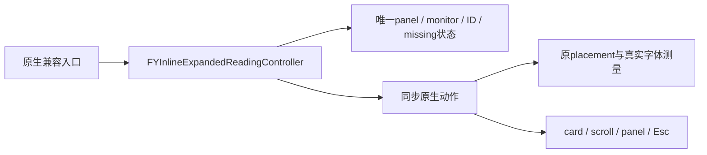

| 职责 | 状态拥有者 | 接口与检查 |
| --- | --- | --- |
| 展开尺寸、定位与滚动恢复 | Expanded四字段；engine/测量仍原owner | 原native helper/两同步协议；InlineExpandedReadingTests |
| 两帧缺失、关闭与弱回调 | Expanded强panel/monitor与copy ID/missing | 真实算法+合成native事实；资源释放/回调检查 |
| 原生兼容、当前帧恢复、监视器SDK | Overlay明确动作与既有display/overflow owner | InlineExpandedReadingHostTests同fixture原/新O0/O2；RuntimeOwnership |

66项最小依赖Native检查直接运行生产算法，无UI对象；合成边界只提供已测量placement/原生属性和动作事实，没有模拟定位/scroll/缺失/关闭算法。15项实际controller同fixture直接编译拆前/后O0/O2通过；6迁移方法正文仅typed source和SDK动作适配，152其它native方法逐字相同，Study/display/manual/drag/selection/binder/layout/measurement/renderer/OCR model整文件不变。首次fixture Footer漏原NSView isHidden导致运行异常，保留原例/命令/错误，仅补getter=isHidden，未改生产或断言。

接入后的66NativeExpanded+15实际host与154宿主/Trace在O0/O2通过，Module O2及原显示33/37/13 O2通过；6相关UI套件只编译。4受控变异（延后缺失关闭、callback强持有source、跳过monitor移除、appearance改立即显示）退出2，恢复66退出0。

拆前完整Debug186passed+2known_gap_reproduced，报告 `.build/debug/20261013T174002Z-37f7dd/summary.json`；专项/完整收尾、散列/白名单/变异/UI编译见本机 `.build/mac-decoupling/batch19-evidence.json`。UI只编译；原按钮粘连/520×170旧预期/会话启动条件保持，未安装/提交/推送/发布。后续overflow、全部页面/存储/设置诊断继续。最短手动追加：授权后compact展开/收起、Esc、滚动后改字号/缩放保持顶部位置、原文旁展开、两帧消失、换页清场、Option拖动与学习返回。

## 子批20：overflow候选、冻结列表与原生资源

2026-10-14，`FYInlineOverflowCoordinator` 在Foundation/CG维护原entries构造、两帧count采纳、chooser冻结、1.5s过期、单条直接展开、row索引/标题与缺失OCR item默认值。它唯一拥有原6项entries/count/panelCount/candidateCount/frames/emptySince；原strong entries保持mutable数组和元素别名，不为了快照一律copy。原entries构造发生在chooser guard之前，expanded短路前不提交新entries，expiry/clear仍不清candidateCount。

`FYInlineOverflowController` 继承policy，只拥有原strong entry panel/choice panel/key monitor三资源。原8个位置候选、可见panel/caption/当前原文与译文障碍、integral与.5 overlap门，entry测量/resize、compact弱click、>1 chooser的实际NSPanel/scroll/按钮/target/tag/样式与第一条滚动、弱Esc53以及remove→nil→panel close→nil保持。Root只dynamic兼容与目的明确的native动作，具体receiver/helper/Host target和getter顺序不变；两个新组件不保存source/host，不导入Root/privateSupport或使用通用转发。原FlippedDocumentView类声明和isFlipped正文原样独立，AppSupport兼容导入，其它共享正文不变。

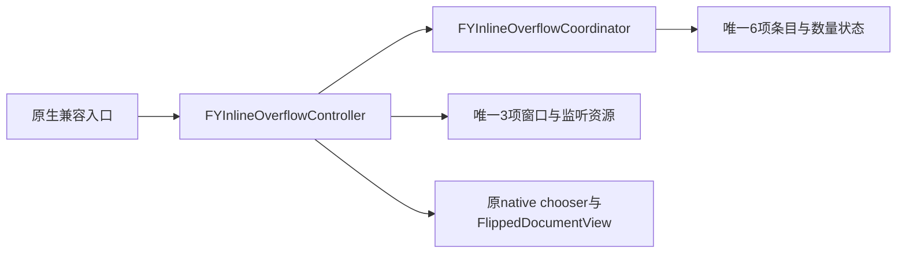

| 职责 | 状态拥有者 | 接口与检查 |
| --- | --- | --- |
| 条目构造、冻结、两帧数量与1.5s过期 | policy6 | 四组同步目的协议；InlineOverflowPolicyTests |
| row标题/索引、单条直接展开与关闭重入 | policy与原entry局部租约 | 真实policy/alias/读取顺序检查；无UI控件读入Core |
| 入口避让/测量/resize、选择窗口/monitor | native3与原engine/renderer | InlineOverflowNativeTests、原/新InlineOverflowHostTests；真实>1 UI只编译 |

34pure+25Native最小依赖事实检查在O0/O2通过；20项实际controller同fixture直接编译拆前/后O0/O2通过。合成的是原生属性/动作和已测量size，不模拟候选/计数/时间/row算法；真实字体另由canonical度量/模块套件验证。8原方法只有明确source/native动作与UI部分拆出，161其它native方法、原shared view与剩余Support以及其它display/expanded/drag/selection/layout/measurement/renderer/OCR组件不变。首真实host fixture漏旧captionPanel getter，原/新均出现相同异常；保留首fixture/双方编译与错误，仅补nil属性，不改生产或断言。

接入后的34policy+25Native+20真实host、159宿主/Trace在O0/O2通过，Module O2和原显示33/37/13 O2通过；6相关UI只编译。6变异（取消chooser冻结、首帧采纳count、提前expiry、entries改copy、callback强持有source、跳过monitor移除）目标退出2，恢复34+25退出0。

拆前完整Debug187passed+2known_gap_reproduced，报告 `.build/debug/20261013T180124Z-1a7d6d/summary.json`；专项/完整收尾、白名单散列/变异/UI编译见本机 `.build/mac-decoupling/batch20-evidence.json`。UI仅编译，原按钮粘连/520×170旧预期/会话启动条件保持，未安装/提交/推送/发布。后续全部页面/存储/设置诊断继续。最短手动追加：授权后入口N±1抖动、漏一帧保留/持续空1.5s收起、打开列表期间换帧冻结、第一条默认可见/滚动选择、同文异位row、Esc/关闭、展开时隐藏入口与换页清场。

## 子批21：原生卡片渲染、正文更新与外观

2026-10-14，`FYInlineCardRenderer` 独立原20项短/长card构造、raw layout映射、body font/style/lineHeight/minheight、实际placement测量、正文更新、compact/selected/body几何复用或重建、scroll上限、attributed/chrome/label shadow、颜色与面板外观刷新。组件无state、不保存source/host/缓存/资源；engine/fontProvider/height cache、Display/Expanded/Overflow/Drag/Study各自原owner不变，Overlay只有lazy renderer与明确兼容入口。

五组同步小协议限定engine、原样式/native UIFont与palette、view factories/helpers、Host selected/wire与当前panel集合。新组件不读设置控件、不导入Root/privateSupport，不采用通用转发；实际字体/paragraph/measuredBody/ceil/+4/Normalize与绘制primitive仍canonical。原getters/具体helper覆写/原Host选择与绑定顺序、compact nil/empty区别、标题/footer/tooltip/层级/卡内滚动、strict scrollability+.5、复用保留旧scroll、仅超界origin回移与selected badge排除/原alpha保持。Fold标签工厂仍同步强具体source捕获，原install函数不保存该block；异步click/hover/drag仍独立binder/weak owner。

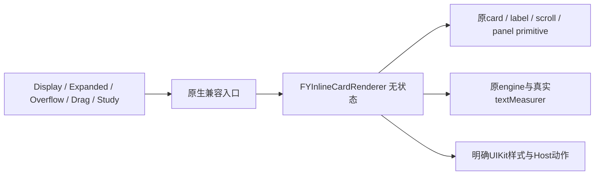

| 职责 | 状态拥有者 | 接口与检查 |
| --- | --- | --- |
| body/attributed/placement/font/style/height | renderer无state，原engine/measurer持有font/cache | 实际native measure；InlineCardRendererTests |
| 原card复用/重建、scroll/颜色、Host重绑 | 原各presentation owners | Native属性事实 + InlineCardRendererHostTests原/新同fixture |
| 实际NSPanel/view/scroll创建与绘制 | 原native SDK及现有renderer views | six相关UI与原事件套件仅编译 |

16最小依赖Native检查与20实际controller同fixture原/新O0/O2通过，不创建NSApplication/view/control/window，实际fonts/paragraph/attributes和measure函数运行。20正文只typed source/Host/palette适配，两raw尺寸/映射方法精确；185其它native方法、实际rendering primitives/measurement/calculator/其它业务组件整文件不变。

首次nil正文fixture误把height写死22；原primitive测量空字符串有字体行高，诊断证实font/style各读1、width80、height30、expectedReal30。诊断自身读空attributed index0越界，修改入口全局匹配两处又assert失败而继续旧诊断；全部源/输出留档，达到3失败后止损审计。限定完整nil调用观测后，将合同恢复为真实native ceil+4并保留>=22/empty/default/getter断言；新增相同nil场景到original/new共同host，在O0/O2证明拆前相同，不改生产/不将错误硬编码当产品要求。

接入后的16Renderer+20真实host与162宿主/Trace在O0/O2通过，Module O2和原显示33/37/13 O2通过；6相关UI只编译。6变异（忽略placement字体、移除selected复用门、取消scroll clamp、丢失alpha、重染selected badge、添加renderer重复state）退出2，恢复16退出0。

拆前完整Debug188passed+2known_gap_reproduced，报告 `.build/debug/20261013T183432Z-caa1a9/summary.json`；完整收尾/命令/白名单散列/变异/UI编译见本机 `.build/mac-decoupling/batch21-evidence.json`。UI仅编译，原按钮粘连/520×170旧预期/会话启动条件保持，未安装/提交/推送/发布。后续主窗口/实时/选词与其它页面/存储/设置诊断继续完整目标。最短手动追加：授权后普通/compact/expanded card、短长译文更新保留scroll、缩放/字号/字体、selected badge、hover/click/drag/展开学习与返回，核对原生正文/索引与视觉。

## 子批22：可见句子状态、选词与词汇操作

2026-10-14，`FYDisplayedSentenceState` 唯一拥有Main原displayedSentenceID/sourceText/translation三copy与version scalar；`FYWordSelectionController` 唯一拥有原vocabSelectionGeneration/savingVocabulary/vocabCompletionFromAI三字段。原12项sync/pin/follow/freeze、UTF16 selected文本/range、wordPick/form、bookmark与AI补全编排在Foundation运行；Main只dynamic兼容和明确native文字/range/form读写/Host动作。学习current/return、Reference generation/activeWord、coordinator/tokenizer/store仍原owner，新组件不存source/host/services或读UI控件/Rootprivate，不使用通用context/转发。

保持原text copy与ID/version/gen/range捕获，tokenizer/bookmark原强具体source任务租约，AI/follow原弱source。真实FYLearningCoordinator归属门比较当前文字、可见句/版本/代次或同句同词不同选区；迟到结果不填UI。bookmark回包仍先saving=NO，再generation不符只refreshList；不把取消scope合并或顺手改忙碌释放规则。Native helper每次读取原相同控件，原guard/getter/Trim/entry enums/提示文本/重入/Host调用顺序保持；没有更改选区/原字符索引、实际coordinator服务或数据库行为。

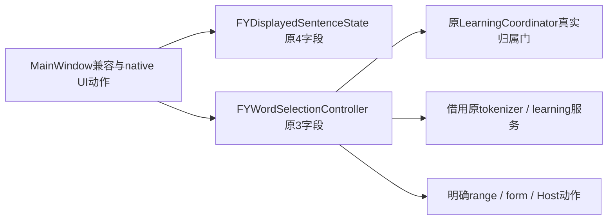

| 职责 | 状态拥有者 | 接口与检查 |
| --- | --- | --- |
| 可见句子ID/version/source/translation | Display4 | 原copy/scalar声明；copy/兼容/单owner |
| freeze/pin/follow/tokenizer与选区 | Word3，Reference与Learning仍原owner | five目的协议；WordSelectionControllerTests held callback/真实gate |
| bookmark/AI form与迟到结果 | Word原generation/busy/AI，服务自身任务scope | 原strong/weak/capture顺序；同词不同range/late/释放验证 |
| native读取/写入与主窗口返回 | Main及原native资源 | WordSelectionHostTests原/新同fixture；真实UI仅编译 |

37项Foundation最小依赖实际算法与22项实际MainWindow共同fixture在O0/O2通过，无AppKit最小链接/真实DB/API/设备/UI对象；服务事实只保存与交付callback，不模拟被测归属算法。12原方法仅明确source/native动作，86其它Main方法（包含live refresh/page构造/chat/resize）逐字相同，原app bridges/learning gates/tokenizer/store及其它presentation组件不变。

首验证分别暴露最小链接漏canonical OCR normalize source、Area事实少NSView isHidden getter、new RW reference协议与旧RW extension重复声明。首源/错误/入口全部保存，只补TextModels.m/nil界面事实getter、删除两重复extension声明（原Reference getter/setter/owner不变）。共同host旧token场景初始range显式0/旧回包1，让拒绝可观察，保留原行为断言；生产算法不改。

接入后的37选词/学习+22实际Main与167宿主/Trace在O0/O2通过，Module O2通过；MainWindowResize/PreviewLayout/InlineLearningAcceptance/OverlayOwnership/InlineFoldRead/InlineTranslationPipeline六UI只编译。7变异（ID不copy、tokenizer/bookmark强lease改weak、AI/follow改strong、stale不释放原busy、绕过AI range gate、busy允许第二收藏）退出2，恢复37退出0。

拆前完整Debug189passed+2known_gap_reproduced，报告 `.build/debug/20261013T190004Z-eb5a9f/summary.json`；专项/完整收尾、命令/白名单散列/negative/UI编译见本机 `.build/mac-decoupling/batch22-evidence.json`。真实UI仅编译，原按钮粘连/520×170旧预期/会话启动条件保持，未安装/提交/推送/发布。后续live reading/native page/list与Main导航/layout、其它页面/数据库/设置诊断继续完整目标。最短手动追加：授权后同句重复词两处点击/拖选、分词/AI中切句与更改选区、手动改form、收藏中换句、固定/跟随/学习返回，核对原文本/索引/提示与草稿；MainWindowResize真实production规则另跑。

## 子批23：实时阅读刷新与原生文字展示

2026-10-14，`FYLiveReadingCoordinator` 运行原刷新与等级读取；`FYLiveReadingRenderer` 运行原文字样式、实际栏宽测高、对白与固定状态展示。两者无实例状态，同步借用明确接收者，不保存source/host/view/cache。Display4、Word3、Learning与Reference服务和native视图仍只有原拥有者。Main保留兼容入口与明确原生文字/constraint/字体动作；另外124个Main方法和原桥接/学习/贴译组件正文保持。

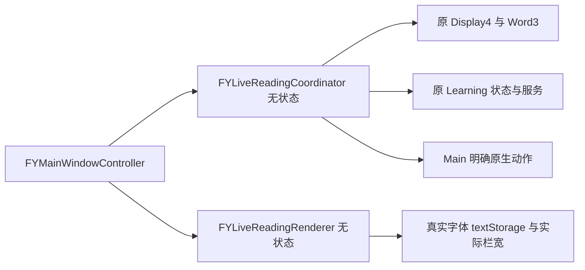

| 职责 | 唯一状态拥有者 | 接口与检查 |
| --- | --- | --- |
| 句子刷新、空状态、分析清理与hover门 | 原Display4/Word3/Learning/Reference；Core无状态 | state/services/text/native/peer目的协议；LiveReadingCoordinatorTests18 |
| 文字样式、speaker匹配和真实高度 | Main原native视图；Renderer无状态 | native font/view目的协议；LiveReadingRendererTests18 |
| Main兼容与原UI表达式读取顺序 | Main与原Host | LiveReadingHostTests17，同fixture原/新O0/O2；真实UI仅编译 |

刷新次序保持History→changed清理/选词generation→Display4→source/grammar文字门→空状态与156/104→译文/等待提示→layout→实际height→dialogue→grammar提示→Host状态→hover门。原textStorage接收者先读取的完整原生表达式留在Main动作中，未提前缓存字体、状态或控件。字体19/13、paragraph0/5、中文speaker只在原文标签相同时改变属性；不增删字符。测量使用实际clip宽减两侧padding、真实attributed boundingRect、原options与ceil+12、高度42..190。

接入后18+18+17实时阅读检查、170宿主归属与Trace在O0/O2通过，Module O2通过；6个独立副本变异（忽略version/source变化/悬停恢复、改变空态最小高度、无匹配speaker也改样式、改文字高度偏移）退出2，恢复18+18退出0。MainWindowResize/PreviewLayout/InlineLearningAcceptance/OverlayOwnership/InlineFoldRead/InlineTranslationPipeline六UI只编译。最早O0 native事实元数据早于textStorage事实调整，首次negative入口在4项core变异失败后拒绝native散列；原记录保存，最终O0 minimum与O2反向验证用当前夹具重跑通过，不修改生产或行为断言。

`bash scripts/run-live-reading-tests.sh` 纳入统一Debug，18 Foundation与18原生检查不建UI，17实际Main fixture对照拆前/后；发布优化使用同一实现。拆前完整Debug190passed+2known_gap_reproduced，报告 `.build/debug/20261013T192509Z-ae2826/summary.json`；最终收尾命令、反向验证、白名单散列与Replay对照在本机 `.build/mac-decoupling/batch23-evidence.json`。既有缺口保留，源码未安装或发布。后续native实时页/列表与主窗口导航布局，以及其它页面、存储、设置和诊断继续。

授权后最短手动验收：实时页切换有文/空状态、固定/跟随和分析忙碌；拖宽/窄窗口，核对原文选择索引与阅读高度、中文speaker样式；手动展开/收起AI并切页，核对1100/720与原聊天/草稿。当前仅编译相关UI套件，不能据原生事实宣布桌面通过。

## 子批24：实时页界面译文列表

2026-10-14，`FYInlineTranslationListCoordinator` 唯一拥有原copy signature/snapshots两个字段，执行原筛选、刷新和行选择；`FYInlineTranslationListRenderer` 无状态，执行原220pt card及row构造。Main动态兼容并保留原stack/card/count资源，原Display4/Word3/阅读与学习owner不重复。另145个Main方法和原bridges/learning/inline正文保持。

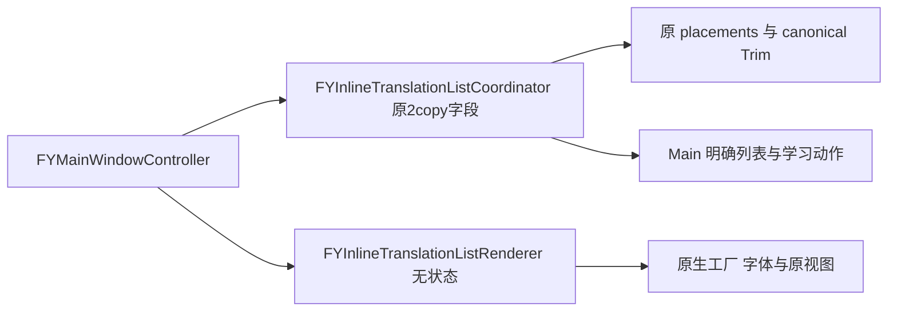

| 职责 | 唯一拥有者 | 接口与检查 |
| --- | --- | --- |
| 筛选、签名/空态/相同门与快照状态 | Core两个原copy字段 | input/state/native/learning目的协议；CoordinatorTests26 |
| card/row/font/line/selector构造 | Main原视图；Native无状态 | views/factories协议；RendererTests24 |
| 主窗口兼容、学习入口与快照 | 原Main/Study/Learning | HostTests25，实际原/新Main同fixtureO0/O2 |

只收录Trim非空的Unplaceable/Compact，原顺序与原始译文签名保留。card hidden仍在empty/same门前，旧空signature不重复清场，相同signature不重建或替换snapshots；source/reason/geometry不进入signature。原signature copy→clear→count→row add/pin→snapshot factory→最终array copy顺序保持。Native借用原局部snapshot数组，workspace工厂后才读取count作为tag；按钮读取tag一次并打开当前保存快照，不改用最新帧。原字体13/15、行数3/6、spacing6、Host target/selector和空reason保持。浮层Overflow的冻结策略仍独立，不能混入此列表。

接入后的26pure+24native+25实际Main、174宿主归属与Trace在O0/O2通过，Module O2通过；7个独立副本变异（signature或snapshots不copy、相同签名重建、遗漏Compact、snapshot提前于row、改native行数上限、偏移tag）退出2，恢复26+24退出0。MainWindowResize/PreviewLayout/InlineLearningAcceptance/OverlayOwnership/InlineFoldRead/InlineTranslationPipeline六UI只编译。

`bash scripts/run-inline-translation-list-tests.sh` 纳入统一Debug。最小Foundation/CG链接同一生产算法与canonical Trim/模型/OCR normalize定义；native只合成UI工厂与属性、使用实际字体。真实Main仅覆盖未迁移的scroll工厂返回事实；三个列表算法和Main状态/Host桥接完整执行。真正scroll/鼠标/窗口只编译另验。

首minimum未链接原normalize定义及Native草稿count文字动作与NSTextField属性setter同名，证据保留；只补canonical依赖与把新动作改名updateInlineTranslationListCountText，原属性setter/算法/断言保持。原同fixture25通过而新草稿失败，修正后双方O0/O2通过。parity行方法尾换行差异只修验证器，不改正文。拆前完整Debug191passed+2known_gap_reproduced，报告 `.build/debug/20261013T200253Z-08b0a7/summary.json`；完整收尾、命令/散列/negative/Replay见本机 `.build/mac-decoupling/batch24-evidence.json`。未安装/提交/推送/发布，后续native实时页与Main布局及其它页面/存储/设置诊断继续。

授权后最短验收：界面贴译落入Compact/Unplaceable→核对列表顺序和查看按钮→输入换帧后打开已有行→相同signature刷新/空场景清场→学习返回；再跑真实MainWindowResize/PreviewLayout，保持手动AI1100/720和原chat/草稿。

## 子批25：原生实时页构造与选词事件接线

2026-10-14，完整原`makeLivePage`在独立`FYLivePageBuilder`中构造；Main只lazy builder/兼容入口与目标/外部词汇label适配。Builder无任何字段，不保存receiver/view/cache/token；Main原native视图、Word3/Display4/List2、阅读与学习服务各原owner。另159个Main方法、所有原native primitives/Theme/其它业务正文保持。新builder只import AppKit与FYLearningViews，preview/reading/word/factory/selection目的协议不暴露Root私有业务。

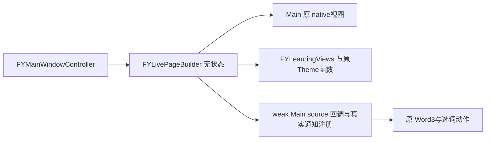

| 职责 | 唯一拥有者 | 接口与检查 |
| --- | --- | --- |
| preview/translation/source/form/list/grammar原生构造 | 原Main视图；Builder无字段 | 分组native目的协议；真实图由LivePageBuilderUITests原/新仅编译 |
| will/did/click与selection通知 | 原center拥有注册，callback弱引用Main；Word3仍业务owner | LivePageBuilderTests20，真实center/filter/background→mainQueue与weak lease |
| 控制器兼容、回调state写入 | 原Main/Word3 | HostTests19，实际Main与原body精确摘录同fixtureO0/O2；159其它方法精确 |

原preview1..480/preferred500、UIFont13/12/14/11/15bold/source19、source height48/min104、spacing0、hugging999、spacer>=0/equal0 priority1和所有字体/颜色/选择属性/selector/Host target/视图顺序沿用。没有外层固定宽锁或自动sidebar显隐，main导航/layout/1100/720/chat与draft代码未改。Native构造原getter和factory顺序保持，外部vocabularyStatusLabel仍由原Host owner写入。

绑定仍weak具体Main source，不是builder；三个callback及同一defaultCenter、原text object、mainQueue、tracking guard→三字段清空→AI NO→generation++→update的次序保持。Native wire返回原SDK token供隔离测试移除合成注册，生产makePage继续忽略原center拥有的token，不新增持久资源/修改observer生命周期。控制器释放后的held callback安全，builder释放不影响receiver。

接入后的20native+19实际Main、177宿主归属与Trace在O0/O2通过，Module O2通过；6个副本变异（strong source捕获、跳过tracking guard、取消object过滤、generation不加、移除mainQueue、漏meaning清空）退出2，恢复20退出0。原六UI加LivePageBuilderUITests共七UI、专用原/新图fixture在O0/O2均只编译。旧列表fact按原实现补接口声明，13 inherited protocol warnings消除；原全部实现/断言字节保持。

`bash scripts/run-live-page-builder-tests.sh` 纳入统一Debug。最小独立native运行20检查；host19执行原source的精确选择body摘录与实际新Main，未另写模拟算法；该证据仅证明接线，不证明完整原生页面布局。专用LivePageBuilderUITests原/新及原六UI只编译，未运行。旧列表fact父类只补已有工厂方法声明，函数正文与行为断言未改。拆前完整Debug192passed+2known_gap_reproduced，报告 `.build/debug/20261013T203004Z-8bb4d5/summary.json`；完整收尾/命令/白名单散列/negative/Replay见本机 `.build/mac-decoupling/batch25-evidence.json`。源码未安装/提交/推送/发布，后续Main导航布局及其它全部页面/存储/设置诊断继续。

最短授权后验收：跑LivePageBuilderUITests/PreviewLayout/MainWindowResize实际生产图；核对实时空卡/有文、选词开始/完成/点击、原生中文复制字体、输入换帧后的学习返回、实际缩放与手动AI/原chat/草稿。现有520×170两条旧期望不为本次重构改变。

## 子批26：主窗口公有依赖与尺寸驱动画布

2026-10-14，Main公有头用AppKit、目的组件头和StudyChat视图类型，移除FYAppSupport大头；clang实际依赖清单不再含Root私有支持、capture、OCR engine、windowtracking/geometry、settings/service、diagnostics。Main.m显式保留确实使用的旧native shell/OCR兼容helper，不改变其算法。Main当前职责是shell/nav/layout及显式兼容入口，163个方法正文全部精确。

原`FYFrameDrivenContentView`独立为同名native类，保留三个strong资源和原constructor/setFrameSize/sync/layout。原三赋值仅从self改为同步借用source的Native geometry function，控件/画布仍实际UIKit；不增加owner、缓存、bounds快照或外框固定宽锁。AppSupport仅import该类独立头、删除同一旧class implementation；其它正文保持。

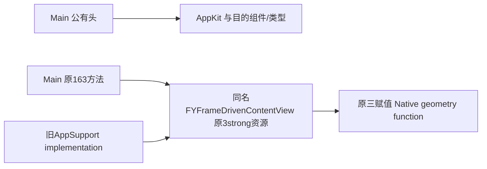

| 职责 | 唯一拥有者 | 接口与检查 |
| --- | --- | --- |
| Main shell/nav/layout/selectedPage/manualAI | Main原state与views；其它组件原owner | MainWindowBoundaryTests18，实际原/新同fixtureO0/O2 |
| native frame canvas/constraints | 同名FrameDriven原3strong资源 | geometry目的协议/原三表达式；FrameDrivenGeometryTests10原/新同fixture |
| 公有依赖 | Main目的头；Support仅implementation | clang-MM真实清单，无Root/capture/OCRengine/settings/diagnostic依赖 |

主导航仍indexguard→mount→selectedPage→chat→appearance preview→header→priority249→visibility→history/vocab→选中状态；侧栏只manualwantsVisible，1100/720、-510/-190、同chat/session/draft保持；resize仍window identity→chat→layout→真实reading height。这里无窗口nav事实使用已mounted页面，运行canonical selected-page primitive；真实unmounted mount和尺寸约束由MainWindowResize/PreviewLayout等UI仅编译，不能通过人为回调或facts宣布生产窗口体验通过。

接入后的10geometry+18实际Main与178宿主/Trace在O0/O2通过，Module O2通过；6个副本变异（width改height、漏canvas写入、冻结bounds、sidebar使用当前hidden替代manual意图、接受其它window resize、appearance也强制隐藏preview）退出2，恢复10+18退出0；七UI只编译。

`bash scripts/run-main-window-boundary-tests.sh` 纳入统一Debug。新10 native几何最小链接与原body精确对照，18真实Main同fixture在O0/O2通过；frame构造/super/layout实际UIKit未执行。旧源码native赋值先读取RHS bounds再取目标getter，测试初次误写顺序的错误/诊断保留，只锁定旧实测序列。Main fact初次把NSLayoutPriority误写CGFloat，旧/新都priority249失败；本机SDK typedef float与原诊断5.59e-315证明ABI错，只补fact原签名，保留原全部行为断言。

拆前完整Debug193passed+2known_gap_reproduced，报告 `.build/debug/20261013T210043Z-ac4119/summary.json`；完整收尾、命令/散列、negative/UI/Replay在本机 `.build/mac-decoupling/batch26-evidence.json`。源码未安装/提交/推送/发布。Main已收敛为nav/layout与compatibility，后续进入语法、聊天/quick/return、收藏/复习、词典/hover，继续数据库和设置诊断全目标。

最短授权后验收：真实MainWindowResize/PreviewLayout/LivePageBuilderUITests，不人工调用resize解除约束；拖宽/窄与松手保持、切页、手动AI1100/720、原chat/session/draft、学习返回与原文选择。原520×170两条旧期望与其它已知缺口继续保持记录。

## 子批27：语法分析、追问、展开解释与深度复核

2026-10-14，`FYGrammarInteractionCoordinator` 在Foundation运行原七个业务方法：初次分析、example/simple followup、question、action state/config、item选择、expand、review；唯一拥有原analysis generation/followup generation/busy/error/currentAnalysis/mainAction/quickAction七字段。native controller动态兼容保留原视图、scroll和render动作；quick句子/结果仍原owner，两ActionState及analyzer/map/pending/generation仍各原owner，未复制缓存或合并取消scope。

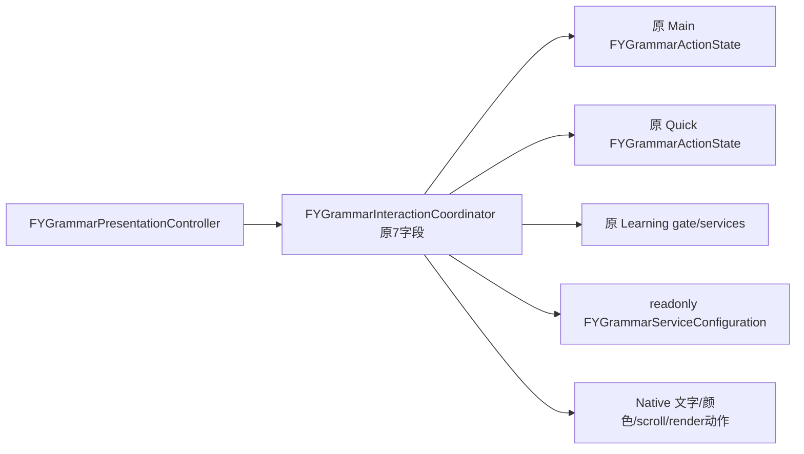

| 职责 | 唯一拥有者 | 接口与检查 |
| --- | --- | --- |
| initial/followup request与当前结果/busy/error | Core原7字段；Learning仍原服务 | state/sentence/services/native/peer目的协议；CoordinatorTests51 |
| expanded/review main和quick | 原两个ActionState/analyzer/caches | 持有回包、指针/generation/identity/cancel与独立transport checks |
| 配置读取与UIKit更新 | Native原控件；readonly DTO保留原strong aliases | HostTests44原/新同fixture O0/O2，真实UI只compile |

初次分析保持syncDisplayed→空ID返回→clear/pin/status→ID/version/gen→page0/busy→service；回包先current request gate才busyNO，error保留原文字/颜色/提示，result再归属验证。followup保留item指针/句子/version/generation和原两个错误文案。所有completion对具体native source与原state/item/existing局部的strong任务租约不变，新Core不保存idle source/host/service。

配置native读取保持Trim学习model，非空不读fallback；为空采用原raw fallback，再base/key。readonly三字段container只强持原局部字符串别名，不提前copy或归一化。context仍六项ID/version/source/translation/base/model且排除Key，另按Key比较reset；analyzer原copy setter、首次transport缺失时采用对应surface来源、已绑定不替换、reset只原surface的cancelAll保持。

展开保持pending去重、cached collapse/reopen、Trim只作empty资格而答案原样存储、两个generation/state指针门后移除pending。复核保持既有结果身份/stronglease、busy/适用guard、reviewStatus、nativepreservingPosition更新的执行时点、finish门后reviewingNO、error保留结果/success计算added并写对应owner。native scroll keeper全部原文，仍在更新时读before/after、layout与actual frame clamp，未搬入假算法。

接入后的51pure+44实际native、182宿主归属和Trace在O0/O2通过，Module O2通过；8个副本变异（initial强lease改weak、门前清busy、Key改变不reset、transport总替换、pending允许重复、移除expanded状态指针门、复核失败丢旧结果、配置别名提前copy）退出2，恢复51退出0。原七UI再加GrammarActionsAppTests/LearningAppTests共九UI只编译。

`bash scripts/run-grammar-interaction-tests.sh` 纳入统一Debug。51最小Foundation与44实际原/新native controller同fixtureO0/O2通过；native field/peer/render/scroll更新是明确边界事实，未运行真实UI。118其它native方法及原canonical gates/ActionState/analyzers/其它所有业务正文保持。最初harness复制源码路径与source-list前缀不匹配，未执行算法，原错误留档，仅纠正路径。首45/40成功版本保存，最终fixture增加transport/配置getter/追问复核leases且保留所有旧断言。

拆前完整Debug194passed+2known_gap_reproduced，报告 `.build/debug/20261013T212100Z-5d7559/summary.json`；完整收尾、命令/散列、negative/UI/Replay在本机 `.build/mac-decoupling/batch27-evidence.json`。未安装/提交/推送/发布，native Grammar renderer/依赖及其余页面/数据库/设置诊断继续全目标。最短授权后验收：GrammarActionsAppTests实际main/quick展开/收起/重试、复核失败保留旧结果、等待时滚动后回包保持位置；切句/切项/模型服务配置改变后的旧回包与学习返回/原chat草稿，服务只用合成边界。

## 子批28：语法滚动、详情刷新与公有依赖

2026-10-14，四个原Native算法独立到无状态`FYGrammarScrollRenderer`：结构图位置读取/恢复、quick详情替换、复核结果更新时保存位置。原controller只明确四个门面；视图、Core七字段和main/quick ActionState仍由原拥有者保存，没有新增异步任务、缓存或observer。143个其它native方法正文精确不变。

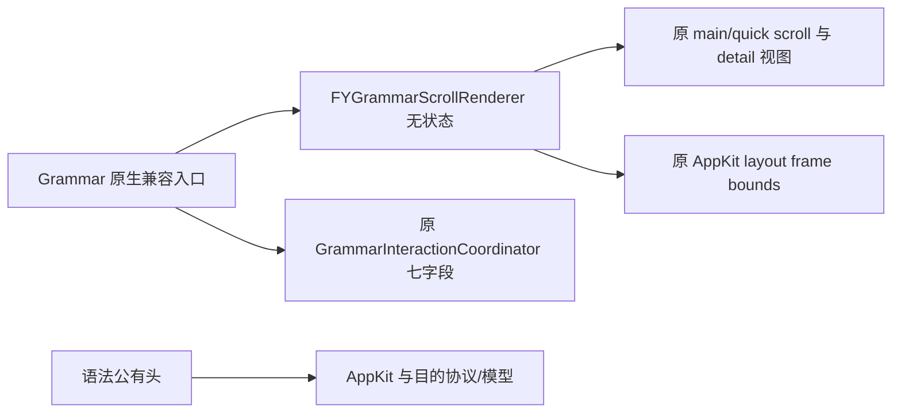

| 职责 | 唯一拥有者 | 接口与检查 |
| --- | --- | --- |
| horizontal offset与恢复 | 原main/quick scroll；renderer无字段 | Native Source明确视图接口；RendererTests38 |
| quick detail替换与复核位置保持 | 原detail/panel/stack/scroll | HostTests37，实际原/新同fixture O0/O2 |
| 头文件依赖 | AppKit、业务与scroll目的协议 | clang-MM实际清单排除Root/support/capture/OCR/settings/diagnostics |

保留offset<=0.5在读source前返回、document→scroll布局、真实宽度clamp与原y。quick详情仍remove-arranged/remove-view→原item工厂→同setter→add→panel layout→实际高度clamp/scroll/reflect。复核仍读取更新时before/position→updates恰一次→重新获取after（quick可换整个document）→nil门→window/super/document布局→实际frame/bounds两轴clamp，不采用请求开始位置或伪造字宽。

`bash scripts/run-grammar-scroll-tests.sh`纳入统一Debug。独立38与实际拆前/后37在O0/O2通过；只合成SDK属性/动作，不创建应用、view、control或window，不读取真实Key/数据库/服务。五个副本变异（漏结构图宽度clamp、复核沿用旧scroll、nil-before跳过updates、漏detail布局、threshold提前读取source）退出2，恢复38退出0。Runtime182/Trace O0/O2、Module O2通过。GrammarActionsAppTests、LearningAppTests、QuickSentenceAnalysisTests、PresentationOwnershipTests四UI只编译。

首fixture漏__block及新协议RW属性/原extension冲突导致clang失败，首产物保留；备份路径碰撞使第一次修正未应用，同错误留档后校正脚本，只修改测试声明和新协议getter/setter声明，不改原算法/属性/断言。首次negative误复制PCH绝对缓存路径，编译即失败；记录保留，只在独立变异副本排除/重建Clang缓存。实际算法对照与变异均随后通过。

拆前基线复用紧邻的子批27完整Debug195passed+2known_gap_reproduced，报告`.build/debug/20261013T213657Z-c85365/summary.json`；595个current散列逐一相同，并另存本批快照/状态和manifest/diff。收尾完整Debug、154Replay逐项比对、命令/散列/白名单见本机`.build/mac-decoupling/batch28-evidence.json`。没有安装/提交/推送/发布。原已知缺口不变，真实字体/滚动/窗口体验只列待验收。

授权后最短验收：在main与quick结构图横向滚动后换选中项；展开/收起解释与切换详情；复核等待时继续滚动，成功重建quick文档或失败后核对当前位置与合法范围。运行上述四真实UI套件；切句与学习返回继续保留原身份、原chat/草稿。

后续继续Grammar其余渲染/clear/tab/构造；StudyChat/context/quick/return、Collection/复习、Reference/hover/dictionary、数据库与设置诊断全范围尚未完成。

## 子批29：语法详情、局部选择与富文本高亮

2026-10-14，六个原Native方法收敛为无状态`FYGrammarDetailRenderer`：详情与短字段/用法/来源、三种高亮入口、局部选择、main/quick展开与复核控件渲染。controller只有六个明确门面，141个其它方法正文保持。原Core七字段、两ActionState、所选index和全部view没有移动或复制；renderer无字段、不保存source、没有新任务或取消。

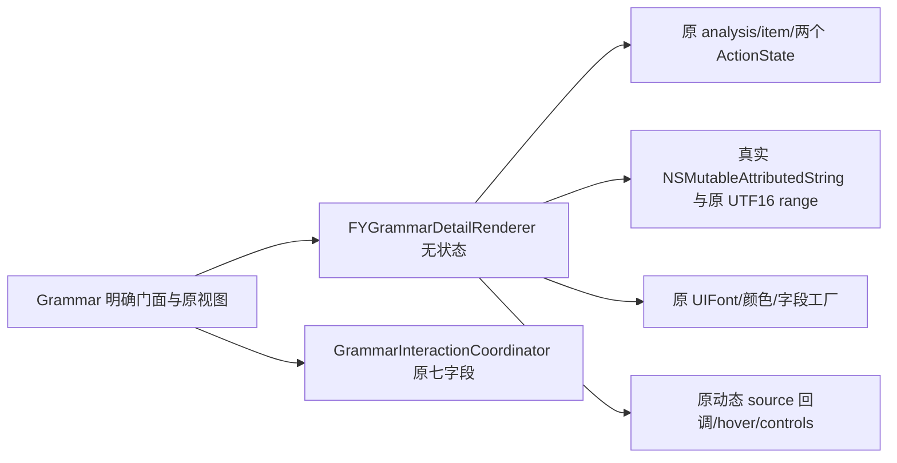

| 职责 | 唯一拥有者 | 接口与检查 |
| --- | --- | --- |
| 详情/字段/用法/来源/收藏按钮 | 原controller视图与分析；renderer无字段 | model/views/native actions目的协议；RendererTests39 |
| 原文高亮与局部选中展示 | 原textStorage、index、buttons | 真实富文本/canonical range gate；HostTests37原/新同fixtureO0/O2 |
| main/quick展开与复核控件 | 两原ActionState与原控件 | 原业务取item/config边界不改；独立pending/review/busy/status |

高亮保持nil view立即返回，其它路径先清全部旧background，再判断color/analysis/当前身份/版本，最后用canonical适用项和原item指针标记selected accent alpha0.23。字符、emoji UTF16、换行、选区和非background属性不变；两个source视图通过原facade动态调用后才刷新hover。局部selection只更新现有buttons/detail/highlight，不重建结构图；无效index跳过detail仍刷新高亮。

详情保持原name/等级待核实/meaning缺省、connection→register字段、无字段时待补充、实际UIFont13、spacing2、104pt约束/三行、usage→Trim例句→来源说明顺序与四行上限。bookmark/title/tag与来源URL保持。动作控件仍使用各自main/quick状态，pending去重展示、cached解释原样不Trim、error重试、reviewing/initial busy/适用门和quick status显隐不变。

`bash scripts/run-grammar-detail-tests.sh`接入统一Debug。39最小Native与37实际原/新controller同fixtureO0/O2通过；最小链接不含Root、app support、采集/OCR引擎、设置与诊断组件。只合成控件/约束/工厂和模型输入；真实富文本/gates/fonts/colors运行，不复制被测渲染算法。8变异（漏清旧background、gate提前于清场、alpha变化、字段宽度变化、漏选中detail、忽略pending、quick错误使用main busy、提前Trim解释）退出2，恢复39退出0。Runtime182/Trace O2与Module O2通过，O0由本批最终完整Debug核验。GrammarActionsAppTests/LearningAppTests/QuickSentenceAnalysisTests/PresentationOwnershipTests四UI仅编译。

拆前复用紧邻子批28完整Debug196passed+2known_gap_reproduced，报告`.build/debug/20261013T215128Z-496976/summary.json`，全部601散列一致并保存独立快照/status、manifest/diff。收尾完整Debug、154Replay逐项比对、命令/散列/白名单见本机`.build/mac-decoupling/batch29-evidence.json`。未安装/提交/推送/发布；原已知缺口保留，真实控件/鼠标/文字选择/滚动体验不由边界事实证明。

授权后最短验收：主窗口/quick切选中语法与结构节点，核对两原文视图高亮和原生选择/复制；展开/收起/错误重试与复核等待时阅读；核对字段/来源/收藏状态、切句后旧高亮清除、学习返回及聊天草稿。其它Grammar results/busy/clear/tab/native构造与所有页面/存储/设置诊断仍继续。

## 子批30：语法结果、清场、页签与追问显示

2026-10-14，五个原Native方法独立到无状态`FYGrammarResultsRenderer`：busy、结果刷新、清场、页签和追问折叠。controller仅明确五个门面；142个其它方法正文精确保持。原Core七字段、两个ActionState、view、index与tab仍原owner，通过目的Source原访问器读写，没有新增状态、任务、观察或取消范围。

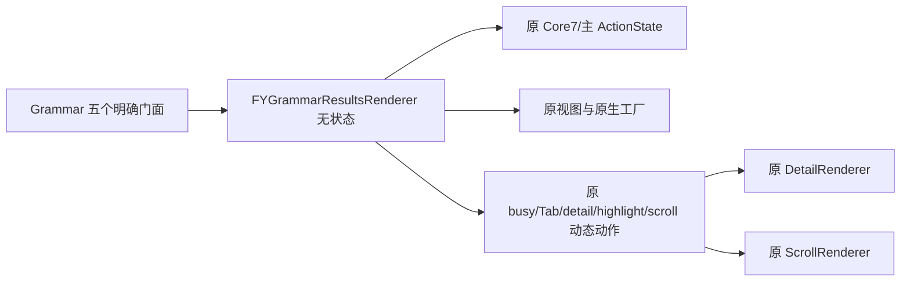

| 职责 | 唯一拥有者 | 接口与检查 |
| --- | --- | --- |
| busy/result/clear与回包失效 | 原Core七字段；主ActionState取消范围不变 | model读写/native views/actions目的协议；RendererTests96 |
| 空态、页签、followup显隐 | 原controller视图/index/tab | HostTests93，实际原/新同fixture O0/O2 |
| 结构图/行工厂与滚动调用 | 原native factory与ScrollRenderer | fixture仅记录边界输入/输出，真实图只UI编译 |

busy保持先写原状态，再title/enable/status和Tab动态回调。结果刷新强持原局部result，先清error与更新controls，再层次/等级/当前structure offset/clear/工厂/跟随控件/generation；空分支原文案与early return保持，非空原index、行14pt/5pt圆角/tag/tooltip/truncation/等宽约束与detail→highlight→Tab→offset恢复顺序保持。回调改写Core结果后，结构工厂仍收到刷新开头捕获的原result，不提前或重新读取。

clear只reset主grammarActions，保留quick的缓存/expanded/reviewing/generation与任务；两request generations、两次currentAnalysis=nil以及setBusy:NO触发Tab重入的位置保持。原当前结果第一次nil后被回调换入新result时，Tab仍在原时点看到新result，随后第二次nil清掉它。没有为了简化去重这两次写入。页签保持三个title/13pt字体/leaf underline、busy→无句→error→空grammar优先级；followup继续读原hidden并更新title/state，缺少视图/按钮安全。

`bash scripts/run-grammar-results-tests.sh`接入统一Debug。96最小Native与93实际原/新controller同fixtureO0/O2通过，真实Core字段、ActionState reset/cancel、canonical身份门、原字体/颜色执行；控件/约束、结构图工厂和其它已独立组件动作是边界事实，不复制被测五算法。Runtime182/Trace O2与Module O2通过，O0由最终完整Debug核验。八受控变异（busy延后、followup代次不增、error回调后才读result、跳过state reset、漏第二次nil、漏offset恢复、去busy优先级、反转followup hidden）退出2，恢复96退出0。四UI：GrammarActionsAppTests/LearningAppTests/QuickSentenceAnalysisTests/PresentationOwnershipTests只编译。

最初95/92夹具在O0/O2都通过，但反向验证中error回调后读取result仍退出0：弱引用活性不足以证明读取时点。首全部源码/fixture/证据和未检出变异保存，保留全部旧断言，只在结构工厂增加原result身份断言后最终96/93与所有八变异重新通过。生产算法没有因此修改。

拆前复用紧邻子批29完整Debug197passed+2known_gap_reproduced，报告`.build/debug/20261013T220712Z-144e94/summary.json`，607散列逐一一致，并保存本批快照/status与manifest/diff。完整收尾、154Replay逐项比对、命令/白名单/散列见本机`.build/mac-decoupling/batch30-evidence.json`。没有安装/提交/推送/发布；所有原已知缺口保留。

授权后最短验收：主语法页无句/分析中/失败/零条目/有结果切换三个页签；等待时继续阅读与改变选项，再清场/切句，核对旧回包与quick独立缓存；行列表/结构图/高亮/水平scroll位置保持，学习返回与chat草稿不变。真实结构图构造、窗口/鼠标/字体布局未由边界事实代替。

随后继续Grammar结构图/info/完整native card builder，其余所有页面/存储/设置诊断目标仍未完成。

## 子批31：完整语法卡、结构图与信息单元构造

2026-10-14，三个完整原Native方法迁至无状态`FYGrammarPageBuilder`：`structureViewForAnalysis:source:quick:`、`grammarInfoCellWithLabel:value:`、`makeIntegratedGrammarCard`。controller只三个明确门面及`grammarControlTarget`一次原weak Host读取适配；144个其它原方法正文精确。Builder不存view/target/source/cache/state，不增加观察、任务或取消。

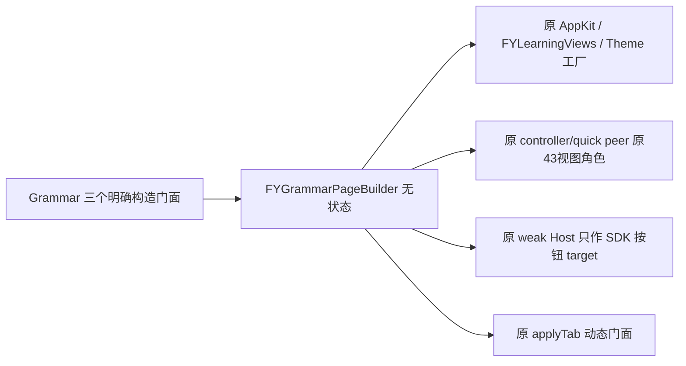

| 职责 | 唯一拥有者 | 接口与检查 |
| --- | --- | --- |
| 完整card/info/main-quick structure构造 | 原controller/peer持有view/arrays/scroll/index/tab；Builder零字段 | page views/factories目的协议；完整UI原/新仅编译 |
| structure输入与冷启动 | 原模型、source与原校验，无新缓存 | BuilderTests65；实际原64/新65同fixture O0/O2 |
| 按钮目标 | 原weak Host；adapter只读取一次 | 新API额外结构断言与错误target受控变异；实际SDK按钮目标待UI执行 |

三个完整正文只将self改typed receiver，并把原host目标读取改为明确native适配；原参数/模型、source字符/UTF16范围、parts数量/顺序/边界/substring验证、首相交grammar tag、main/quick资源setter顺序、字号/颜色/约束/flow/scroll尺寸均沿用。原数组copy与视图strong由同一既有setter保持，默认selectedTab=1仍先于applyTab，隐藏followup继续不挂入层次，没有新增视觉设计。

`bash scripts/run-grammar-page-builder-tests.sh`纳入统一Debug。65独立冷/guard检查、实际旧64/新65同fixture在O0/O2通过，所有旧行为断言保持；新增接口额外检查只存在于新版本。无效结构在任何factory之前返回，main/quick按钮数组与scroll身份保留。四个合法main/quick/emoji子进程仅执行生产验证，到第一个native factory明确标记并退出43；父进程核对预定marker/状态，未运行后续UI构造，也不把退出43当作整图通过。最小仅链接Builder、模型与FYLearningViews，未引入Root/private/support/采集/OCRengine/设置诊断。

六变异（去count门、count过严、去顺序门、接受text mismatch、Builder新增重复字段、native target改nil）均退出2；恢复独立和host均65退出0。Runtime182/Trace O2和Module O2通过，O0由最终完整Debug核验。完整新`GrammarPageBuilderUITests`已登记统一UI清单，验收入口继续从同一清单读取；原/新专用图fixture在O0/O2均COMPILED_ONLY，canonical新图加GrammarActions/LearningApp/QuickSentenceAnalysis/PresentationOwnership五UI只编译。有效card/info/graph的真实运行、尺寸、点击、鼠标、字体与选择体验均未由冷/guard/factory入口检查证明。

首新增协议漏uiAccent造成新版本clang失败、原guard63通过；首源码/日志留档，只补新接口/测试声明，不改构造算法/断言。首完整图UI编译复制隔离header却从原目录编译隔离m，产生duplicate interface；证据保留，改为同一个私有tests副本编译，所有源码/夹具正文不变。首guard版本保留，最终增加旧Host身份与新增target单次读取验证，没有删改旧断言。

拆前复用子批30完整Debug198passed+2known_gap_reproduced，报告`.build/debug/20261013T222638Z-5cb868/summary.json`；613散列逐一一致，独立快照/status/manifest/diff齐全。完整收尾、154Replay逐项比对、命令/散列/白名单见本机`.build/mac-decoupling/batch31-evidence.json`。未安装/提交/推送/发布，全部原已知缺口继续记录。

授权后最短验收：执行GrammarPageBuilderUITests与相关真实UI，核对三个页签/默认项、card/info样式、hidden followup未挂入、main/quick结构节点tag/target/原文与两套scroll身份；再核对缩放、语法选择/高亮/复制、学习返回/聊天草稿。随后继续Grammar bookmark业务边界及其余所有页面/存储/设置诊断，完整目标未结束。

## 子批32：语法收藏异步业务与任务租约

2026-10-14，`bookmarkGrammarItem:`与`bookmarkSelectedGrammar:`两原业务算法进入Foundation `FYGrammarInteractionCoordinator`，使用无状态类方法避免为了转发提前读取/创建Core实例。Core仍只有原七字段，全部旧Core实现及146个其它Native方法正文精确。Native只保留事件、同步indexProvider和BOOL enabled读写/既有status文字动作，不把NSControl或Root私有状态带进业务头。

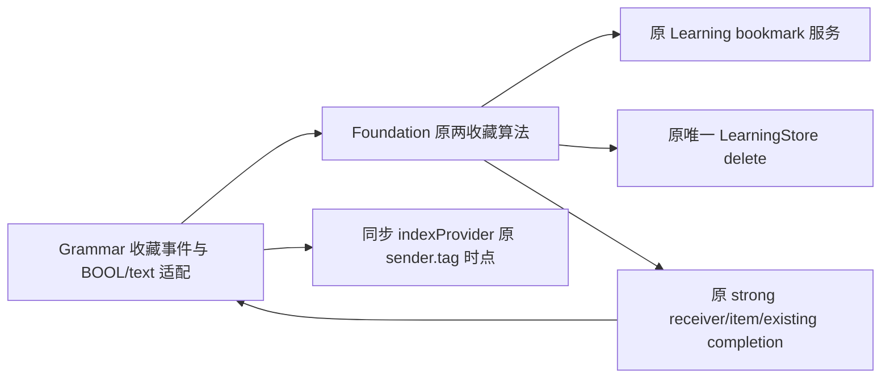

| 职责 | 唯一拥有者 | 接口与检查 |
| --- | --- | --- |
| 列表项收藏、详情收藏/删除 | 原learning/store服务，Core无新字段/slot | 小FYGrammarBookmarkSource；GrammarBookmarkTests60 |
| index与按钮/文字适配 | 原Native事件/控件，provider仅同步借用 | 原/新GrammarBookmarkHostTests61 O0/O2 |
| 异步回调与迟到结果 | 原具体Native receiver/item/existing强捕获 | held服务、释放、stale identity/pointer与读序检查 |

列表操作保持analysis gate后，在原canonical grammarItemInList消息的index参数位置调用provider，fallbackNO；getter重入改变当前分析后仍使用原已求值数组。provider只在同步调用期间持事件参数，不进入completion。回包继续使用原捕获item更新成功/错误文字；不新增原先没有的stale gate，成功才refresh。

详情操作仍先identity/item/enabled短路，随后第二次读取selected item、读取existing、disable，再构造finish并选择原store.delete或learning.bookmark。finish先item pointer再current identity/version门；stale仅refresh，不enable或更新status；匹配回包原enable→status→refresh顺序不变。existing与item/receiver仍原strong任务租约，不合并实时翻译、服务测试、聊天或语法请求取消scope。

`bash scripts/run-grammar-bookmark-tests.sh`接入统一Debug。60最小Foundation与61实际原/新controller同fixtureO0/O2通过；服务是明确held boundary，不初始化真实库/Key或发API。覆盖空/越界/nil sender、tag getter重入/读取顺序、错误/成功、既有bookmark删除、item/version变化、重复点击、两次item getter和existing快照、等待后source/item/existing释放。class方法没有idleSource或新store，原七字段与Scope未变。Native字段仅以NSObject属性事实接入，实际按钮/窗口不运行。

七变异（index早于gate、index早于数组求值、row source改weak、去selected pointer gate、去enabled门、反转store分支、去selected identity门）退出2，恢复60退出0。Runtime182/Trace O2与Module O2通过，O0由最终完整Debug核验。五相关UI仅编译。编译器实际完整依赖图证明业务公有头不带AppKit、Root/private、capture/OCRengine、settings/diagnostics；生产与离线工具继续使用既有统一Core源码数组，无重复实现。

拆前复用子批31完整Debug199passed+2known_gap_reproduced，报告`.build/debug/20261013T224718Z-ed0b62/summary.json`；620散列逐一一致，独立快照/status/manifest/diff齐全。收尾完整Debug、154Replay逐项比对、命令/散列/白名单见本机`.build/mac-decoupling/batch32-evidence.json`。未安装/提交/推送/发布，全部原已知缺口保持。

授权后最短验收：主语法列表/详情的收藏与取消，等待时换语法/换句/学习返回；匹配错误重试与既有收藏状态刷新，核对按钮/提示及原有持久化记录，配合已有GrammarActions/LearningApp UI。真实数据库/服务/设备和鼠标体验未由合成边界证明。语法现已收敛原生适配/查询/事件与各业务/渲染组件；继续StudyChat/session/context/quick/return、Collection/复习、Reference/hover/dictionary、DB和settings/diagnostics全目标。

## 子批33：聊天上下文与发送

原四方法移入Foundation `FYStudyChatContextCoordinator`，两项原标量唯一拥有；111其它Native方法原文保持。Native只保留值/配置/草稿/返回动作，既有Session仍原owner/网络取消scope。职责图、状态/接口/测试表、旧回调/强弱租约和待真实UI范围见[聊天上下文](study-chat-context.md)。73最小与74实际原/新同fixture O0/O2通过，八变异失败并恢复；原生配置交错、latest/current/UUID、nil/empty、capture canonical门、同一会话/两草稿保持。首两fixture误预期和纠正全留档，生产不为测试改行为。

前置为624散列与子批32最终Debug200+2完全匹配；完整收尾、154Replay逐项对照与全部命令/白名单见本机`.build/mac-decoupling/batch33-evidence.json`。相关UI仅编译，真实服务/截图/鼠标未验收，未安装/提交/推送/发布。后续quick/return/native构造、Collection/复习、Reference/hover/dictionary、DB及settings/diagnostics全目标继续。

## 子批34：快捷查句分析与收藏

六原取消/分析、句子及语法收藏查询/操作进入Foundation `FYQuickSentenceCoordinator`，原九状态唯一owner，Native只保留配置/BOOL/text与原导航/视图，121其它Native方法原文不变。职责图与状态/接口/测试表见[查句业务](quick-sentence-workflow.md)。81最小与82实际旧/新同fixture O0/O2通过，九变异失败并恢复；原取消顺序/独立scope、stale门、copy/strong别名、UUID/身份及首existing保持。首最小链接依赖遗漏及纠正留档，不改算法或断言。

前置631散列精确匹配子批33完整Debug201+2；完整收尾、154Replay与源码/命令白名单证据见本机`.build/mac-decoupling/batch34-evidence.json`。UI仅编译；未安装/提交/推送/发布，全部原已知缺口保持。下一批继续Study返回导航/native构造，随后Collection/复习、Reference/dictionary/hover、DB和settings/diagnostics全部剩余目标。

## 子批35：学习进入与返回导航

七原导航算法独立到Foundation/CG `FYStudyNavigationCoordinator`，原12状态包括当前/返回snapshot唯一拥有；Study仅兼容及native动作，142其它Native方法原文保持。职责图/状态/接口/测试表见[学习导航](study-navigation.md)。59最小与60实际旧新同fixtureO0O2通过，11变异失败并恢复；两种sameBlock、原strong回调/result/snapshot、固定ID/version、草稿与同源不取消、原窗口读序/focus保持。首协议重复声明、新getter临时autorelease释放检查及private helper解析问题全留档，未为测试改生产算法/ARC或原行为断言。Runtime加强唯一owner及原跨Inline快照身份检查。

前置638散列精确匹配子批34完整Debug202+2；完整收尾、154Replay对照/命令/白名单见本机`.build/mac-decoupling/batch35-evidence.json`。UI仅编译，原缺口保持，未安装/提交/推送/发布。随后Study native构造/小头、Collection/复习、Reference/dictionary/hover、DB及settings/diagnostics全部剩余目标继续。

## 子批36：学习页原生渲染与小头

14原Native方法分Chat4/Quick7/Scroll3，均无state；原视图/数组/offset仍Study唯一owner，三Foundation业务owner与Session不变，167其它Native方法正文保持。Study公有头隔离整套应用支持，原生renderer也只依赖准确AppKit/domain小头；真实clang依赖验证。职责图与state/interface/test表见[学习原生渲染](study-native-rendering.md)。69独立与68实际原/新同fixtureO0O2、10变异失败/恢复；执行13完整原方法、真实weak闭包/UIFont/富文本/scroll，只有OS控件构造/native事实边界。完整Quick graph与真实UI只编译原/新专用fixture O0O2及9 canonical UI，不写成运行通过。首测试block声明错误与首54版详情升级留档，未改原断言/算法。

前置645散列精确匹配子批35完整Debug203+2；完整收尾、154Replay与命令/散列/白名单见本机`.build/mac-decoupling/batch36-evidence.json`。原缺口保持，未安装/提交/推送/发布。Study现保留视图owner/原生事件/小动作与typed门面；继续Collection/复习、Reference/dictionary/hover、DB与settings/diagnostics全目标。

## 子批37：收藏复习业务与状态

七个完整业务方法独立为 Foundation `FYCollectionReviewCoordinator`；reviewList strong别名、reviewIndex、reviewingEntry 三字段唯一拥有，Native保留控件与八个明确文字/显隐适配。其它原生方法正文保持，加载/标记 strong 与删除 weak 回调、原重绑及刷新顺序不变。职责图/接口/测试对应表见[收藏复习](collection-review.md)。60 最小与61实际拆前/拆后同用例 O0/O2通过，八项反向变异失败/恢复；业务头真实依赖不带 UI/Root。完整 Debug、Replay 对照和 UI compile-only 以本机 `.build/mac-decoupling/batch37-evidence.json` 为准；未安装、发布或进行真实桌面/设备验收。收藏其它查询/操作/原生展示、Reference、数据库及设置/诊断仍需继续。

## 子批38：收藏查询、词卡操作与原生渲染

21个原完整方法分为Query十/Card六/Native五；另分原生三个行循环、两个原位更新与原卡片例句回调，形成Query/Card两个Foundation owner和无状态Native renderer。Query四/Card三原字段唯一；Review三保持，Native只持控件/tab/generation与明确适配，62其它Native方法正文保持。公开头隔离大Support，输入provider同步使用，原raw/copy、强弱寿命/例句generation和原生target/字体/滚动语义保持。94业务/64完整原生最小与实际原新同fixtureO0O2、11变异/恢复通过；首测试问题与诊断均留证据，生产/原断言不改。职责图/接口/测试及桌面待验收见[收藏工作流](collection-workflow.md)，完整Debug/154Replay与UI只compile以 `.build/mac-decoupling/batch38-evidence.json` 为准。

## 子批39：词典查询、悬停与原生展示

14原完整方法与三段原生片段分别进入Query／Hover两个Foundation owner及零状态renderer，Query4／Hover4唯一字段，56其它Native正文保持；公开头隔离大Support。63业务／26原生最小与实际旧新同fixture O0/O2、11变异／恢复通过。详细接口、租约、实际富文本与UI仅编译边界见[词典工作流](reference-workflow.md)。当前阶段不继续数据库、设置、诊断，最终统一回归及源码散列见阶段交付证据。
