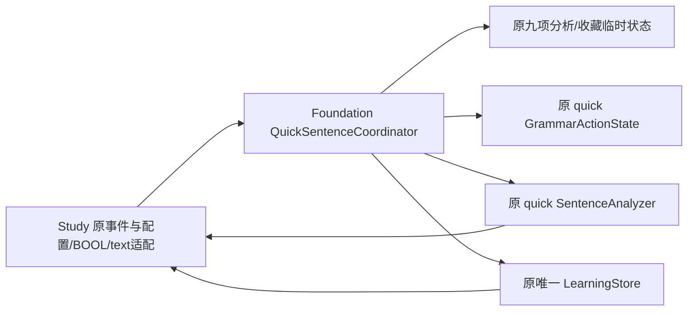

# 快捷查句分析与收藏业务

`FYQuickSentenceCoordinator` 处理原取消/分析、句子收藏查询/请求、语法收藏查询/请求六个业务方法。原 `FYStudyPresentationController` 继续拥有视图与原生适配；句子选择/导航、快照与返回状态已在子批35归属 `FYStudyNavigationCoordinator`，见[学习导航](study-navigation.md)。原生适配只读取配置、禁用句子收藏按钮或更新现有状态文字。

| 职责 | 唯一拥有者 | 接口与检查 |
| --- | --- | --- |
| 分析代次、busy、result/error、两文本快照与analyzer | Coordinator 原七字段 | FYQuickSentenceAnalysisSource；真实分析/取消与 held analyzer |
| 句子、语法收藏 pending | Coordinator 两个原 BOOL | FYQuickSentenceBookmarkSource；held store 查询/写入 |
| 句子身份/选择与导航、原生视图 | NavigationCore / 原learning；Study视图 | 原 Native 动作、Root/Native 兼容入口 |
| 主/快捷语法、聊天、实时与服务测试取消 | 各自原 owner | 不合并 generation 或 analyzer；独立取消检查 |

取消保持 quick ActionState.reset→分析 generation++→busyNO→quick analyzer.cancel，原 ActionState 的缓存/展开/复核状态由其真实 reset 清理。主语法、聊天、实时翻译与服务测试不改动。分析保留 requested/source/busy 的原短路，清旧 result/error/index，再复制两个分析快照；lazy analyzer 仍在原时点创建。原生配置的 base 读取/setter、Key 读取/setter、学习模型 Trim/空才 raw fallback、model setter、catalog 读取/setter 顺序不变。原强局部 source/translation 不额外复制；回包只按原 generation/requested/source 检查，过期不能清新 busy。错误不接受 result，保留原原因。

句子收藏仍按 ID/version 查询原 saved 数组。请求创建 canonical identity/fresh UUID 后设 pending、禁用按钮，再用原 store toggle。完成清 pending、错误才更新原文字，随后刷新收藏；不新增成功提示、enable 或 stale gate。

语法收藏保持原下标语义和 ID/version/name 的首个匹配对象。请求捕获原 item/身份/文本，设 pending 并更新按钮，然后从原 store 获取现存书签，匹配则删首条，否则添加同一快照。finish 总是清 pending；只有原 ID/version 匹配才更新状态，随后依次 refreshGrammarBookmarks、updateQuickGrammarBookmark。换 item 不增新回包门，换身份不改写捕获的旧书签，不新增 store 或取消行为。

`bash scripts/run-quick-sentence-workflow-tests.sh` 纳入统一 Debug，源码统一在 `scripts/lib-sources.sh`。81 个最小 Foundation 检查和82个实际拆前/后控制器同夹具在 O0/O2 通过；运行真实六算法、canonical identity/文本 helper、实际 ActionState.reset。只在 analyzer/store 与原生配置/字段边界注入事实，不初始化用户数据库、不读真实 Key、不发 API。lazy analyzer 的真实路径使用缺失的合成 Key，在既有请求前验证失败；其余回包由 held 服务边界提供。

覆盖 busy/重复点击、原取消顺序与范围、copy/strong别名、fresh UUID、ID/version/name、空/越界与既有下标异常、成功/错误/既有删除/新增、迟到回包与原 strong source/item/text 租约。九变异分别破坏 reset、分析代次/busy、语法状态门、句子 pending、existing 分支、查询版本、copy 与 strong 回调，均被检出，恢复通过。首最小链接漏 canonical normalization 依赖的证据保留，仅补现有链接源，不改算法或断言。

RuntimeOwnership 追加冷初始化、唯一九字段及 Root/Native 双向兼容的检查。编译器完整依赖图检查业务头不带 AppKit/Root/private/采集/设置诊断依赖。六个完整原方法只作记录的 native 值/动作适配，121个其它 Native 方法精确保持；既有聊天 Session/Context、导航、渲染与持久化实现不改。完整 Debug、154 Replay 比对、命令/散列/白名单在本机 `.build/mac-decoupling/batch34-evidence.json`；拆前为631散列精确匹配的子批33最终201 passed +2 known_gap_reproduced。原缺口继续记录。

相关UI仅编译，真实输入、按钮与持久化体验单列待验收。授权后最短检查：QuickSentenceAnalysisTests、GrammarActionsAppTests 与 LearningAppTests；在分析中换句/关闭/重开，核对旧结果不覆盖；分别收藏/取消句子和语法，错误后重试，检查原状态文字和记录，再核对学习返回/聊天草稿。未安装、提交、推送或发布。

子批36补充：Study的视图物理归属与本页业务state不变，原生构造/刷新/选择/scroll已分别委托三个无state renderer，public header隔离整套应用依赖。完整Native/UI与未验收范围见[学习原生渲染](study-native-rendering.md)。
