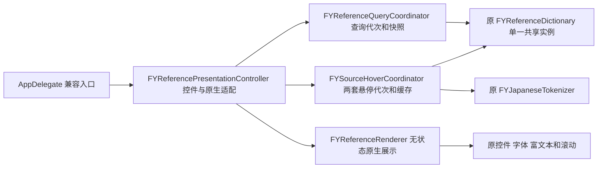

# 词典查询与悬停提示

2026-10-14 子批39。词典查询、主页面／查句悬停业务与原生展示分别维护；原生控件仍由 `FYReferencePresentationController` 拥有。没有新增查询、取消、持久化或视觉行为。

| 职责 | 状态唯一拥有者 | 接口与测试 |
| --- | --- | --- |
| 查询及迟到回包 | Query：generation、activeWord copy、records copy、共享 dictionary strong | FYReferenceQuerySource；ReferenceWorkflowTests |
| 主页面与查句悬停 | Hover：两套 generation、cache strong、suspended | FYSourceHoverSource；文字／editable 值与不透明 view handle |
| 原生构造、内容、揭示、收藏词资料及属性 | Native：原控件；Renderer：零状态 | FYReferenceRenderSource；ReferenceRendererTests |
| 根入口和原任务寿命 | 原 Native 强查询／分词租约；currentness 弱 owner 和强 view 局部 | ReferenceWorkflowHostTests、ReferenceRendererHostTests、RuntimeOwnershipTests |

14 个完整原方法只做明确 receiver、native target、文字与属性适配；三段原生行／清除循环保持，56 个其它原生方法正文未变。查询代次独立于主／查句悬停；懒初始化共享词典与 tokenizer 不改。保留缓存上限300、迟到字典结果先写缓存再检查当前性、词汇提示后语法覆盖、UTF16范围及不可编辑／同源门。悬停的弱 currentness owner 与原强 view/source/ID/version 租约保持。收藏词资料仍原位展开，不更改学习来源。

`bash scripts/run-reference-workflow-tests.sh` 接入统一 Debug：四个实际生产算法执行入口分别为63业务、26原生、63实际宿主业务、26实际宿主原生检查。拆前／拆后／最小依赖在 O0/O2 的12组同夹具对照通过；11项受控变异均退出2，业务与原生恢复后通过。测试只替换字典／分词传输及原生控件构造、属性边界，使用真实模型、富文本和字体；没有读取真实词典库、用户学习库、Key、调用API或创建应用窗口。首次合成控件漏 `isHidden` getter的异常留档，仅修测试适配，未更改生产算法或行为断言。

公有头通过 clang 实际依赖图核对：两业务头不带 AppKit、应用私有状态、采集、OCR engine、设置、诊断；原生头不带整套 FYAppSupport。正式源清单统一在 `scripts/lib-sources.sh`。最终接入验证与完整回归以本机 `.build/mac-decoupling/stage-delivery-evidence.json` 为准。

真实词典搜索、弹出菜单、页签、收藏词资料展开、原生鼠标悬停、学习／查句切换和滚动仍待桌面验收；UI 编译不证明上述体验通过。本阶段不开始数据库、设置、诊断的新拆分。
