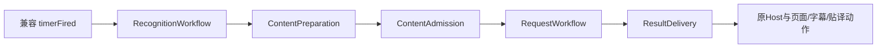

# 实时翻译编排职责与状态归属

本轮只拆 Mac `FYTranslationRuntimeController` 的实时timer及直接交付流程，公开兼容头、AppDelegate桥接和页面控制器不变。先完成学习协调器阶段A并记录完整报告，再开始本阶段。学习存储/AI分析、设置、诊断、平台采集适配、OCR算法、贴译布局、服务适配与产品规则没有重做。进度与私有证据为 `.build/learning-workflow-runtime-split/PROGRESS.md`。

| 阶段 | 明确输入 / 结果与职责 |
| --- | --- |
| FYRealtimeRecognitionWorkflow | 原Host的单次原生输入动作 + 原scheduler/refinement/worker；运行/几何前置检查、后台取帧、OCR配置/图像租约、回主队列检查与释放识别槽。成功才交给内容阶段 |
| FYRealtimeContentPreparation | 原OCR文本/观察/modal观察、耗时、语言、trace/layout上下文；模式提交在所有去重前，干净源观察按原对白/界面策略准备；返回normalized/items/mode三字段结果，未准备好返回nil |
| FYRealtimeContentAdmission | 三字段准备结果 + 原观察/耗时/当前Host；渲染去重、几何/分组重排、pending匹配、两种节流和稳定门；只返回是否准入 |
| FYRealtimeRequestWorkflow | 准备结果、观察、耗时、原周期值和原runtime/Host；建立原revision/ticket、按UI或对白+选项提交，保留学习身份与原copy点、请求及统计顺序 |
| FYRealtimeResultDelivery | 显式回包值、原请求局部快照、ticket与原runtime/Host；UI/选项/对白回包门、当前坐标读取、学习回填、状态/统计及原排队落位交付 |

五个阶段均无ivar，不拥有设备、任务字典、timer、忙碌槽、revision或长期Host引用。每个阶段分别声明只含实际依赖的窄Host协议（最多20个属性），runtime协议只暴露既有owner与接续动作，不使用另一份巨型Context、通用字典或事件总线。原trace/layout字典仍只作原有诊断载体。

`FYRealtimeRecognitionFrame` 只保存原local的generation/windowID/inputEpoch/captureCard/language/cycleStart六值；`FYPreparedRealtimeContent` 只保存原normalized/items/mode三值。均readonly，不是可变运行状态。原局部NSString/NSArray/NSDate是strong时仍保留原别名；UI的mutableCopy→copy、选项copy、身份/数组持有点仍原样。周期值对象仅在同步阶段间传递，网络回调逐项捕获原locals，UI回调不额外延长cycleStart寿命。

| 唯一状态owner | 保持原归属 |
| --- | --- |
| FYRecognitionCycleScheduler | running/timer/inFlight、实际已识别帧号、OCR几何/目标；旧cycle只可释放自己的代次 |
| FYOCRRefinementSession / 原worker leases | 精读上下文/证据、单任务原生操作与图像生命周期；没有新全局图像owner |
| FYContentTranslationState | 内容revision、operations、text/mode/items、当前确认几何/目标 |
| FYInlineTranslationCoordinator | 原缓存、dialogueCache、serial、pending长批与计划接续 |
| FYTranslationRequestCoordinator / 原task owner | 原传输、实时任务登记/取消与请求交付；服务测试仍独立 |
| 原router/对白/界面稳定组件 | 模式、全帧对白与字段确认状态；本轮不修改算法、阈值或观察身份 |
| 原Host和原页面/浮层组件 | 原生控件、显示、错误、统计与现有UI状态 |

兼容门面仍从weak host取得原strong局部接收者。捕获这个原Host的任务、OCR操作租约和原runtime self租约全部保留，接续明确传递原接收者，不能在阶段之间重读weak host或改为统一weak。票据仍lazy读取原runtime；回包时才读取最新 `contentTranslationUIItems`、revision/serial/代次/epoch/mode。落位方法仍先读取当前内容与几何并求placement，再排主队列核对ticket，旧geometry不隐藏已重排的新面板。

原手动“翻译当前界面”正文保持，仍持有单次OCR槽至HTTP回包；实时OCR完成即释放，不等网络。原其他125方法与当前兼容头保持。完整timer由实际五阶段与回包方法重新拼回，去除同步转接与局部参数绑定后token与原实现一致；placement正文一致，434处字符串多重集合一致。方法间原Host覆写分派、原错误及回调线程保持。

共享清单 `FY_REALTIME_WORKFLOW_SOURCES` 供全部应用/生产链路消费者使用。新增 `CheckRuntimeWorkflowLease` 只hold原OCR外部边界，覆盖停止重启旧结果不能释放新槽、在途任务强持有原Host/runtime、结束释放；拆分前后O0/O2通过。旧乱序HTTP、两类策略、最新几何、四种手动/实时重启、取消/节流及复制输入断言全部保留。RuntimeOwnership新增五个阶段的冷初始化/零state检查，O0/O2各222通过；旧学习功能O0/O2通过。

阶段 B 完整自检报告 `.build/debug/20261014T111128Z-1b54ec/summary.json`：209 passed + 同一粘连按钮旧缺口两次复现，source_unchanged=true，全部780报告哈希与交付源码一致；原208通过记录与154次Replay关键字段全部保留。私有代次变异退出2并命中新回归，生产源码哈希核对未污染。最终清单、失败记录与命令见 `.build/learning-workflow-runtime-split/delivery.json`、`MANIFEST.sha256` 和 `FAILURES.md`。已知粘连按钮缺口和520×170长卡两条旧UI预期差异继续单列，不改变长卡滚动/折叠规则。全程headless，无真实Key/玩家库/API/设备/桌面/剪贴板验收，不安装、提交、推送或发布；此处是执行者自检，真实游戏与原生交互未验收。

最短手动检查（另行安排时段）：对白A→B→C在请求中快切并停止/重启，确认只有当前译文显示；再打开含长正文与短字段的界面，在等待翻译时移动窗口/改变短字段，确认长批保留并按最新位置交付。A的固定/修正/收藏步骤见 [学习协调器](learning-workflow.md)。
