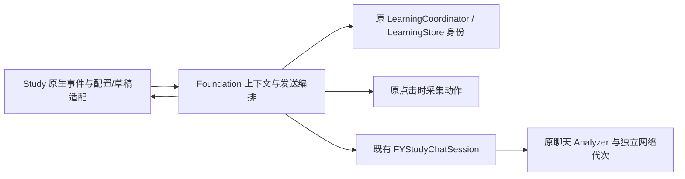

# 聊天上下文与发送编排

`FYStudyChatContextCoordinator` 只拥有原 `chatContextGeneration`、`chatResolvingSource` 两项状态，处理引用最新句、身份/原句解析和发送编排。`FYStudyPresentationController` 保留控件、同一聊天会话、主/悬浮聊天视图和原生适配；返回快照与导航状态已在子批35归属 `FYStudyNavigationCoordinator`，见[学习导航](study-navigation.md)。AppDelegate 与 Study 的兼容属性均访问同一状态，不新增持久化、会话或取消范围。

| 职责 | 唯一拥有者 | 接口与检查 |
| --- | --- | --- |
| 上下文代次/解析标记 | ContextCoordinator 两个原标量 | 小 FYStudyChatContextSource，StudyChatContextTests |
| messages/source/translation/sending 与网络取消 | 既有 FYStudyChatSession | 原生产实现，held analyzer 边界 |
| 控件值、配置提交、草稿恢复、返回关系 | Study 原视图；NavigationCore 原快照 | Native 明确值/动作；实际原/新 Host 同夹具 |
| 当前/最新身份及存储 | 原 learning/store | fresh UUID、版本、latest 与 pinned 区别 |

引用最新句仍先确保会话、增加上下文代次、设解析中，再在同一会话开始新对话，清旧返回快照并刷新返回入口，最后按点击时画面解析。旧解析只能返回，不能清除新解析标记。身份优先读取不同于当前句的 latest 记录；原 current 路径和每次 fresh UUID、错误返回 nil 保持。

运行且选中窗口时仍使用既有采集动作；错误先显示原原因，再返回空原文/译文。成功后执行同一 `FYDialogueComparisonKey` / `FYDialogueIsSpeakerAnchoredFragment`，对白/日语门和 nil/empty 回退保持。canonical identity factory 本来就把 nil source 转为 empty；不能将它当成读取原文控件的条件。

发送仍先按上下文/网络 busy 短路；原生配置保持 base 读取→base setter→Key 读取→Key setter→学习模型 Trim→空才读原始 fallback→model setter，不提前批量读取配置，不新增服务测试或 Key 保存。已有会话原文时直接发送；没有原文时先设解析中并刷新，再解析。过期结果刷新并按主视图、悬浮视图顺序恢复同一份草稿；不清新解析标记，不发送旧问题。

上下文异步链保留原 strong 具体接收者；网络回包继续由原 Session weak 捕获自身。两种 generation/取消范围独立。快捷查句、同源往返、返回导航和原生视图构造仍在原实现，后续逐批处理，不因本次拆分重建视图、草稿或侧栏显隐。

`bash scripts/run-study-chat-context-tests.sh` 已登记统一 Debug，生产、测试和工具使用 `scripts/lib-sources.sh` 的同一组件/会话源码清单。Foundation 最小依赖运行真实四算法、canonical 身份/文本函数和原 Session，只有采集、store、analyzer 响应与原生字段是边界事实。73 最小检查与74实际拆前/后控制器同夹具在 O0/O2 通过；八种独立破坏均导致失败，恢复通过。RuntimeOwnership 追加冷访问、唯一两字段及双向兼容写入检查；编译器实际依赖图检查业务头无 AppKit/Root/private/设备/设置诊断依赖。

首夹具的 nil-source 误预期与不满足 speaker fragment 合同的合成输入及纠正留在本机证据目录；只修夹具依据，不改生产算法或弱化原行为门。完整 Debug、154 Replay 对照、散列与命令收尾见 `.build/mac-decoupling/batch33-evidence.json`，拆前为紧邻子批32完整 Debug 200 passed +2 known_gap_reproduced，624散列逐项匹配。旧缺口保持。

真实截图/服务、原生输入和窗口体验另列待验收，相关 UI 仅编译。授权后的最短检查：LatestStudyReferenceTests、ChatPresentationTests、ChatClipboardTests，再在已有草稿时引用最新句、快速再次引用、发送期间切回学习页并返回，核对同一会话、主/悬浮草稿、返回入口及手动侧栏。源码未安装或发布。

子批36补充：Study的视图物理归属与本页业务state不变，原生构造/刷新/选择/scroll已分别委托三个无state renderer，public header隔离整套应用依赖。完整Native/UI与未验收范围见[学习原生渲染](study-native-rendering.md)。
