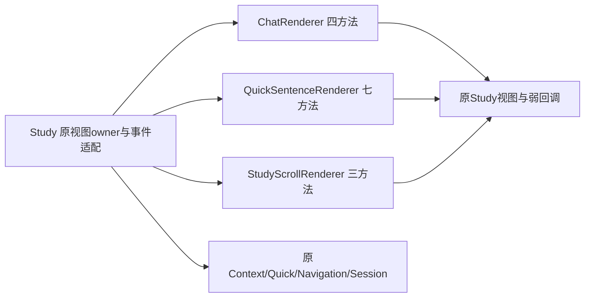

# 学习页原生渲染边界

`FYStudyPresentationController` 保留视图的唯一物理归属、宿主动作、Session接线及原生show/close事件。14个原方法分别在三个无状态原生组件，业务继续使用既有 Context2、Quick9、Navigation12、Grammar7 与同一Session，不新增持久化、观察或取消范围。

| 职责 | 唯一状态拥有者 | 接口/检查 |
| --- | --- | --- |
| 聊天构造/刷新、panel配置、返回入口 | Study原控件；Renderer零字段 | FYStudyChatRenderSource，真实weak callbacks/两view读写顺序 |
| Quick整卡/详情/选择/label/card/收藏按钮 | Study原view/数组；Renderer零字段 | FYQuickSentenceRenderSource；真实字体/富文本与原生边界事实 |
| 寻找/捕获/恢复scroll | Study原offset/scroll；Renderer零字段 | FYStudyScrollRenderSource；layout后geometry/offset与clamp |
| 业务/快照/任务 | 原各Foundation owner | 本批不复制或改变取消/返回/草稿 |

三个组件均为类方法，不保存接收者或UI。Native门面和原helper动态派发保留，按钮目标仍在原读取位置取得同一弱Host。聊天与Quick panel的weak具体接收者回调保持原动作、文本、nil sender与生命周期；主聊天不出现close，overlay保留close/return。刷新仍按context→messages→sending处理原两个view与NSNull/type门，返回入口只绑定overlay原returnButton。

Quick原构造、文字/字体/颜色/约束与原文字符/UTF16索引完整迁移。选择仍按原tag/数组/stack门与强局部scroll，更新原Nav index与ActionState，移除/构造/挂入详情后依次layout/focus，再用实际最新geometry clamp/scroll/reflect。scroll恢复先layout，再读保存offset与最新frame/bounds，原横向0及clamp不变。NSFontWeight/NSLayoutPriority/CGFloat等使用SDK真实类型。

Study公有头现只导入AppKit、domain与组件小头；捕获类以@class声明，整套FYAppSupport只在兼容Native实现内部按旧常量/动作使用。三个新renderer本身也不依赖FYAppSupport/Root private/capture/settings/diagnostics。编译器-M实际依赖清单验证，未用源码字符串替代依赖证据。

`bash scripts/run-study-renderer-tests.sh` 纳入统一Debug；三个生产m由 `scripts/lib-sources.sh` 统一。69独立检查、68实际原/新controller同fixture在O0/O2通过，执行13个完整原生方法。视图/输入/约束仅以明确NSObject事实接入；私有进程临时替换FYStudyChatView +new、NSTextField包装label及NSLayoutConstraint.activate三个控件构造边界并恢复原IMP，生产未新增测试专用factory，不创建NSApplication/view/control/window。实际weak闭包、真实UIFont/NSMutableParagraphStyle/attributed string与原选择/scroll算法均执行；不是另写一套渲染或测量算法。

完整Quick graph的render方法及真实窗口/绘制/鼠标未执行，不能以边界事实宣称已验收。专用 `StudyRendererUITests` 在拆前/后O0/O2均仅编译，覆盖完整原生Quick/chat构造的真实UI验收代码；已加入run-checks统一UI inventory，验收脚本复用该清单。原相关8UI加此套件共9套仅编译。

10变异破坏weak回调、overlay返回目标、sending门、offset/选择clamp读序、水平恢复、解释error fallback、行距、padding、短义阈值，均失败，恢复69通过。RuntimeOwnership新增三个零字段/冷访问、原视图唯一owner和同一Host target/协议检查。首fixture逗号block属性语法错误留档，只修测试声明；首54通过版升级详情覆盖的全部断言保留。14原正文按typed receiver/weak类型/明确target动作可逆比对，167其它Native方法与Foundation业务/Session/Snapshot整文件保持。

本机完整Debug、154Replay前后比对、命令/散列/白名单见 `.build/mac-decoupling/batch36-evidence.json`；拆前645散列匹配子批35最终203 passed +2 known_gap_reproduced。全部原已知缺口保持。未安装/提交/推送/发布，不改视觉设计、字符索引、数据库或凭据行为。

授权后最短验收：执行StudyRendererUITests及ImmersiveLearning/QuickSentenceAnalysis/PresentationOwnership/MainWindowResize/ChatPresentation；查看完整Quick标题/正文/三语法按钮、切换详情保持scroll、主/overlay草稿/return、weak关闭后回调，以及手动侧栏和窗口尺寸保持。真实设备/鼠标/原生绘制体验单列。
