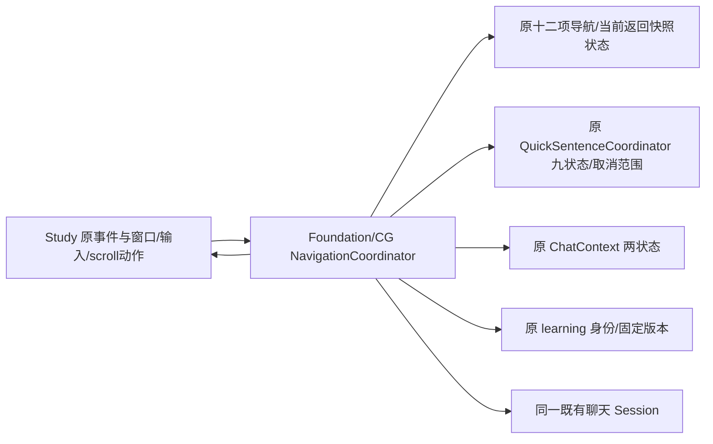

# 学习进入与返回导航

`FYStudyNavigationCoordinator` 独立处理七个原导航方法：查句进入 AI、打开快捷查句、回到主学习区、按文字/快照打开贴译学习、绑定新块聊天，以及从聊天返回。Core只使用 Foundation/CoreGraphics；原生视图、窗口、草稿输入与滚动动作仍在 `FYStudyPresentationController`。

| 职责 | 唯一拥有者 | 接口与检查 |
| --- | --- | --- |
| 当前/返回 snapshot、返回原文 | NavigationCore 三字段 | 同一 Snapshot 强引用，不copy对象；Root/Study/Inline兼容读取 |
| quick ID/source/translation/version/requested/gen/inline、chatOverlayRequested、selectedIndex | NavigationCore 九字段 | 原copy/标量属性，quick/inline/workspace分组协议 |
| 分析与收藏等待状态 | 原 QuickSentenceCoordinator 九字段 | 原 cancel/analyze peer动作，保留独立scope |
| 聊天解析与网络 | 原 Context2 / Session | 同源同译往返不reference、不取消；新块才显式startNew |
| panel/view/scroll/draft 与显示 | Study 原生组件 | typed hide/exists/center/focus/activate/clearDraft动作 |

同块打开只按 blockID 复用分析和草稿；聊天返回还要求 snapshot.sourceText 等于 analysisSource。两条原门分别保留。请求最新 identity 的 callback 仍强持原具体 Study 接收者；旧 requested/generation 不产生显示副作用。firstPresentation 在 render 之前读取，render/saved/center/focus/analyze 顺序与 foreground/selection 短路保持。

进入主学习区先沿用原激活顺序，再捕获显示中的 ID/version/文本/quickResult，关闭浮层后继续使用捕获值。quickResult跨关闭动作保持原强局部租约，复用时新建原 FYAnalysisResult 并逐字段复制、绑定固定身份；selected index仍在原较晚时点读取。不换成实时 latest，不新增持久化。

文字入口使用同一 Trim/Normalize 和原非空行几何，不更改字符、索引或显示阈值。captureEnabled→capture对象/NSUInteger epoch→record 的读序保持。快照缺ID才交给原 learning.recordText Snapshot，修改并保存同一个八字段对象，当前/返回入口均引用它。原 `FYStudyPresentationController.inlineBlockSnapshot` 现为兼容门面，物理状态唯一归属 NavigationCore；Inline及Root消费者看到同一对象。

新块才 reset 原 quick 分析/缓存、显式在同一Session startNew、按主输入→悬浮输入 setDraft(empty)、refresh并将原scrollOffset清零。同块往返不清草稿、不取消在途回答；返回仍render→restore原scroll→条件focus→必要时analyze，未引入新的reference/cancel。

`bash scripts/run-study-navigation-tests.sh` 已纳入统一 Debug，源码在同一 `scripts/lib-sources.sh`；Snapshot单独源码组仍复用于既有selection组，未重复实现。59最小Foundation/CG检查与60实际拆前/后controller同夹具在O0/O2通过，运行真实七算法和既有Snapshot/Session/Quick cancel，只有identity/learning服务与原生panel/input/其它peer动作是明确边界事实。不会创建NSApplication/view/control/window、读真实Key/DB或连设备/服务。

覆盖两种sameBlock门、同源同译在途回答/草稿、固定身份与close重入/强result、原panel读序/首屏与focus短路、12字段copy/strong归属及强identity回调lease。11变异破坏同源取消、两种sameBlock门、代次、close顺序、epoch宽度、草稿清理、首屏center、result别名、copy与snapshot强owner，全部失败，恢复通过。RuntimeOwnership新增冷/唯一12字段/双向兼容，并加强已有跨Inline快照身份断言；原全部行为断言保留。

首新增协议公开三个peer属性后，旧class extension重复声明导致新Native编译失败，已只删重复声明，原所有accessor正文保持。追加释放断言时，兼容getter的临时autorelease须先排空才能判断owner；首结果与修正留在私有证据目录。最终同一weak-nil/identity/copy断言及全部原行为检查保持，不因测试改生产ARC或所有权。私有integration helper首次语法解析失败在执行前退出，仅纠正helper引号。

七方法只作记录的native值/动作适配，142其它Native方法、原Session/Context/Quick实现保持。完整Debug、154Replay与命令/散列/白名单见本机`.build/mac-decoupling/batch35-evidence.json`；拆前638散列精确匹配子批34最终202 passed +2 known_gap_reproduced。原全部已知缺口保持。相关UI只编译，未安装/提交/推送/发布。

授权后最短验收：ImmersiveLearningTests、QuickSentenceAnalysisTests、LatestStudyReferenceTests与PresentationOwnershipTests，核对同块在学习/AI间往返保留回答/草稿/选择/scroll、换块清旧上下文、主学习区带固定ID/version；再检查手动侧栏/缩放不改会话。实际窗口/鼠标/真实设备体验未由合成原生事实证明。

子批36补充：Study的视图物理归属与本页业务state不变，原生构造/刷新/选择/scroll已分别委托三个无state renderer，public header隔离整套应用依赖。完整Native/UI与未验收范围见[学习原生渲染](study-native-rendering.md)。
