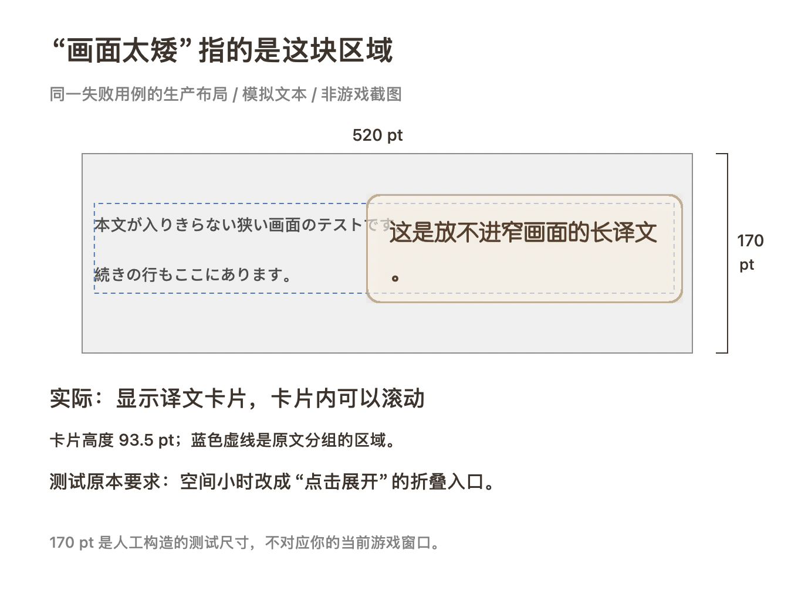

# 字幕外观：集中预览

2026-10-12 维护入口更新：字幕窗／快捷小条／示例预览位于 `objc/presentation/FYSubtitlePresenter.m`，贴译面板／拖动／折叠选择／展开阅读位于 `FYInlineOverlayController.m`。样式设置仍由原设置控件提供；以下视觉规则、滚动卡高度上限和两条旧预期失败保持。模块拆分验证见 [维护记录](project-maintenance.md)。

Mac 字幕外观页切换「长对白字幕 / 界面贴译」，各自提供黑底白字、白底黑字、粉底深字及译芽花境四张样式卡。配色、字色、字号、尺寸独立保存；背景不透明度共用。旧版自定义贴译字色保留，点选样式或「跟随样式」后使用对应字色。

参数区与即时预览为 1:2、间距 22 pt，窄窗口上下排列；预览内部两个原文分区为 1:1.2。贴译示例使用所选字号、Regular 字重与 1.55 倍行高。长对白示例按 `max(18, 字号 × 0.72)` 缩放。示例卡宽映射为对应分区可用宽度的 60–100%，高度按设置 × 0.46 演示。这些比例用于示例；真实贴译继续使用现有排版引擎。

展开贴译「尺寸设置」时，右侧切换为十二行「长文示例」，使整个「长卡最大高度」滑条范围都有可见反馈；超出部分可滚动阅读。收起后恢复两句示例和自然高度。最大高度仍是上限，短译文不强行撑高。原问题在字号 13 pt 时从 160 调到 500，短示例始终只有 61 pt 高；新增失败回归后修正，示例实际高度分别为 73.6 / 230 pt。原生文档视图根据 `isFlipped` 选择顶部坐标，打开及调整后从首句开始阅读。

示例使用可选择、可复制的原生文本，不进入 OCR、翻译或正式字幕。真实贴译换色原位更新短贴片、长卡、展开阅读卡和折叠入口，保留几何、字号、条目身份和滚动位置。打开的选择列表保持独立奶油阅读底。

游戏内「最大宽度 / 长卡最大高度」也约束点击展开后的阅读卡。原展开入口固定使用 560×420 pt，并且尺寸滑条只更新普通贴译；现在打开时与连续拖动时均读取当前上限，在同一张阅读卡内重新排版，保留正文、滚动视图、阅读偏移、块身份、收起按钮及 Esc。短内容按自然高度显示，上限不强行撑高卡片；调整尺寸不请求重新翻译。

## 小画面中的滚动卡片

2026-10-11，用户查看合成小画面示意后确认沿用现有贴译显示。在现有布局允许生成普通长卡时，卡片遵守高度上限；完整译文超出正文视口时，在卡内滚动阅读，可以少于三行。三行是首选可读高度，不应使实际卡片超过上限。真正不能通过既有长卡空间门、避让失败等情况，继续使用原有的折叠入口或不可放置处理。

这里的“小画面”指贴译布局可使用的区域。[贴译验收](../tests/InlineAdaptiveAcceptanceTests.m) 的 `TestDegradationChain` 人为设置 520×170 pt 的画布，当前生产布局给出 270×93.5 pt 的滚动卡片；默认高度比例为 55%。旧测试分别要求紧凑入口模式和对应的折叠状态，两条检查均失败。`-O0` 与 `-O2` 都是 167 通过、2 失败，属于同一场景的旧验收预期与已确认显示行为的差异。

本次确认保留现有布局和测试断言，继续记录这两条失败；不为使旧验收通过而强制折叠，也不将整组桌面验收记为全部通过。完整 `-O2` 核心检查为 166 项通过；缺失的真实 OCR 夹具和真实设备仍按独立范围记录，详见 [源码构建检查记录](源码构建.md)。

示意图使用同一合成输入、生产分组与布局引擎，以及原生译文卡片渲染；原文背景为示意。170 pt 是测试画布高度，不对应用户当前游戏窗口。灰框表示可用区域，蓝色虚线表示原文分组，棕色卡片表示实际译文。

## 验证

- `scripts/run-subtitle-appearance-tests.sh`：headless，测试默认值、旧设置迁移、两类配色独立、自定义字色、重开序列化及不透明度。
- 在已安排桌面时段运行 `FY_TEST_ALLOW_UI=1 scripts/run-learning-app-tests.sh SettingsInteractionTests`：验证实际栏宽、字体、836 pt 参考内容宽度、四主题、尺寸展开，以及 720 / 1320 pt 窗口与 13 / 16 / 30 pt 字号下的高度变化、滚动和收起恢复。
- 同时运行 `FY_TEST_ALLOW_UI=1 scripts/run-learning-app-tests.sh BatchAppearanceTests`：验证真实面板换色、窗口复用、位置和滚动保留，以及普通/展开卡的宽高限制、打开后的连续宽高/字号调整、无普通场景缓存时的更新与收起。
- `FY_TEST_ALLOW_UI=1 scripts/run-learning-app-tests.sh InlineFoldReadTests`：检查折叠、展开、收起、几何跟随及零新增翻译请求。
- `python3 scripts/debug.py check` 将外观设置 headless 回归纳入统一核心检查。

2026-10-11 已对本机安装进行实际鼠标验收：最大高度 500 → 160 → 500 时预览跟随改变，受限视口内可滚动，收起恢复短文。使用 0.2.1 / build 40 安装重开，原设置保留；API Key 仅比较文件元数据，未读取内容。在线翻译与真实游戏设备验收不由这些示例检查代替；本轮未更新公开附件。

同日补充宽高限制回归：240×160 设置下，普通卡已正确缩小，但展开卡仍是 560×420，原生失败回归退出 2。修正后，打开与连续宽高/字号调整、阅读偏移、完整正文及收起检查通过；`InlineFoldReadTests` 的 135 条断言通过。设置页在 720 / 1320 pt 窗口下验证宽度 240→720 与高度 160→500，卡框均有实际变化。`python3 scripts/debug.py check --timeout 600` 为 75 条通过及同一个既有 OCR 缺口的两次 `known_gap_reproduced`，总结果为 `baseline_passed_with_known_gaps`。两架构构建和 dSYM UUID 核对通过，0.2.1 / build 40 已再次安装；具体游戏长卡页面尚未现场复测。

用户随后明确问题发生在直接贴在原文旁的普通卡，并反馈调大、调小都有问题。补测复现了普通长卡在字号 24 pt、上限 240×160 时实际高 174 pt：三行首选高度超过上限，原 clamp 返回下限。现将首选下限限制在当前上限内，正文保持所选字体与完整内容，通过滚动阅读。`BatchAppearanceTests` 的原生失败回归先退出 2，修正后 13 / 14.51 / 16 / 24 / 30 pt 均显示为 240×160；`InlineFontStabilityTests` 同时提供统一核心检查中的无窗口回归。合成长正文放宽宽度上限到 720 时实际宽由 240 增至 384，放宽高度到 500 时实际高由 160 增至 441（画面高度上限及整数外框）；再次收紧恢复 240×160，面板和条目身份保留。

宽高参数继续表示最大允许尺寸，实际卡片还受原文区域、内容自然高度、画面空间与避让约束；放宽上限不保证每张卡撑满。此次普通卡高度超限有失败证据；用户具体游戏页的宽度及其余不响应情形尚未取得现场证据，不能由合成场景通过宣称全部解决。

普通卡修正后的 `InlineLongBodyEntryTests` 为 184 条通过、`InlineFoldReadTests` 为 135 条通过，统一核心检查仍为 75 条通过及同一个已知缺口两次复现。双架构构建、dSYM UUID 和安装签名核对通过；本机已重装 0.2.1 / build 40，重新打开后宽高、字号与配色保持，凭据仅比较元数据且未改变，翻译已恢复。公开附件未更新。
